# 전투 HUD 개편 (2026-11-22)

Strategy UI Kit(Cyan) 위에서 HUD 배치 자체를 다시 짰다. 목표는 전장 가림 줄이기, 한 번에 하나의 선택 카드·명령 패널, 겹침 없는 모바일 가로 배치.

## 원래 문제

- 버튼이 154 단위(9mm)로 커서 오른쪽 위 3개, 왼쪽 부대 버튼 5개+범위 버튼이 상시 화면을 차지했다.
- 명령 패널이 명령 수와 관계없이 3x3 높이였고, 건물 선택 때 제목줄이 빈 청록 막대였다.
- 휴전 카운트다운·추천 문구가 화면 위 가운데 두 줄을 차지했다. 튜토리얼은 밝은 크림색 1100x120 띠였다.
- 이동·공격 탭 뒤 땅에 표지가 없었다. 궁극 목표 지정 때 폭발 범위를 미리 볼 수 없었다.
- '방어·지원' 설명에 실존 무기 이름이 남아 있었다(가상 이름으로 교체).

## 바뀐 배치

| 영역 | 변경 |
| --- | --- |
| 기본 버튼 | 154 → 128 단위(6.1인치 폰 7.5mm, 약 48dp). 메뉴·외교는 120(7.1mm, 44pt). 최소 터치 기준 9mm → 7mm(사용자 지시 44~48 논리 단위) |
| 위 | 자원 한 줄(높이 48) + 같은 줄 오른쪽에 휴전 카운트다운(호박색). 알림·쪽지는 그 아래 잠깐만 |
| 오른쪽 위 | 궁극 슬롯 128 + 외교·메뉴 120 |
| 왼쪽 아래 | 미니맵 260 + 그 위 한 줄(부대·유휴 공병). 1~3부대·전체 군대·범위는 '부대'를 누르면 펼쳐지고 고르면 접힌다. 범위 선택 중이면 '부대' 버튼이 '범위 중'으로 바뀌고 다시 누르면 끈다 |
| 가운데 아래 | 선택 카드 하나(최대 600x168). 아이콘 132, 이름·크기 배지·체력·상태 2~3줄, 생산 대기열 |
| 오른쪽 아래 | 명령 패널(3열, 칸 128). 쓰는 줄 수만큼만 높아진다. 제목줄이 비면 메뉴 이름 |
| 튜토리얼 | 위쪽 알림 아래 짧은 어두운 띠, 건너뛰기 버튼 |
| 설정 | UI 크기 100·115·130%(작게는 못 함: 터치 기준 유지) |

## 전장 가림률 (HUD 그림이 덮는 화면 비율, 96x54 격자 합집합)

`UiKit_CaptureHudAtLandscapeAspects`가 장면마다 `coverage_battle.csv`로 남긴다. 같은 장면, 같은 카메라.

| 장면 (16:9) | 전 | 후 |
| --- | --- | --- |
| 준비 단계, 선택 없음 | 25.4% | 13.8% |
| 공병 선택 | 47.9% | 26.2% |
| 건설 위치 지정 | 45.4% | 29.2% |
| 사령부(생산 대기열 3) | 47.9% | 24.2% |
| 전차 1기 / 3기 | 47.9% | 26.2% |
| 궁극 목표 지정 | (전 캡처는 도크트린 창이 열린 상태라 비교 제외) | 23.7% |

19.5:9·20:9는 같은 장면에서 전 21~40% → 후 11~25%.

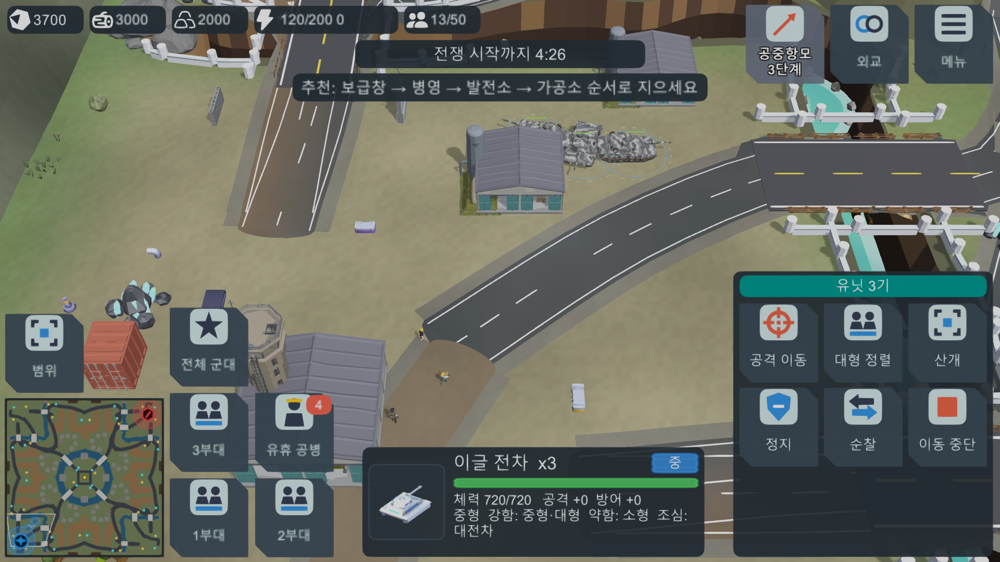
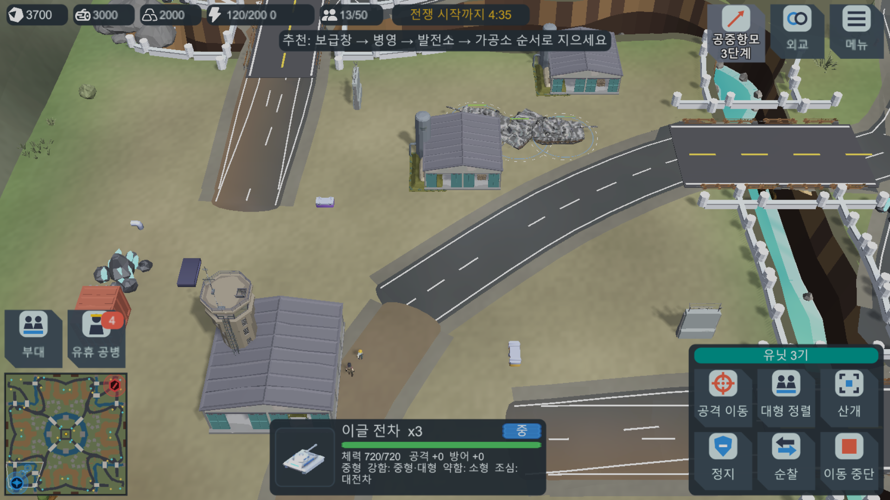

| 장면 | 전 | 후 |
| --- | --- | --- |
| 선택 없음 | 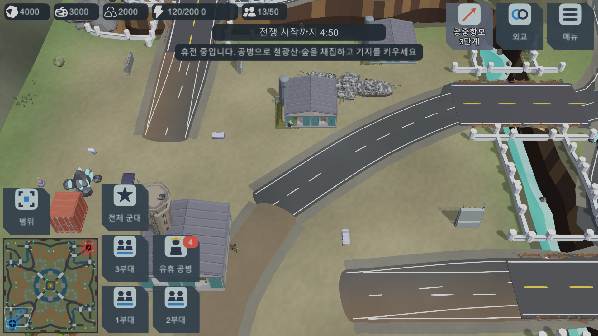 | 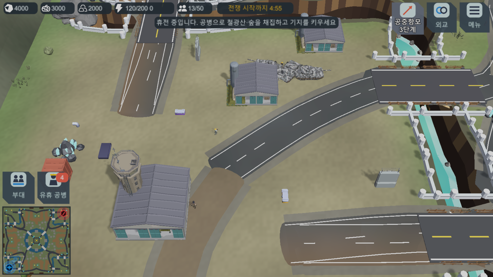 |
| 사령부 생산 | 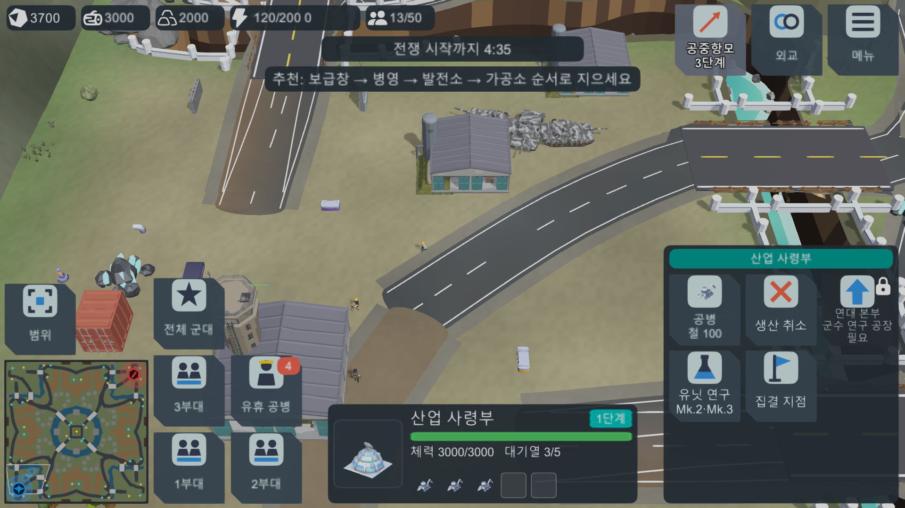 | 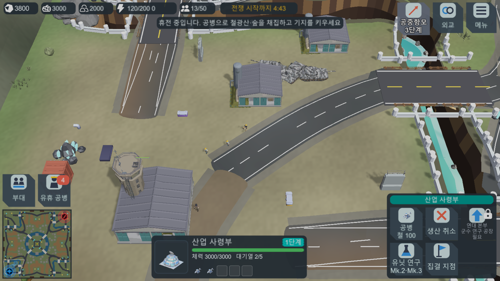 |
| 건설 위치 지정 | 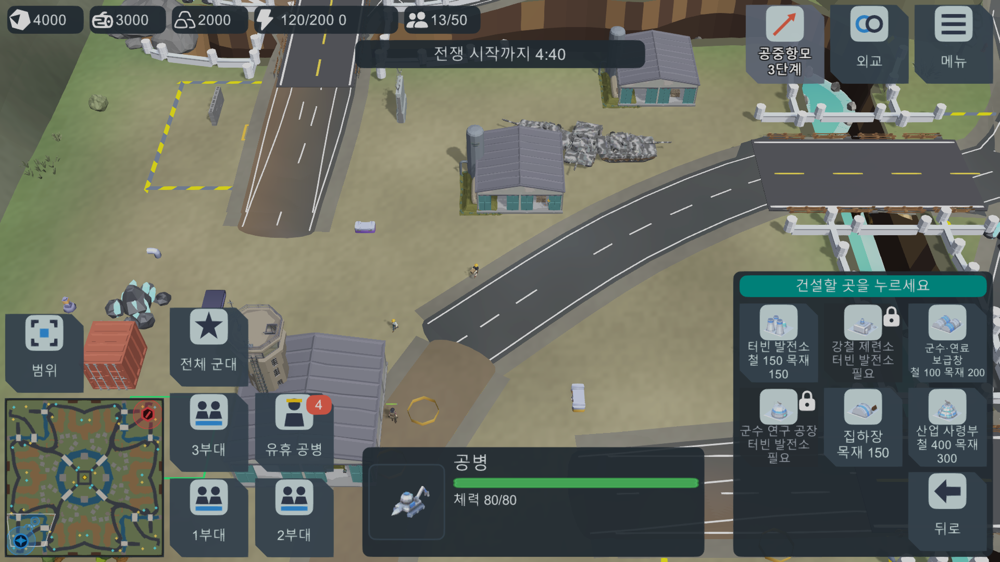 | 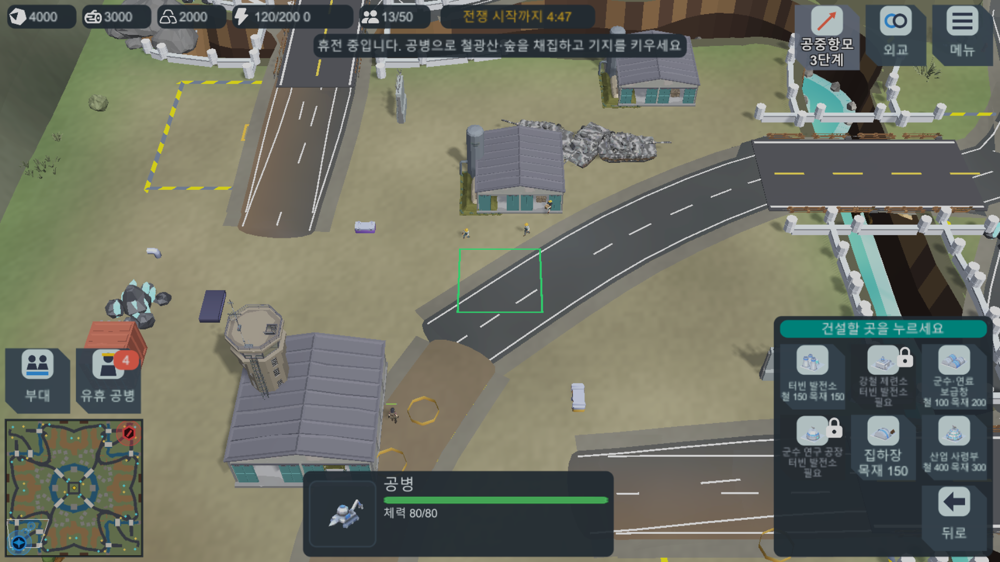 |
| 공병 20:9 | 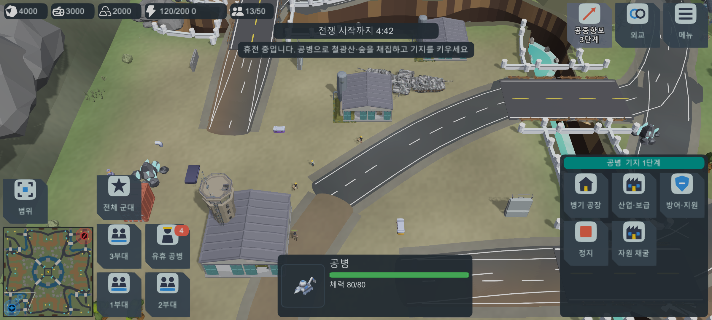 | 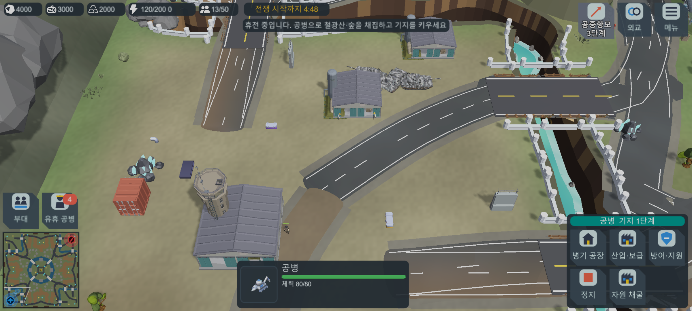 |
| 궁극 목표 지정 | 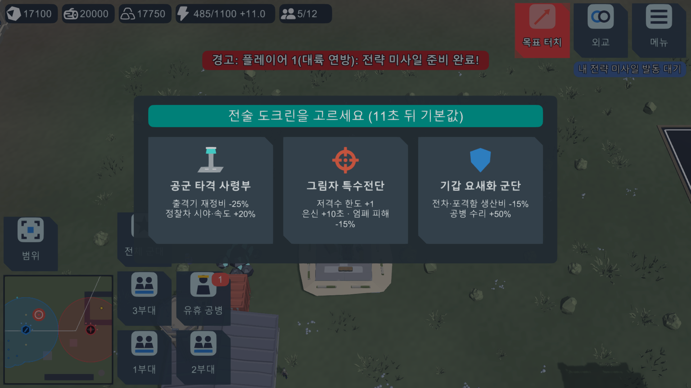 | 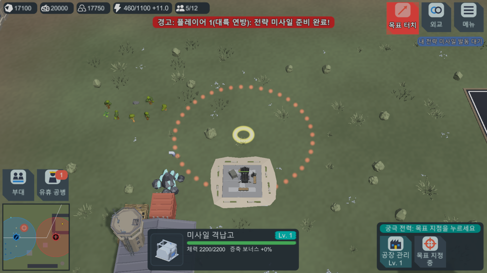 |

전체(11장면 × 3비율)는 `DevelopmentReports/Screenshots/StrategyUiKit/redesign_{before,after}/`.

## 새 상호작용 (화면 전용, 시뮬레이션 규칙 변경 없음)

- 명령 표지: 빈 땅 탭 → 청록 고리(이동), 공격 이동 → 주황, 적 탭 → 대상 자리 빨강, 건설·채집·궁극 발사 등 → 호박색.
- 궁극 조준 고리: 목표 지정 중 화면 가운데에 `UltimateSpec.BlastRadius` 그대로의 빨간 고리 + 노란 중심점. 끌어서 맞추고 누르면 발사.
- 채취 시설 배치: 화면 안 자원 지점 중 지을 수 있는 곳 녹색, 못 짓는 곳 회색 고리(기존 녹/적 기초 미리보기와 함께).
- 튜토리얼 8단계: 카메라 → 공병 선택 → 채굴 시설 건설 → 공병 배치 확인 → 자원 수입 → 전투 유닛 생산 → 집결 지점 → 공격 이동. 판정만 하고 명령은 대신 보내지 않는다.

## 검증 (Unity 에디터 PlayMode, GPU)

| 항목 | 결과 | 검사 |
| --- | --- | --- |
| 부대 펼침·선택 후 접힘·범위 선택 켜고 끄기 | PASS | `Hud_GroupFlyoutOpensSelectsAndCloses` |
| 빈 땅 탭 이동 표지, 적 탭 공격 표지 + 실제 공격 대상 설정 | PASS | `Input_TapOrdersShowMoveAndAttackMarkers` |
| 명령 패널 높이 = 쓰는 줄 수, 제목줄 비지 않음 | PASS | `Hud_ContextPanelUsesOnlyNeededRows` |
| 조준 고리 반경 = 실제 폭발 반경, 탭으로 발사·고리 해제 | PASS | `Ultimate_AimRingShowsRealBlastRadiusAndTapLaunches` |
| UI 크기 115%·130%·되돌리기 | PASS | `Ui_ScaleOptionEnlargesHudAndRestores` |
| 튜토리얼 1~2단계 | PASS | `Tutorial_StartsFromMenuAndStepsAdvance` |
| 겹침·화면 밖·글자 맞춤·7mm 터치·빈 패널(16:9~21:9, 기기 3종) | PASS | `Ui_*`, `Hud_*`, `Device*` |
| UI·입력·제스처·미니맵·생산·건설 묶음 92건 | 90 PASS / 2 FAIL | 실패 2건은 기존 기준선(`AiDiplomacy_BreaksAfterCommonEnemyFalls`, `Produce_PopulationLimitCountsQueue`) |
| Android 실기기 | NOT TESTED(보류 지시) | — |

## 남은 일

- 튜토리얼 3~8단계는 판정 코드만 있고 끝까지 진행하는 자동 검사는 없다.
- 공장 출고 차량의 건물·컨베이어 끼임은 이번 개편에서 새로 확인하지 않았다(기존 `Vehicle*`·`Factory*` 검사 기준).
- 키트 문양(Sheet 3) 장식, 한글 OFL 글꼴.
