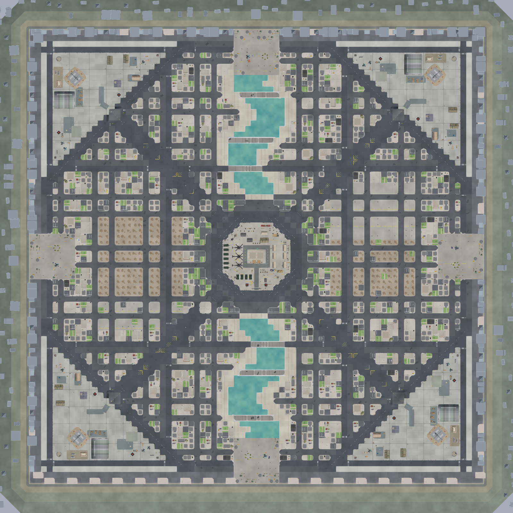
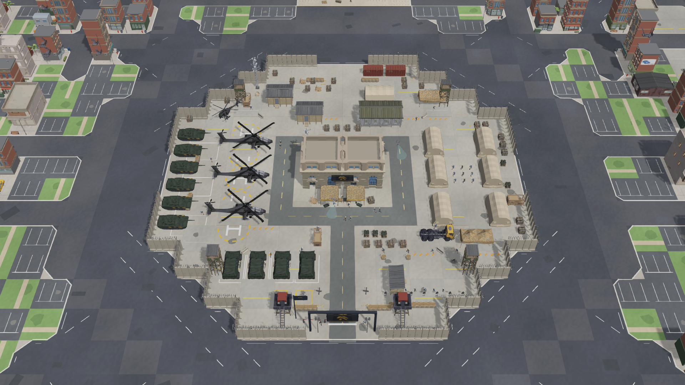

# Map4P 시각 인수인계 · 2026-11-23 KST

**현재 플레이 가능 기준은 `fd8bba2`의 Unity 6000.0.85f2 · `Map4P.unity`다.** 한 변 640m인 80×80칸(v5, 한 칸 8m)이다. Claude 작업 잠금이 유효해 기존 Unity 캡처를 사용했다. 리뷰 시점에 로컬 `main`과 `origin/main`이 같았고, Git 작업 트리에 미커밋 변경은 없었다. 씬에 표시되는 꾸미기 블록의 생성물은 Git 제외 대상이다.

## 캡처와 출처

**직상공 · 1,600×1,600 · 2026-11-23 16:45:16 KST.** 네 모서리 본진, 외곽 순환로와 지상 플레이 경계 전체, S자 운하와 교량 6곳, 중앙의 96m 팔각 기지와 동서남북 거점이 한 장에 들어온다. 플레이 경계 바깥의 배경 건물 일부는 프레임에 걸린다. [원본 PNG](status_images/Map4PV4/handoff_t39_j1_top.png)

**RTS 사선 · 1,920×1,080 · 높이 132m · 2026-11-23 16:45:20 KST.** 경기 카메라로 팔각 기지, 둘레 간선과 교차로, 인접 건물 높이를 보여 준다. 네 모서리를 함께 담은 사선 원본은 확인하지 못했다. 경사로와 수로 단차는 아래 근접 사진에서 볼 수 있다. 두 큰 화면 모두 HUD와 에디터 표시가 보이지 않는다. [사선 원본 PNG](status_images/Map4PV4/handoff_t39_j1_oblique.png)

| 상태 | 확인한 범위 |
| --- | --- |
| 커밋 및 원격 반영 | `09ff622`에서 중앙을 약 147m → 96m로 줄였고, `00d85ae`에서 8m 여유의 고정 철제 아치교와 깊어진 수로를 적용했다. 현행 규칙의 도개 모드는 꺼져 있다. `aaa7847`의 PMC 앰버 배너·깃발·거래소 간판, 포탑 전차, 연속 담장까지 사선 화면에서 확인했다. [지형·교량 변경](https://github.com/5Bok2Daddy/factory-wars/commit/00d85aeb3aaa4c5bbf9979d35931503f964ab24e) |
| 촬영 당시 로컬 작업 | 직상공과 사선은 Claude의 PlayMode `Map4P_CaptureTopAndGameplayViews` 통과 기록(`claude-fix6-r1.xml`, 현지 16:45:12–25 KST)의 `j1` 원본이다. 당시 HEAD `aaa78475efa33a3b25146d146c890a7e52c98666` 위에 작업 중이던 6차 첫 재색칠과 로컬에서 생성한 블록이 포함된다. 현재 커밋의 6차 2회차 색·피부 보정은 16:47:40 KST에 찍힌 `j2` 캠프 원본에서 확인했다. 해당 PNG는 `fd8bba22c7c0f3a10e5cd2ec46e935b569becf3e`에 포함돼 있다. [최종 캠프 사선](status_images/T39/t39_v6_camp_wide.png) · [차량 색 전후](status_images/T39/t39_v6_before_after_vehicles.png) |
| 검수 대기 | 상점 아이콘·상태는 연결됐고 HUD 캡처는 남아 있다. 전차의 올리브 비중은 사용자 검수 대기이며 거래소 표식은 실제 경기 줌에서 읽히는지 확인이 필요하다. 6차 2회차의 전장 전체 재촬영과 네 모서리를 담은 사선 촬영도 남아 있다. `j1` 본진 광각의 그리기 호출 추정치는 371회(보통 기준 350회)다. `j2` 캠프 광각은 235회·577,358삼각형으로 기록됐다. [최종 캠프 측정 기록](status_images/T39/t39_v6_perf.txt) |

## 시안 A와 전체 구도

시안 A와 현재 사진 모두 **모서리의 쐐기형 본진 네 곳 → 대각 간선 → 팔각 중앙**, 그리고 **S자 운하·교량 여섯 곳·외곽 순환로**가 첫눈에 읽힌다. 현행 96m 캠프의 둘레에 생긴 간선과 전면 공간도 뚜렷하다. 시안 A에서는 대각 간선 양옆의 건물 덩어리, 수변의 연속된 가장자리, 변 중앙의 거점이 더 강하게 구분된다. 현행 캡처에서는 비슷한 크기와 간격의 지붕·주차·잔디 칸이 반복되고, 축척을 줄이면 경계 시설과 거점이 밝은 띠와 넓은 포장으로 합쳐 보인다. [시안 A 원본이 포함된 기존 대조 이미지](status_images/Map4PV4/dress_vs_conceptA.png)

## 다음 Codex 세션 우선순위

좌표는 맵 중심 원점에서의 `(x, z)` 미터다. 직상공 이미지의 위는 북(+z), 오른쪽은 동(+x)이다. 아래는 기존 블록과 통행 면 안에서 할 수 있는 **표현 개선안**이다. 같은 카메라 위치·높이·품질의 전후 화면으로 판단한다.

| 순위와 위치 | 화면에서 보이는 문제 | 제안 | 전후 비교 합격 기준 |
| --- | --- | --- | --- |
| **1. 네 본진의 대각 진출 경사로** · 남서 0번 램프 중심 `(-200, -200)`과 나머지 세 곳 `(200, -200)`·`(200, 200)`·`(-200, 200)` | 램프 위 노란 유도선은 있으나, 턱 옆 회색 삼각 면과 상·하단 포장 경계에서 도로가 끊겨 보인다. 본진 평탄부는 넓고 표식은 드문 편이다. [경사로 50m](status_images/Map4PV4/handoff_t39_j1_base_ramp.png) | 기존 경사면을 따라 포장 톤과 가장자리선을 이어 주고, 옹벽 면과 상부 포장에 명도 차를 둔다. 유도·대기 표식은 기존 포장 면에 넣는다. | 네 자리 모두 전차가 오를 길이 줌아웃에서도 한 번에 읽히고 회색 삼각 이음이 사라진다. 네 자리의 건설 가능 면과 통행 폭은 일치한다. |
| **2. 요새 북쪽 첫 아치교** · 중심 `(-16, 124)`과 남쪽 대응 교량 `(16, -124)` | 짙은 도로의 차선은 밝은 상판 양끝에서 끊기고, 밝은 부두 포장과 계단식 제방 면이 길게 반복된다. 아치와 수로 깊이는 잘 읽힌다. [수로·다리 62m](status_images/Map4PV4/handoff_t39_j1_canal_bridge.png) | 기존 상판에 접근로 차선·가장자리 표시를 맞추고, 교대와 벽에 접합부·수위 띠의 톤 차를 준다. | 동일 시점에서 진입 차선과 상판 길이 한 줄로 이어지고, 교대와 수면이 구분된다. 하부 통과 단면은 그대로 확인된다. |
| **3. 중앙 96m 캠프** · `(0, 0)`의 거래소 전면, 서쪽 전차 진열열, 북서 담장 안쪽 | 배너와 진열열 덕분에 입구와 기능이 구분된다. 최종 `j2`의 전차는 여전히 올리브가 강하고, 북서 보급 띠는 동쪽 병영보다 듬성하다. [최종 캠프](status_images/T39/t39_v6_camp_wide.png) | 차체의 주 면을 건메탈·차콜로 정리하고 올리브를 일부 패널에 둔다. 거래소 표식과 북서 적치 구역은 기존 위치에서 바닥 표식과 명도로 먼저 구분한다. | 같은 132m와 근접 시점에서 정문·거래소·진열·병영·보급을 구분하고 궤도·포탑·유리 경계가 남는다. |
| **4. 서쪽 시가지** · 카메라 초점 `(-168, 92)`의 교차로 주변과 동쪽 대응 구역 | 높낮이와 비상계단은 보인다. 비슷한 적갈색 중층 건물과 평지붕이 여러 교차로에 반복되고, 위에서 보면 주차와 잔디의 밝은 테두리가 먼저 보인다. [도시 62m](status_images/Map4PV4/handoff_t39_j1_west_city.png) | 동일 블록 면적에서 기존 지붕·벽면 변형의 배분을 바꿔 교차로마다 실루엣을 하나씩 구분한다. 안쪽 골목은 덜 강조한다. | 같은 축척에서 인접 두 교차로를 지붕·가로변 실루엣으로 구분할 수 있고, 차선과 인도가 계속 드러난다. |
| **5. 외곽 순환로와 변 중앙 거점** · 북측 경계와 서측 자원지의 카메라 초점 `(108, 310)`·`(-282, -6)` 및 나머지 변의 대응 거점 | 북측의 경계 건물·방벽이 길게 같은 간격으로 이어진다. 서측 철·목재 거점은 넓은 밝은 포장에 흩어져 순환로에서 접근 표시가 약하다. [북측 경계 76m](status_images/Map4PV4/handoff_t39_j1_north_edge.png) · [서측 자원 거점 70m](status_images/Map4PV4/handoff_t39_j1_west_outpost.png) | 통행로 밖 경계 소품의 묶음을 바꾸고, 거점 입구의 기존 포장에 공통 유도 표식과 얕은 재질 대비를 준다. | 네 변에서 순환로의 방향과 거점 입구가 빠르게 구분되고, 접근 폭과 자원 접근 시야가 동일하게 읽힌다. |

**판정 변경은 별도 검토.** 본진 경사 높이·폭이나 건설 부지, 캠프 출입구·점유 면적, 다리 여유 높이·수상 통로, 외곽 자원·입구 위치를 바꾸면 지상·수상 NavMesh와 밸런스에 영향이 생긴다. 검토 기준은 네 자리의 이동 시간·경로 길이와 180° 대응(기존 공정성 기준 ±5%), 건설 판정, 지상·수상 통과 시험이다. 다음 시각 검수에서는 같은 고정 시점의 전후 사진과 함께 보통 350회·60만 삼각형, 낮음 200회·30만 삼각형 예산을 대조한다.
