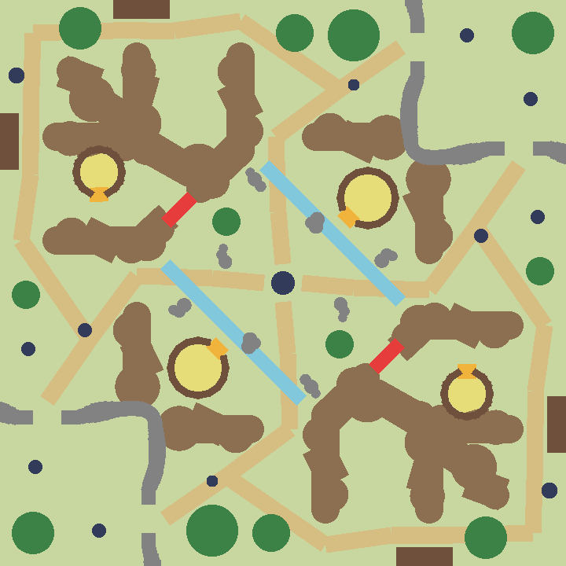
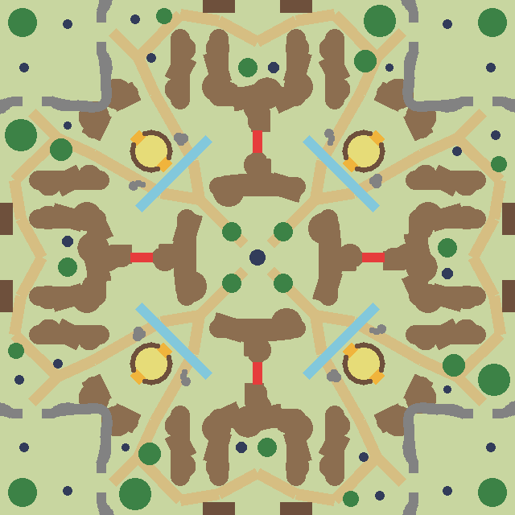

# TASK-01 결과 보고서

작성일: 2026-11-06

## 요약

**TASK-01은 끝났습니다.** `Game` 프로젝트가 Unity 6000.0.85f2로 만들어졌고, `finish-setup.sh` 실행 결과 컴파일 에러 0, PlayMode 테스트 4/4 통과입니다. 이어서 진행한 TASK-02의 결과는 이 문서 끝의 "TASK-02 결과"에 있습니다.

## 사용자가 직접 할 일

자세한 내용은 문서 끝 "채집·건설·전투 결과"의 "사용자가 할 일"에 있습니다. `Game\FactoryWars` 폴더 정리입니다.

## 단계별 상태

| 단계 | 상태 | 내용 |
| --- | --- | --- |
| 1. Unity 설치 | 완료 | 6000.0.85f2와 Android 모듈 설치됨 |
| 2. 프로젝트 생성 | 완료 | `C:\Users\MinGyu\FactoryWars\Game` |
| 3. Quantum SDK | 완료 | 3.0.14, User Files, App ID, CodeGen |
| 4. Git | 완료 | 첫 커밋 포함, push 안 함 |
| 5. 기본 구조 | 완료 | `staging\`에서 `Game`으로 복사됨 |
| 6. 보고서 | 완료 | 이 파일 |

## 입력값과 달랐던 환경

- **SDK 위치:** `Downloads`가 아니라 바탕화면에 있습니다. `C:\Users\MinGyu\Desktop\photon-quantum-3.0.14-stable-2241.unitypackage`
- **Hub 위치:** 기본 경로가 아닌 MS Store(MSIX) 버전 3.22.5입니다. 실행 파일은 `C:\Program Files\WindowsApps\UnityTechnologies.UnityHub_3.22.5.65535_x64__2vrhnee42bhxm\app\Unity Hub.exe`입니다.
- **설치된 에디터:** `6000.6.8f1`(Unity 6.6)이 이미 있었습니다. TASK 지정 버전이 아니라서 프로젝트에는 쓰지 않았고 삭제도 하지 않았습니다.
- **라이선스:** 정상입니다. Unity Personal이 할당되어 있고 6.6 배치 모드가 동작했습니다.

## 설치 버전

| 항목 | 값 |
| --- | --- |
| Unity | 6000.0.85f2 (Hub 릴리스 목록의 6000.0 최신) |
| Quantum | 3.0.14 Stable 2241 |
| AI Navigation | 2.0.16 (NavMesh 베이크에 필요해서 TASK 목록 외에 추가) |
| URP, uGUI | 17.0.4, 2.0.0 (에디터 내장 버전) |

## Quantum 설정 변경값

현재 저장된 값입니다. 동기화 설정은 TASK-02에서 바뀌었습니다.

| 설정 | 기본값 | 변경값 | 근거 |
| --- | --- | --- | --- |
| `LockstepSimulation` | 0 | 0 | TASK-02 (TASK-01에서는 1) |
| `UpdateFPS` (SimulationRate) | 60 | 20 | TASK |
| `InputDelayMin` | 0 | 4 | TASK-02 (TASK-01에서는 10) |
| `AppIdQuantum` | 없음 | TASK의 App ID | TASK |
| `Navigation.EnableNavigationCallbacks` | 0 | 1 | 꺼져 있으면 도착 시그널이 오지 않음 |

## TASK-01 검증 결과 (Unity 6000.0.85f2)

- **컴파일:** 에러 0. `codegen.log`의 `error CS` 198건은 코드 생성 전이라 나오는 예상된 에러이고, 이어진 `compile.log`는 0건입니다.
- **`InstallAllUserFiles` 배치 실행:** 성공. "Unity 열고 버튼 클릭" 단계는 필요 없습니다.
- **데이터 에셋:** 37개 생성 (유닛 12, 건물 20, 모듈 2, 진영 2, 규칙 1)
- **PlayMode 테스트:** 4/4 통과. TASK-02 규칙이 들어가며 일부를 고쳤습니다. 현재 상태는 "TASK-02 결과"를 보세요.

**아직 실행 확인을 안 한 기능:** 유닛 생산 완료와 취소, 프리셋, 관통탄·반응장갑, 방어탑, 공중 이동, 진영 패시브, 전력 부족 페널티

## 구현하지 않은 것

현재 기준 목록은 문서 끝 "채집·건설·전투 결과"의 "아직 없는 것"에 있습니다.

`SystemsConfig` 에셋 대신 `SystemSetup.User.cs`의 `AddSystemsUser`에서 시스템을 코드로 등록했습니다.

## 임시값 (GDD에 없어 정한 수치)

전부 `Game\Assets\Editor\FactoryWars\FactoryWarsSetup.cs`에서 고칠 수 있습니다.

### 유닛

| 유닛 | 피해 | 사거리 | 공격 간격(초) | 이동 속도 | 기타 |
| --- | --- | --- | --- | --- | --- |
| 공병 (양 진영) | - | - | - | 4 | 인구 1, 슬롯 0 |
| 레인저 분대 | 15 | 7 | 1 | 4 | |
| 스카이가드 분대 | 20 | 8 | 1 | 4 | |
| 이글 전차 | 60 | 9 | 2 | 5 | |
| 호크 공격헬기 | 55 | 8 | 2 | 7 | |
| 스카이포트리스 폭격기 | 200 | 4 | 5 | 5 | 광역 반경 4 |
| 민병대 | 10 | 6 | 1 | 4 | |
| 화염방사 분대 | 20 | 3 | 1 | 4 | 광역 반경 2 |
| 용린 전차 | 45 | 8 | 2 | 5 | |
| 천둥 대공차 | 40 | 10 | 1.5 | 5 | |
| 만리 다연장포 | 120 | 18 | 6 | 3 | 최소 사거리 6, 광역 반경 4 |

### 건물 (양 진영 동일)

| 건물 | 비용 | 건설(초) | 체력 | 전력 | 인구 한도 |
| --- | --- | --- | --- | --- | --- |
| 사령부 | 0 | 0 | 3000 | +50 | +10 |
| 발전소 | 300 | 15 | 600 | +100 | |
| 정제소 | 500 | 20 | 800 | -20 | |
| 보급창 | 300 | 15 | 500 | -5 | +20 |
| 병영 | 400 | 20 | 800 | -10 | |
| 연구소 | 600 | 25 | 700 | -20 | |
| 군수공장 | 900 | 30 | 1200 | -25 | |
| 비행장 | 1100 | 35 | 1000 | -30 | |
| 중공업 기지 | 1500 | 45 | 1600 | -40 | |
| 방어탑 | 450 | 20 | 700 | -15 | |

방어탑 공격: 대장갑, 피해 40, 사거리 10, 간격 1.5초

### 모듈과 규칙

- **관통탄:** 비용 100, 중형 이상 대상 피해 ×1.25
- **반응장갑:** 비용 120, 받는 피해 ×0.5, 쿨다운 20초
- **시작 자금:** 5000
- **시작 유닛:** 공병 1 + 자유 연방 레인저 2·이글 1 / 대륙 연방 민병대 2·용린 1 (테스트용)
- **테스트 씬 시작 위치:** (-30,0,0), (30,0,0), (0,0,30), (0,0,-30)
- **쪽지 문구 수:** 12
- **전력 부족 배율:** 생산 속도 ×0.5, 방어탑 공격 속도 ×0.5
- **스폰 거리·공중 고도:** 각각 6
- **패배 조건:** 건물이 하나도 없으면 패배

## TASK-02 결과

**완료했습니다.** 컴파일 에러 0, 결정론 금지어 0건, PlayMode 테스트 18/18 통과입니다. 실존 명칭 검색은 `TargetDesignator`의 부분 일치 오탐 1건뿐입니다. 로그는 `Game-logs\task02\`에 있습니다.

TASK-01 보고서의 결정 사항 세 건은 TASK-02 기본값으로 정리됐습니다.

### 완료 항목

| 항목 | 상태 | 내용 |
| --- | --- | --- |
| 맵 | 완료 | `Map2P` 160×160, `Map4P` 240×240. 회전 대칭 배치 |
| 자금 노드 | 완료 | 2인 9개(합계 44,000), 4인 17개(합계 84,000) |
| `MapSpec` | 완료 | 경계, 시작 위치, 노드. `Map.UserAsset`으로 맵에 연결 |
| 외교·쪽지 비용 | 완료 | 수치는 모두 `GameRulesSpec`에 있음 |
| `ActionRejected` | 완료 | 자금 부족, 쿨다운, 모드 불가, 잘못된 요청 |
| 외교 모드 제한 | 완료 | 3인 이상 자유 대전만. 1대1과 팀전은 거부, 쪽지는 허용 |
| 공동 승리 | 완료 | 전원 동맹 60초 유지. 파기하면 초기화 |
| 동기화 | 완료 | soft lockstep, 입력 지연 4틱 |

### 바꾼 설정값과 근거

| 설정 | 이전 | 현재 | 근거 |
| --- | --- | --- | --- |
| `LockstepSimulation` | 1 | 0 | `Quantum.Deterministic.xml:8948`이 Legacy로 표기하고 soft lockstep을 권장 |
| `InputDelayMin` | 10 | 4 | 단위는 틱 (`Quantum.Deterministic.xml:8997` "Defined in ticks"). 20Hz에서 틱당 50ms, 4틱 = 200ms |

- **입력 지연은 200ms가 최솟값입니다.** 핑이 `InputDelayPingStart`(100ms)를 넘으면 `InputDelayMax`(60틱 = 3초)까지 늘어날 수 있습니다. 두 값은 기본값 그대로입니다.
- **SDK 권장보다 적습니다.** SDK 주석은 soft lockstep에 10틱 이상을 권하는데, 4틱은 TASK-02의 200ms 기준을 따른 값입니다. 네트워크가 나쁘면 롤백이 늘 수 있습니다.

### 맵 측정값

NavMesh 크기·경로 탐색 시간 관련 경고는 없었습니다. 베이크는 맵당 0.03초 이내입니다. NavMesh 데이터는 `Map2P` 36KB, `Map4P` 77KB입니다. `WorldSize` 256, 격자 64×4는 기본값 그대로이고 240 맵을 덮습니다.

| 경로 (이동 속도 5) | 직선 거리 | 직선 이론값 | 실제 |
| --- | --- | --- | --- |
| 2인 맵 기지 → 기지 | 155.7 | 31.1초 | 37.8초 |
| 4인 맵 맞은편 기지 → 기지 | 254.6 | 50.9초 | 53.1초 |

TASK의 약 48초는 240을 속도 5로 나눈 값입니다. 시험한 경로는 기지 사이 대각선이라 더 길고, 그만큼 시간도 늘었습니다.

### 테스트 결과 (18/18 통과)

| 분류 | 테스트 | 확인 내용 |
| --- | --- | --- |
| 기본 | `Bootstrap_SetsUpBothPlayers` | soft lockstep, 20Hz, 입력 지연 4틱, 시작 상태 |
| 기본 | `AttackMove_ArmiesMeetAndFight` | 이동 23.3, 체력 합계 1810→945 |
| 외교 | `Alliance_BlocksCombatAndBreakHasGrace` | 파기 유예, 재동맹 금지(쿨다운 거부, 비용 없음) |
| 비용 | `Proposal_Charges300_RejectRefunds150` | 300 차감, 중복 제안 거부, 거절 시 150 환급 |
| 비용 | `Proposal_ExpiresAfterThirtySeconds_Refunds150` | 30초 만료 환급, 만료 후 수락 불가 |
| 비용 | `Proposal_TargetDefeated_Refunds150` | 대상 패배 시 150 환급 |
| 비용 | `Accept_Charges150AndFormsAlliance` | 150 차감, 동맹 성립 |
| 비용 | `Accept_InsufficientFunds_KeepsProposalPending` | 수락 실패, 제안 유지 |
| 비용 | `Break_Charges500`, `Break_InsufficientFunds_Fails` | 500 차감, 자금 부족이면 파기 실패 |
| 쪽지 | `Note_ChargesAndHasCooldown_InEveryMode` | 50·100 차감, 5초 제한, 1대1에서 허용 |
| 모드 | `Duel_RejectsDiplomacy` | 1대1 외교 거부 |
| 모드 | `TeamMode_RejectsDiplomacy_AllowsNotes` | 팀전 외교 거부, 쪽지 허용, 시작 직후 종료 안 됨 |
| 승리 | `JointVictory_EndsAfterSixtySecondsOfFullAlliance` | 59초 계속, 60초 종료 |
| 승리 | `JointVictory_BreakResetsTimer` | 파기 시 초기화, 원래 시각에 안 끝남 |
| 승리 | `JointVictory_Off_NeverEnds` | 방 설정을 끄면 타이머가 시작되지 않음 |
| 맵 | `Map2P_LayoutAndCrossing`, `Map4P_LayoutAndCrossing` | 크기, 노드 수·매장량, 회전 대칭, 직선 차단, 우회로 2개, 횡단 도착 |

**기존 테스트 4개는 그대로 두지 못했습니다.** TASK-02 규칙이 기존 동작을 바꾸기 때문입니다.
- `Bootstrap_SetsUpBothPlayers`: Lockstep 켜짐 확인을 꺼짐 확인으로 바꿨습니다.
- `Alliance_BlocksCombatAndBreakHasGrace`: 1대1 외교가 금지되어 3인 경기로 바꿨습니다.
- `JointVictory_AllRemainingAlliedEndsGame`: 즉시 종료가 없어져 60초 테스트로 교체했습니다.

### 확인하지 못한 것

- **롤백 경로:** 로컬 모드에는 네트워크 지연이 없어 soft lockstep의 롤백이 실제로 일어나지 않습니다. 온라인 대전을 연결할 때 2대 이상의 기기로 확인해야 합니다.
- **입력 지연 체감:** 200ms는 설정값 계산이고 실기기 측정이 아닙니다.
- **씬 화면:** 맵은 배치 모드로만 돌려서 카메라 구도와 모양을 눈으로 보지 못했습니다.
- **팀전 승리:** 상대 팀 전멸 시 즉시 승리하는 경로는 테스트가 없습니다.

### TASK에 없어서 정한 동작

- **`Invalid` 사유 추가:** 지정된 세 사유에 맞지 않는 경우(중복 제안, 없는 제안 수락, 범위 밖 문구 등)를 위해 넣었습니다.
- **서로 제안 금지:** 상대가 나에게 낸 제안이 대기 중이면 내 제안은 `Invalid`입니다. 양쪽이 300씩 내는 일을 막습니다.
- **재동맹 금지 중 제안:** `Cooldown`으로 거부하고 비용을 받지 않습니다.
- **받을 사람 없는 쪽지:** `Invalid`로 거부하고 비용과 쿨다운을 적용하지 않습니다.
- **제안자가 패배한 제안:** 환급 없이 지웁니다.
- **외교 인원 기준:** 경기에 참가한 인원입니다. 4인전에서 2명이 패배해도 외교는 계속 가능합니다.
- **팀전 승리:** 공동 승리 설정과 60초 타이머를 쓰지 않고, 상대 팀 전멸 시 즉시 승리합니다. 기존 코드는 시작 때 같은 팀만 먼저 합류하면 바로 끝날 수 있어 함께 고쳤습니다.
- **이벤트 동기화:** soft lockstep에서는 예측 프레임의 이벤트가 취소될 수 있어 `ActionRejected`, `NoteReceived`, `AllianceChanged`, `PlayerDefeated`, `GameOver`를 `synced`로 바꿨습니다. `UnitDestroyed`는 그대로입니다.

### 새 임시값

- **4인 맵 플레이어 순서:** 시계 반대 방향 회전 순서입니다. P0 (-90,-90), P1 (90,-90), P2 (90,90), P3 (-90,90)
- **2인 맵 시작 위치:** (-55,-55), (55,55)
- **기지 노드:** 사령부에서 12 떨어진 곳에 2개
- **확장 지점:** 2인 맵 (-50,50) 부근과 대칭 위치. 4인 맵 (0,-90) 등 네 변 중앙. 노드 2개의 간격은 8
- **장애물:** 2인 맵 벽 2개·바위 2개, 4인 맵 벽 12개. 높이 6, NavMesh에서 제외. 시뮬레이션 충돌체는 없어 공중 유닛은 그대로 지나갑니다.
- **`MinDiplomacyPlayers`:** 3

### 저장소 상태

- **커밋:** TASK-02 3개.
  1. `외교·쪽지 비용, 모드 제한, 60초 공동 승리, MapSpec`
  2. `2인·4인 맵 씬과 데이터, soft lockstep 설정`
  3. `PlayMode 테스트 18개로 확장`
- **`staging\`, `finish-setup.sh`:** TASK-01 시점의 코드입니다. 이제 기준은 `Game`이고, 지우지는 않았습니다.
- **CLAUDE.md:** 아직 "Quantum lockstep 모드로 시작"이라고 적혀 있어 현재 설정과 다릅니다. 수정하지 않았습니다.

### 다음 작업 제안

1. 공병 채집과 건설 흐름. 수입이 있어야 비용 규칙이 의미 있습니다.
2. 공격 상성
3. 유닛 특수 기능

## 채집·건설·전투 결과

**구현, 테스트, GitHub push를 완료했습니다.** 컴파일 에러 0, 결정론 금지어 0건, PlayMode 테스트 45/45가 2회 연속 통과했습니다. 로그는 `Game-logs\task03\`에 있습니다.

이번부터 기준 문서로 GDD를 직접 읽었습니다(Claude Docs 연결로 열림).

### 사용자가 할 일

**`Game\FactoryWars` 폴더 정리.** 21:51에 Unity **6.6**으로 만든 새 프로젝트가 `Game` 안에 생겼습니다(1.1GB).

- 진짜 프로젝트는 `Game` 폴더 자체이고 버전은 `6000.0.85f2`입니다.
- 제가 만든 것이 아니라 지우지 않았고, `.gitignore`에 넣어 저장소에서 제외했습니다.
- 할 일: 6.6 에디터를 닫고 필요 없으면 폴더를 지워 주세요. Hub에는 `Game` 폴더를 **Add**로 등록하고 `6000.0.85f2`로 여세요.

### Android 모듈 확인 결과 (정정)

**설치되어 있습니다.** 앞서 "설치되지 않았다"고 보고한 것은 틀렸습니다. 21:53~21:55에 설치가 진행되던 때 그 전에 읽은 폴더와 `modules.json` 내용을 근거로 판단했고, 뒤에 갱신된 파일을 다시 읽지 않았습니다. Hub의 `failed to install` 메시지가 어떤 시도에서 나온 것인지는 확인하지 못했습니다.

| 폴더 | 크기 | 내용 |
| --- | --- | --- |
| `SDK` | 882MB | platforms 34·35·36·37.0, build-tools 36.0.0, platform-tools, cmdline-tools 16.0 |
| `NDK` | 2.3GB | r27c (27.2.12479018) |
| `OpenJDK` | 230MB | Temurin 17.0.18+8, `java -version` 실행 확인 |

`modules.json`의 Android 항목 11개가 모두 선택 상태입니다. `iOSSupport` 폴더도 함께 있습니다. 실제 Android 빌드는 아직 해 보지 않았습니다.

### 구현한 것

| 항목 | 내용 |
| --- | --- |
| 채집 | `GatherCommand`. 노드 → 정제소 왕복 반복. 고갈되면 가까운 노드로 이동 |
| 건설 | `BuildCommand`에 공병 지정. 부지를 잡을 때 비용 차감, 공병이 있을 때만 진행. 여러 명이면 빨라짐 |
| 위치 검사 | 맵 경계, NavMesh(중심과 네 모서리), 건물 겹침, 자금 노드 겹침 |
| 수리 | `RepairCommand`. 자금 소모. 미완성 건물에 쓰면 건설 재개 |
| 공격 상성 | `GameRulesSpec.Matchups` 표 |
| 특수 기능 | 공병 제외 10종 모두 동작 |
| 거부 이벤트 | `ActionKind`에 건설·채집·수리, `RejectReason`에 `BlockedLocation` 추가 |
| `ScenarioUnits` | `RuntimeConfig`에 추가. 경기 시작 때 유닛을 지정 위치에 배치. 튜토리얼과 테스트용 |

### 고친 기존 버그

- **공중 유닛 사거리:** 3D 거리로 계산해서 고도 6 때문에 사거리 4인 폭격기는 지상을 절대 맞힐 수 없었습니다. 이제 수평 거리로 계산합니다.
- **광역 공격과 건물:** 광역 공격이 유닛만 맞혀서 화염방사 분대·다연장포·폭격기가 건물을 공격해도 피해가 없었습니다. 이제 건물도 맞습니다.

### 공격 상성표 (임시값)

GDD는 방향만 정했습니다(대인→소형, 대장갑→중형·대형, 대공→공중). 배율은 제가 정했습니다.

| 공격 유형 | 소형 | 중형 | 대형 | 공중 | 건물 |
| --- | --- | --- | --- | --- | --- |
| 대인 | 1.5 | 0.6 | 0.4 | 1 | 0.5 |
| 대장갑 | 0.6 | 1.5 | 1.5 | 1 | 1 |
| 대공 | 0.5 | 0.25 | 0.25 | 1.5 | 0.25 |
| 광역 | 1 | 1 | 1 | 1 | 1 |

공병은 소형으로 계산합니다.

### 특수 기능 (수치는 임시값)

| 유닛 | 기능 | 동작 |
| --- | --- | --- |
| 레인저 분대 | 표적 지시 | 맞은 적은 5초간 나와 동맹의 원거리 공격에 피해 ×1.25. 레인저 자신도 포함 |
| 스카이가드 분대 | 공중 우선 | 공중이 사거리에 있으면 공중 우선. 없으면 지상을 쏨 |
| 이글 전차 | 첫 발 2배 | 8초간 사격이 없었으면 다음 발 ×2 |
| 호크 공격헬기 | 저공 비행 | 지상 대장갑 무기(방어탑 포함)에 맞지만 피해 ×0.5 |
| 스카이포트리스 | 융단폭격 | 반경 8에 적 5기 이상이면 폭격기 아래에 피해 ×1.5. 쿨타임 45초 |
| 민병대 | 2명 생산 | 1회 생산에 2명 |
| 화염방사 분대 | 건물 추가 피해 | 건물 피해 ×3. 상성과 합치면 ×1.5 |
| 용린 전차 | 집단 돌격 | 같은 유닛 5대 이상이면 속도 ×1.15. 거리 무관, 1초마다 갱신 |
| 천둥 대공차 | 포화 사격 | 사거리 안의 공중 유닛 최대 3기 동시 공격 |
| 만리 다연장포 | 넓은 범위 | 광역 반경 4, 최소 사거리 6 (데이터로 구현) |

**GDD 해석 두 가지를 확인해 주세요.**
- **스카이가드:** 대공 유닛이 공중만 쏘면 "우선 조준"이 의미가 없어서, 공중이 없을 때 지상도 쏘게 했습니다. 지상 피해는 낮습니다.
- **호크:** "지상 대장갑 무기에 덜 맞음"을 위해 대공이 아닌 지상 대장갑 무기도 호크를 맞힐 수 있게 했습니다. 폭격기는 여전히 대공으로만 맞습니다.

### 경제·작업 임시값

| 항목 | 값 |
| --- | --- |
| 1회 운반량 | 50 |
| 채집 시간 | 2초 |
| 작업 거리 | 부지·노드 가장자리에서 2 |
| 다음 노드 탐색 반경 | 30 |
| 건물 부지 | 중심에서 변까지 3 (전 건물 동일) |
| 자금 노드 반지름 | 2 |
| 부지 시작 체력 | 최대의 10% |
| 수리 속도 | 초당 20 |
| 수리비 | 회복 비율 × 건물 비용 × 0.5 |

- **건설 거리 제한 없음:** 기지에서 멀어도 지을 수 있습니다. 공병이 걸어가야 하니 확장 기지를 허용했습니다.
- **수리 대상:** 건물만입니다. 유닛 수리는 없습니다.
- **건설 취소:** 부지 취소와 환불은 없습니다.

### 테스트 결과 (45/45)

이번에 27개를 추가했습니다.

| 분류 | 수 | 확인 내용 |
| --- | --- | --- |
| 채집 | 4 | 왕복과 자금 보존, 정제소 없을 때 대기 후 반입, 고갈과 다음 노드, 이동 명령으로 취소 |
| 건설 | 5 | 공병 있을 때만 진행, 재개, 2명이면 빠름, 잘못된 요청 6종, 자금 부족, 장애물 위 거부 |
| 수리 | 2 | 체력 회복과 수리비, 적 건물·만피 건물 거부 |
| 상성 | 2 | 설계 방향, 실전 피해 |
| 특수 기능 | 14 | 10종 전부. 발동 조건 미달 사례 포함 |

기존 18개는 건설 헬퍼만 새 흐름에 맞게 고쳤고 모두 통과합니다. 처음에 쓴 `Gather_WithoutRefinery` 테스트 끝부분이 아무것도 검증하지 않아 보강했고, 그 과정에서 가득 든 공병이 2초를 허비하는 문제를 찾아 고쳤습니다.

**전투 수치가 바뀌었습니다.** 상성이 들어가 `AttackMove` 측정값이 체력 합계 1810→945에서 1810→1049로 변했습니다.

### 확인하지 못한 것

- **실제 경기 밸런스:** 수치는 전부 단위 테스트 기준입니다. 수입 속도와 한 판 10~15분 목표는 AI 대전이 있어야 잴 수 있습니다.
- **공병 다수 혼잡:** 여러 공병이 한 노드에 몰릴 때의 동작은 시험하지 않았습니다.
- **방어탑 실전 사격:** 호크를 맞히는 경로를 포함해 방어탑 테스트가 없습니다.
- **롤백·실기기:** TASK-02와 같습니다. 온라인 연결 후 확인이 필요합니다.

### 아직 없는 것

- **건물 해금 조건:** GDD의 테크 트리(병영은 발전소 필요 등)가 없습니다. 지금은 처음부터 모두 지을 수 있습니다.
- **건물이 길을 막지 않음:** 유닛이 건물을 통과합니다. NavMesh가 고정이라 별도 설계가 필요합니다.
- **모듈:** 관통탄·반응장갑만 있습니다. GDD의 공통 8종 + 진영 전용과 연구소 개발이 없습니다.
- **1대1 승리 조건:** GDD는 "사령부와 생산 건물 파괴"인데, 코드는 "건물 전부 파괴"입니다.
- **건물 파괴 이벤트, 제안 만료 알림**
- **AI 대전, 온라인 방 코드 대전, 입력 UI**

### 저장소 상태

- **로컬 커밋:** 7개. 이번 작업 2개.
  1. `공병 채집·건설·수리, 공격 상성, 유닛 특수 기능`
  2. `PlayMode 테스트 45개로 확장`
- **원격:** `origin` = `https://github.com/5Bok2Daddy/factory-wars.git`. `main` push 완료(`805a143`). 원격과 로컬이 같습니다.
- **저장소 공개 범위:** 로그인 없는 조회는 404라 비공개로 보입니다. Photon App ID가 코드에 있으니 비공개를 유지해 주세요.
- **규칙 변경:** 사용자 지시로 앞으로 작업 단위마다 push합니다. CLAUDE.md의 "push 금지" 문구는 아직 남아 있습니다.

### 다음 작업 제안

1. 건물 해금 조건과 1대1 승리 조건 (GDD 맞춤, 작음)
2. 입력 UI와 AI 대전 (밸런스를 재려면 필요)
3. 나머지 모듈과 연구소

## 챕터 3 진행 상황 (설계 변경으로 일시 중단)

사용자 지시로 진행 중이던 3-3까지 마무리하고 멈췄습니다. 테스트 59/59 통과, 컴파일 에러 0, 결정론 금지어 0건, push 완료(`5df31c9`).

| 항목 | 상태 | 비고 |
| --- | --- | --- |
| 3-1 규칙 마무리 | 완료 (구 자원 체계 기준) | 해금, 건물 충돌, 패배 조건 |
| 3-3 AI | 완료 (구 자원 체계 기준) | 3-2보다 먼저 진행. 메뉴와 HUD가 봇 슬롯·통계에 의존하고, 화면 없이 검증할 수 있어서 |
| 3-2, 3-4, 3-5, 3-6, 3-7 | 미착수 | |

- **AI 측정값:** 보통 AI는 240초에 유닛 33기 생산, 아무것도 안 하는 사람을 342초에 격파. 300초 수입은 쉬움 4,900, 보통 7,950.
- **결함 정정:** 먼저 push한 3-1의 건물 충돌(`c2b501b`)은 회피 원이 좁은 틈을 막아 공병이 갇히는 결함이 있었습니다. 테스트가 건물 한 채만 시험해서 놓쳤고, AI 추적 로그에서 발견해 `5df31c9`에서 고쳤습니다.
- **`ROADMAP.md`:** `Documents`의 파일을 작업 루트에 복사했습니다. 내용은 고치지 않았습니다.

## 설계 변경 영향 분석

기준 문서: `DESIGN-RESOURCE-TERRAIN.md`. 함께 보내 주신 `GDD — 팩토리 워즈.docx`는 자원·건물·지형 항목이 이 설계와 일치합니다. 코드는 고치지 않았습니다.

### 결론

- **전면 재작성은 필요 없습니다.** 전투, 특수 기능, 외교 규칙, 승리 조건은 거의 그대로 갑니다. 바뀌는 곳은 경제와 맵입니다.
- **테스트 59개:** 유지 38, 수정 20, 삭제 1, 신규 약 25.
- **가장 큰 작업:** 지형 데이터와 맵 두 장 재배치, AI 경제 재작성입니다.
- **가장 큰 위험:** 건물은 여전히 경로 계산에 들어가지 않습니다. 폭 8~10의 협곡에서는 건물로 길이 막히는 문제가 커집니다. 협곡·입구 건설 금지 구역을 제안합니다.
- **설계상 그대로는 구현할 수 없는 곳:** 4인 맵 중앙의 숲 2개는 90도 회전 대칭이 될 수 없습니다(질문 1).

### 1. 고칠 코드·데이터와 규모

규모는 변경 줄 수 추정입니다. 소 100줄 미만, 중 100~300줄, 대 300줄 이상.

| 대상 | 지금 | 바뀌는 내용 | 규모 |
| --- | --- | --- | --- |
| `PlayerState` | `Funds`, `PowerProduced/Consumed` | `Iron·Wood·Steel·Power`, `PowerCap`, 정전 상태, 순증감 표시값. 통계를 자원별로 | 소 |
| `ResourceCost` (신규) | 없음 | qtn 구조체. 지불 가능 검사, 차감, 환불, 모자란 자원 마스크 공통 함수 | 소 |
| `ResourceNode` | 남은 자금, 고갈되면 삭제 | 종류(철/목재), 매장량, 작업 지점 점유. **고갈돼도 삭제하지 않음** | 중 |
| `UnitSpec`·`BuildingSpec`·`ModuleSpec` | `FP Cost` | `ResourceCost Cost`. 건물에 유지비, 반입 가능 여부, 전기 생산·저장 추가 | 소 |
| `ProductionOrder` | `FP PaidCost` | `ResourceCost`. 환불도 자원별 | 소 |
| 채집·반입 (`WorkerSystem`) | 정제소 반입 | 철·목재 분기, 들고 있는 자원 종류, 작업 지점 배정, 사령부·집하장 반입 | 중 |
| 생산·건설 차감 (`ProductionSystem`) | `Funds` 비교·차감 6곳 | 공통 함수로 교체. 인구 거부 추가 | 소 |
| 기존 전력 용량 방식 | `UpdateTotals`, 저전력 배율 2종 | **제거.** 전기 시스템 신규: 축적, 유지비, 정전, 이벤트 | 중 |
| 가공소 | 없음 | 변환 시스템, 켜기·끄기 커맨드 | 소 |
| 외교·쪽지 비용 | 자금 | 철로 교체. `FP` 값 6개는 숫자 유지 | 소 |
| `ActionRejected` | 사유 enum | 자원 부족 비트 마스크 필드 추가. `InsufficientFunds` 제거, 인구 한도 추가 | 소 |
| `MapSpec` | 시작 위치, 노드 목록 | 지형 목록(종류·모양·위치·매장량), 시작 자원, 시작 유닛 구성 | 중 |
| 건설 위치 검사 | 경계, NavMesh, 겹침 | 자원 가장자리 3 이격, 건설 금지 구역 | 소 |
| 씬·NavMesh | 평지 + 장애물 | `MapSpec`에서 지형 오브젝트 생성 후 재굽기 | 대 |
| `FactoryWarsSetup.cs` | 비용·건물·맵 표 | 건물 표 교체, 유닛·모듈 비용, 맵 정의 전면 교체 | 대 |
| `BotSystem` | 자금 기준 | 공병 배분, 자원별 판단, 전기 관리 | 대 |
| 정제소 에셋 | `*_refinery` | `*_processor`로 이름 변경 (`git mv`, GUID 유지). 집하장 에셋 신규 | 소 |
| `FactoryWarsDebugView` | 노드 원기둥 | 3-5에서 지형 표시. 그 전에는 소폭 수정 | 소 |

코드에서 센 참조 수: `Funds` 128곳(테스트 76곳 포함), `.Cost` 15곳, 기존 전력 20곳, `Refinery` 22곳, `ResourceNode` 33곳.

### 테스트 59개 분류

보고서 작성 시점 기준입니다. 요청하신 45개 뒤에 14개가 더 늘어 59개입니다(※ 표시).

**전제:** 테스트 씬만 시작 자원을 철 5,000으로 둡니다. 설계대로 철 500이면 외교 테스트에서 제안 두 번(600)도 못 합니다. 그래서 시작 자원을 `MapSpec`에 넣습니다. 이렇게 하면 외교 테스트의 숫자를 그대로 쓸 수 있습니다.

**유지 38개** (헬퍼 `Funds`→`Iron` 이름만 바뀌는 것 포함)

| 분류 | 테스트 |
| --- | --- |
| 특수 기능 13 | `Ability_AirPriority_PrefersAirThenGround`, `Ability_AirPriority_ShootsGroundWhenNoAir`, `Ability_CarpetBomb_FiresOnCrowd`, `Ability_CarpetBomb_IgnoresSmallGroups`, `Ability_FirstShotDouble`, `Ability_FlameBurst_ExtraBuildingDamage`, `Ability_GroundArmorResist_HitByGroundArmorAtHalf`, `Ability_GroundUnitsCannotHitOtherAir`, `Ability_MinRange_CannotHitCloseTargets`, `Ability_MultiAirTarget_HitsThree`, `Ability_SwarmSpeed_NeedsFiveTanks`, `Ability_SwarmSpeed_NotBelowFive`, `Ability_TargetDesignator_BoostsNextRangedHit` |
| 전투·이동 5 | `Matchups_FollowDesign`, `Matchups_AppliedInBattle`, `AttackMove_ArmiesMeetAndFight`, `Units_WalkAroundBuildings`※, `Units_EscapePocketBetweenBuildings`※ |
| 외교·쪽지 13 | `Proposal_Charges300_RejectRefunds150`, `Proposal_ExpiresAfterThirtySeconds_Refunds150`, `Proposal_TargetDefeated_Refunds150`, `Accept_Charges150AndFormsAlliance`, `Break_Charges500`, `Alliance_BlocksCombatAndBreakHasGrace`, `Note_ChargesAndHasCooldown_InEveryMode`, `Duel_RejectsDiplomacy`, `TeamMode_RejectsDiplomacy_AllowsNotes`, `JointVictory_EndsAfterSixtySecondsOfFullAlliance`, `JointVictory_BreakResetsTimer`, `JointVictory_Off_NeverEnds`, `Defeat_RequiresLosingHeadquartersAndProductionBuildings`※ |
| 공병 3 | `Build_TwoEngineersBuildFaster`, `Gather_MoveOrderCancelsWork`, `Repair_RejectsEnemyAndFullBuildings` |
| AI 4 | `Bot_DiplomacyDisabledInDuel`※, `Bot_EasyAnswersProposalWithEitherResult`※, `Bot_NormalRejectsStrongestAcceptsOthers`※, `Bot_SameSeedGivesSameMatch`※ |

**수정 20개**

| 테스트 | 바뀌는 내용 |
| --- | --- |
| `Bootstrap_SetsUpBothPlayers` | 시작 자원 5종 확인 |
| `Ability_MilitiaPair_SpawnsTwoFromOneOrder` | 병영이 사령부 해금이라 발전소 배치 제거 |
| `Accept_InsufficientFunds_KeepsProposalPending` | 철 소진 방법과 거부 사유·마스크 |
| `Break_InsufficientFunds_Fails` | 위와 같음 |
| `Build_InsufficientFundsRejected` | 모자란 자원 전부가 마스크에 담기는지 확인 |
| `Build_LockedUntilPrerequisitesFinished`※ | 병영 대신 가공소로 |
| `Build_HeavyWorksNeedsFactoryAndLab`※ | 가공소 조건 추가 |
| `Build_TechTreeFollowsDesign`※ | 설계 4장 표 전체로 교체 |
| `Build_ProgressesOnlyWhileEngineerWorks` | 비용, 전력 확인을 전기 증가로 |
| `Build_RejectsBadRequests` | 자원 가장자리 3 이격, 지형 좌표 |
| `Build_OnObstacleRejected` | 새 맵 좌표 |
| `Gather_CarriesFundsToRefinery` | 철·목재 각각, 사령부 반입, 채집 2초·3초 |
| `Gather_DepletedNodeIsRemovedAndWorkerMovesOn` | 노드가 남고 채집만 끝남 |
| `Repair_RestoresHealthForFunds` | 자원별 수리비 |
| `Map2P_LayoutAndCrossing` | 전면 교체. 대칭, 연결, 횡단 재측정 |
| `Map4P_LayoutAndCrossing` | 위와 같음 |
| `Bot_BuildsEconomyInOrder`※ | 새 빌드오더 |
| `Bot_ProducesArmy`※ | 기대값 재측정 |
| `Bot_EasyIsSlowerThanNormal`※ | 수입 비교를 자원 합계로 |
| `Bot_DefeatsIdlePlayer`※ | 시간 재측정 |

**삭제 1개**

| 테스트 | 이유 |
| --- | --- |
| `Gather_WithoutRefinery_WaitsCarrying` | 사령부가 항상 반입 지점이라 상황이 사라집니다. 사령부 상실 시 대기 테스트로 대체합니다 |

**신규 약 25개**
- **자원:** 전기 축적, 저장 한도, 발전소 파괴 시 한도 감소, 비용 마스크, 환불, 인구 한도
- **정전:** 유지비 차감, 건물별 정지·재개, 방어탑 ×2, 병영 무영향, 이벤트, 같은 틱 처리 순서
- **가공소:** 변환 비율, 입력 부족 시 정지, 켜기·끄기
- **채집:** 작업 지점 분산, 집하장 반입, 고갈 후 통과 불가 유지, 운반 중 자원 변경
- **지형:** 숲·철광산 통과 불가, 공중 통과, 3 이격, 협곡 건설 금지, 모든 본진·확장 연결, 협곡 폭
- **건물 차단:** 건물 일렬 배치, 입구 양쪽 건물 (아래 3-1 참고)

### 2. 챕터 3 설계 변경안

#### 3-1 규칙 마무리

**해금 트리:** `ROADMAP.md` 3-1의 표를 설계 4장 표로 교체합니다. 이미 있는 `Prerequisites` 구조를 그대로 쓰므로 데이터만 바뀝니다. "파괴되면 다시 잠김"도 지금 코드가 그렇게 동작합니다.

**건물 역할**

| 건물 | 변경 |
| --- | --- |
| 가공소 | 정제소 에셋을 이름만 바꿔 재사용. `IsRefinery`(반입)는 없애고 변환 수치 추가 |
| 발전소 | `PowerProduced`(용량)를 초당 전기·저장 한도 증가로 변경 |
| 군수공장 | 진행 중일 때 유지비, 정전이면 타이머 정지. 비행장·중공업·연구소도 같은 구조 |
| 집하장 | 신규. `IsDropOff`를 사령부와 집하장에 켬 |

**건물 길찾기와 지형을 함께 처리하는 방법**

| 대상 | 방법 | 근거 |
| --- | --- | --- |
| 지형 | Unity NavMesh에 구워 Quantum NavMesh로 가져옴 | 설계 1장 5번과 7장. 정적이라 그대로 맞음 |
| 건물 | **현재 방식 유지:** 부지 밖으로 밀어내고, 면을 따라 목표에 가까운 모서리로 미끄러짐 | 아래 SDK 확인 결과 |

SDK를 확인한 결과는 다음과 같습니다.
- **NavMesh는 실행 중 고칠 수 없습니다.** 실행 중 바꿀 수 있는 것은 미리 구운 영역의 켜기·끄기뿐입니다. `Assets/Photon/Quantum/Runtime/QuantumNavMeshRegion.cs:5`에 "toggle-able regions"를 Unity NavMesh에 투사한다고 되어 있고, 굽는 단계의 작업입니다.
- **영역은 임의 위치에 만들 수 없고 수도 제한됩니다.** `QuantumUnityRuntime.cs:20916`이 `Navigation.Constants.MaxRegions`를 넘으면 굽기를 실패시킵니다. 건물은 어디든 지을 수 있어서, 격자로 영역을 미리 구우면 칸 수가 제한을 넘을 가능성이 큽니다. **정확한 한도 숫자는 확인하지 못했습니다.**
- **`NavMeshAvoidanceObstacle`은 경로를 바꾸지 않습니다.** `Quantum.Engine.xml:12993`에 "not altering the navmesh itself"라고 되어 있습니다. 실제로 써 봤더니 회피 원이 건물 사이 틈을 막아 공병이 갇혔습니다.

**남는 위험:** 경로 계산이 건물을 모릅니다. 그래서 유닛은 건물을 돌아가지만, 건물이 통로를 완전히 막으면 뚫린 경로를 찾지 못하고 벽 앞에서 맴돕니다. 협곡 폭 8~10은 건물 두 채(폭 6)로 막힐 수 있습니다.

**제안:** 협곡 안과 본진 입구를 `MapSpec`의 건설 금지 구역으로 둡니다. 3-0에서 건물 일렬 배치와 입구 주변 테스트로 실제 동작을 확인합니다. 이것은 설계에 없는 규칙이라 승인이 필요합니다(질문 5).

#### 3-2 HUD

- **상단 바:** `철 | 목재 | 강철 | 전기 저장/한도 (순증감 ±/초) | 인구 사용/한도`. 순증감은 시뮬레이션이 계산한 값을 읽기만 합니다.
- **비용 표시:** 자원 아이콘과 숫자. 모자란 항목은 빨간색. `ActionRejected`의 마스크를 그대로 씁니다.
- **알림:** 철·목재·강철·전기 부족, 인구 한도, 건설 불가 지형, 해금 안 됨, 쿨다운, 모드 불가. 여러 자원이 모자라면 한 줄로 묶습니다.
- **정전:** 상단 전기 칸 빨간 깜빡임, 멈춘 건물 위 아이콘. `PowerOutage`, `BuildingPaused` 이벤트 사용.
- **가공소:** 선택 패널에 켜기·끄기 버튼. 현재 변환 상태 표시.

#### 3-3 AI

`BotSystem`의 판단 구조(394줄)는 유지하고 경제 판단을 바꿉니다.

| 항목 | 변경 |
| --- | --- |
| 공병 배분 | 전체 공병 중 철 비율 목표: 초반 60%, 발전소 이후 70%. 쉬는 공병을 부족한 쪽에 배정 |
| 빌드오더 | 공병 → 보급창 → 병영 → 발전소 → 가공소 → 군수공장 → 연구소 → 비행장·중공업 기지 |
| 전기 관리 | 순증감이 음수면 발전소 추가. 저장량이 낮으면 상위 건물 생산을 멈춤 |
| 강철 관리 | 강철이 다음 목표에 모자라고 철이 남으면 가공소 추가 또는 켜기 |
| 확장 | 일하는 노드가 반입 지점에서 멀면 정제소 대신 집하장 |
| 비축 | 자금 `reserve`를 `ResourceCost` 단위로 |
| 난이도 | 수치는 `AiSpec`에. 쉬움은 공병 수와 판단 주기를 낮춤 |

#### 3-5 임시 그래픽

설계 8장 그대로 갑니다. `MapSpec`의 지형 목록에서 도형을 만들므로 씬·미니맵·건설 검사가 같은 데이터를 씁니다.

| 대상 | 표현 |
| --- | --- |
| 철광산 | 회색 각진 도형 + 주황 조각, 고갈되면 회색만 |
| 숲 | 짙은 녹색 원뿔 군집 |
| 바위 | 회갈색 덩어리 |
| 언덕 | 흙색 높은 블록 |
| 협곡 벽 | 어두운 갈색 긴 블록 |
| 노드 | 위에 남은 매장량 표시 |
| 미니맵 | 지형 색 반영 |

#### 3-6 AI 대 AI 기록

- **기존:** 진영별 승률, 평균 경기 시간
- **추가:** 시간대별(1분 단위) 철·목재·강철 수입, 전기 생산·소비·순증감, 정전 누적 시간과 횟수, 첫 발전소·가공소·군수공장 시각, 첫 중형·대형 유닛 시각
- **이유:** 설계 2장의 시간 목표(3~5분 전력 확보 등)를 실제와 비교합니다.
- **구현:** 시뮬레이션 통계 필드를 늘리고, 기록은 테스트 쪽에서 프레임을 읽습니다.

### 3. `ROADMAP.md` 수정안

설계 9장 초안대로 3-0을 3-1 앞에 넣는 데 동의합니다. 두 가지를 바꿀 것을 제안합니다.
- **3-3 AI 재작성을 3-0 마지막에 포함합니다.** 3-1과 3-3이 이미 구 규칙으로 끝나 있어, 3-0이 끝나면 AI가 멈추기 때문입니다.
- **3-0을 커밋 단위로 쪼갭니다.** 커밋마다 테스트가 전부 통과하는 상태를 유지합니다.

파일은 고치지 않았습니다. 아래는 제안 diff입니다.

```diff
--- ROADMAP.md
+++ ROADMAP.md
@@ 현재 상태
-- 구현됨: 자원·전력·인구, 건설(공병·위치 검사), 생산·취소, 프리셋, 채집·수리, 공격 상성, 특수 기능 10종, 관통탄·반응장갑, 외교·쪽지(비용 포함), 공동 승리 60초, 2인(160)·4인(240) 맵, soft lockstep + 입력 지연 약 200ms
-- 테스트: PlayMode 45개 통과
-- Android Build Support·OpenJDK·SDK & NDK: Hub에는 설치 완료로 표시. SDK & NDK 크기가 "1 바이트"로 보여 실제 폴더 확인 필요
+- 구현됨(구 자원 체계): 자금·전력·인구, 건설(공병·위치 검사), 건물 해금·충돌, 패배 조건, 생산·취소, 프리셋, 채집·수리, 공격 상성, 특수 기능 10종, 관통탄·반응장갑, 외교·쪽지(비용 포함), 공동 승리 60초, 규칙 기반 AI, 2인(160)·4인(240) 맵, soft lockstep + 입력 지연 약 200ms
+- 테스트: PlayMode 59개 통과
+- Android 모듈 설치 확인: SDK 882MB(platforms 34~37, build-tools 36.0.0), NDK r27c, OpenJDK 17.0.18. APK 빌드는 미시험
+- 자원·지형 설계 변경: DESIGN-RESOURCE-TERRAIN.md가 GDD의 자금·전력 규칙을 대체
@@ 챕터 3
 **완료 기준:** Unity 에디터에서 진영·맵을 고르고 AI 상대로 처음부터 승패까지 한 판을 할 수 있다. Android APK가 빌드된다.

+3-0. **자원·지형 개편** (DESIGN-RESOURCE-TERRAIN.md 기준, 커밋마다 전체 테스트 통과)
+- a. 비용 구조: ResourceCost, 자금을 철로 기계적 치환, 외교·쪽지 철, 시작 자원을 MapSpec으로
+- b. 데이터: 설계 4·5장 비용·해금, 정제소→가공소 이름 변경, 집하장, 시작 공병 4 (테스트 씬은 현행 유지)
+- c. 채집: 철·목재, 사령부·집하장 반입, 작업 지점, 고갈 노드 유지
+- d. 전기: 축적·한도·유지비·정전·이벤트, 기존 전력 용량 방식 제거
+- e. 가공소: 변환, 켜기·끄기, 강철
+- f. 거부 사유: 부족 자원 비트 마스크, 인구 한도, 수리비 자원별
+- g. 지형: MapSpec 지형 목록, 씬 생성, 건설 검사(3 이격, 건설 금지 구역), NavMesh 재굽기
+- h. 맵: 2인·4인 재배치, 대칭·연결·협곡 폭 테스트, 횡단 재측정, 맵 이미지 첨부
+- i. AI: 공병 배분, 새 빌드오더, 전기·강철 관리, 집하장 확장
+
 3-1. **규칙 마무리**
-- 건물 해금 (GDD 건물표): 사령부 → 발전소·보급창 / 발전소 → 정제소·병영 / 병영 → 연구소·군수공장·방어탑 / 군수공장 → 비행장 / 군수공장 + 연구소 → 중공업 기지
-- 유닛이 건물을 통과하지 않게 (건설된 건물을 길찾기 장애물로 반영)
-- 승리 조건 통일: 모든 모드에서 사령부와 생산 건물(병영·군수공장·비행장·중공업 기지)을 모두 잃으면 패배
-- 확정된 해석: 스카이가드(공중 우선, 공중이 없으면 지상을 약하게), 호크(지상 대장갑 피해 절반) — 현재 구현 유지
+- 완료. 해금 트리는 3-0b에서 설계 4장으로 교체
+- 건물은 NavMesh에 넣지 않고 밀어내기 + 모서리 우회로 처리. 협곡·입구는 건설 금지 구역으로 보호
+- 승리 조건, 스카이가드·호크 해석은 현재 구현 유지

 3-2. **모바일 가로 화면 조작**
-- HUD: 상단 자금·전력·인구, 좌하단 미니맵(탭하면 카메라 이동), 우하단 건설·생산 패널(해금 표시, 비용, 대기열), 건물 선택 시 생산 프리셋 편집
+- HUD: 상단 철·목재·강철·전기 저장/한도(순증감)·인구, 좌하단 미니맵(탭하면 카메라 이동, 지형 색), 우하단 건설·생산 패널(해금 표시, 자원별 비용, 대기열), 건물 선택 시 생산 프리셋 편집, 가공소 켜기·끄기
+- 정전 표시: 전기 칸 경고, 멈춘 건물 위 아이콘
-- 외교·쪽지 패널: 플레이어 목록, 동맹 제안·수락·거절·파기 버튼(비용 표시), 정해진 문구 쪽지, 받은 쪽지 3초 표시 + 쪽지함, "자금 부족" 등 거부 사유 표시
+- 외교·쪽지 패널: 플레이어 목록, 동맹 제안·수락·거절·파기 버튼(철 비용 표시), 정해진 문구 쪽지, 받은 쪽지 3초 표시 + 쪽지함, 철·목재·강철·전기 부족, 인구 한도, 건설 불가 지형 등 거부 사유 표시

 3-3. **AI 상대 (쉬움·보통)**
-- 행동: 공병 채집 → 건설 순서 → 생산 → 일정 규모가 되면 공격 웨이브 → 확장 노드 점유
+- 완료(구 규칙). 경제 판단은 3-0i에서 교체: 공병 철 6:목재 4 → 발전소 이후 7:3, 발전소 → 가공소 → 무기 생산, 전기·강철 관리, 집하장 확장

 3-5. **임시 그래픽**
+- 지형: 철광산(회색 + 주황), 숲(녹색 원뿔 군집), 바위, 언덕, 협곡 벽. 노드 위 매장량, 고갈 철광산 회색

 3-6. **AI 대 AI 자동 대전**
-- 화면 없이 20판(2인 맵 10, 4인 맵 10) 돌려 진영별 승률, 평균 경기 시간, 시간대별 자금 수입을 기록
+- 화면 없이 20판(2인 맵 10, 4인 맵 10) 돌려 진영별 승률, 평균 경기 시간, 시간대별 철·목재·강철 수입, 전기 순증감, 정전 시간, 주요 건물·유닛 첫 등장 시각을 기록
@@ 챕터 5
-- 연구소의 모듈 개발(비용·시간) → 생산 프리셋에 장착 가능
+- 연구소의 모듈 개발(강철·전기·시간, 개발 중 유지비) → 생산 프리셋에 장착 가능
-- 진영 전용 모듈: 자유 연방 "위성 연계"(시야 +30%, 은폐 탐지), 대륙 연방 "인해 보급"(파괴 시 생산비 25% 환급)
+- 진영 전용 모듈: 자유 연방 "위성 연계"(시야 +30%, 은폐 탐지), 대륙 연방 "인해 보급"(파괴 시 생산비 25%를 자원별로 환급)
```

**테스트 계획**

| 커밋 | 테스트 |
| --- | --- |
| a | 기존 59개가 숫자 변경 없이 통과. 치환이 안전한지 확인하는 단계 |
| b | 해금·비용 수정분 |
| c | 채집·집하장·작업 지점 신규, `Gather_WithoutRefinery` 교체 |
| d, e | 정전·가공소 신규 |
| f | 마스크·인구·수리 |
| g | 지형 통과·건설 신규, 건물 일렬 배치 |
| h | 대칭·연결·협곡 폭, 맵 이미지 |
| i | AI 4개 재측정, 같은 시드 재현 |

매 커밋 후 컴파일 에러 0, 결정론 금지어 0건, 전체 테스트 통과를 확인하고 push합니다.

### 4. 질문 목록

**구현 전에 답이 필요한 것**

| # | 내용 | 문제 | 제안 |
| --- | --- | --- | --- |
| 1 | 4인 맵 중앙 숲 2개 | 90도 회전 대칭은 숲 수가 4의 배수여야 합니다. 2개는 180도 대칭만 됩니다 | 숲 4개(각 2,000)로 변경 |
| 2 | 맵 좌표 | 설계는 0~160, 코드는 맵 중심이 원점(-80~80)입니다 | 코드는 중심 원점 유지. 설계 좌표에서 절반을 뺌 |
| 3 | 2인 측면 협곡 | "측면 경로의 협곡"과 "숲 확장으로 들어가는 유일한 협곡"이 같은 것인지 불분명합니다. 숲 확장이 막다른 곳이면 측면 경로와 별개여야 합니다 | 별개로 두고, 측면 협곡은 모서리를 비켜 배치 |
| 4 | 정전 깜빡임 | 전기가 0 근처면 틱마다 조금 생기고 바로 써서 `PowerOutage` 시작·끝이 초당 20번 날 수 있습니다 | 재개 기준을 전기 5 이상으로 |
| 5 | 건설 금지 구역 | 설계에 없지만, 없으면 건물 두 채로 협곡이 막힙니다. 경로 계산이 건물을 몰라 유닛이 맴돕니다 | 협곡과 본진 입구를 금지 구역으로 |
| 6 | 인구 한도 거부 시점 | 지금은 대기열에 넣고 완성 뒤 기다립니다. 설계는 인구 한도를 거부 사유로 둡니다 | 대기열 포함 계산으로 넣을 때 거부 |
| 7 | 공병이 다른 자원을 들고 있을 때 | 철을 든 채 숲 명령을 받으면 처리 규칙이 없습니다 | 먼저 반입하고 이동 |
| 8 | 가공소 변환 단위 | 틱마다 조금씩인지, 1초마다 한 번인지. 철이 1만 있을 때도 달라집니다 | 1초마다 철 2 + 전기 1이 모두 있을 때만 |

**기본값으로 진행해도 되는 것**

| # | 내용 | 제안 기본값 |
| --- | --- | --- |
| 9 | 유지비가 모자랄 때 순서 | 엔티티 순서로 차감. 모자라면 그 건물만 정지 |
| 10 | "생산 중" 범위 | 타이머가 도는 동안만. 인구 대기 중에는 소모 없음 |
| 11 | 발전소 파괴로 한도가 줄 때 | 초과분 즉시 삭제 |
| 12 | 전기 환불이 한도를 넘을 때 | 한도까지만 환불 |
| 13 | 수리 중 한 자원이 모자랄 때 | 수리 중단. 사령부는 비용이 없어 무료 유지 |
| 14 | 사령부 파괴 후 반입 지점 없음 | 자원을 든 채 대기 |
| 15 | 숲·언덕 "다각형" | 1차는 원과 회전 사각형만. 언덕은 사각형 여러 개로 구성 |
| 16 | 작업 지점 수 | 철광산 6, 숲은 긴 변 4 간격 |
| 17 | 지점이 다 찼을 때 | 가까운 다른 노드, 없으면 대기 |
| 18 | 부족 마스크 범위 | 철·목재·강철·전기 + 인구 |
| 19 | 정제소 새 ID | `ff_processor`, `cf_processor` |

**참고로 확인한 점**

- **협곡 폭과 대형 유닛:** 현재 유닛 크기별 반지름이 없고 전부 0.5입니다. 폭 8~10은 충분합니다. 크기별 충돌이 필요하면 별도 작업입니다.
- **빌드업 표 불일치:** 스카이가드는 전기 20이 필요해서 "초반은 철·목재만" 표와 조금 다릅니다. 발전소 뒤에 나온다고 보면 문제없습니다.
- **`CLAUDE.md` 8번째 줄:** "lockstep 모드로 시작" 문구가 현재 soft lockstep 설정과 다릅니다. 요청 범위가 아니라 고치지 않았습니다.


## 3-0 자원·지형 개편 진행 상황

사용자 승인(2026-11-07)에 따라 진행해 완료했습니다. 커밋마다 컴파일 에러 0, 결정론 금지어 0건, 전체 테스트 통과를 확인하고 push했습니다.

| 커밋 | 내용 | 테스트 |
| --- | --- | --- |
| a | `ResourceCost`, 자금을 철로 치환, 시작 자원을 `MapSpec`으로 | 59/59. AI 측정값까지 이전과 같음 |
| b | 설계 비용·해금 표, 가공소, 집하장, 시작 공병 4 | 59/59 |
| c | 철·목재 채집, 사령부·집하장 반입, 작업 지점, 고갈 노드 유지 | 63/63 |
| d | 전기 축적·한도·유지비·정전·이벤트 | 69/69 |
| e | 가공소, 켜기·끄기 | 74/74 |
| f | 부족 자원 마스크, 인구 한도, 자원별 수리비 | 77/77 |
| g | 지형 데이터, NavMesh 굽기, 건설 이격·금지 구역, 건물 벽 따라 돌기 | 82/82 |
| h | 2인·4인 맵 재배치 | 82/82 |
| i | AI 공병 배분, 새 빌드오더, 전기·강철 관리, 집하장 확장, 시작 자원 설계값 | 82/82 |

**분석 때 없던 결정**
- **b~h의 임시 시작 자원:** b부터 건물에 목재·전기가 필요한데 AI는 i 전까지 목재를 캐지 않습니다. 커밋마다 전체 통과를 지키려고 실제 맵 시작 자원을 임시로 철 5,000, 목재·강철 20,000으로 뒀습니다. i에서 설계값(철 500, 목재 300)으로 바꿨습니다.
- **건물 우회 보강:** 붙어 있는 건물 줄 앞에서는 모서리 선택이 건물마다 달라 왕복할 위험이 있어, 처음 고른 회전 방향을 1초간 유지합니다. `Units_FollowRowOfTouchingBuildings`로 확인했습니다.
- **`RuntimeConfig` 시작 자원 덮어쓰기 추가:** 테스트 상황을 만드는 용도입니다. 튜토리얼에도 쓸 수 있습니다.
- **임시값:** 집하장 건설 15초, 체력 500. 작업 지점 간격 1.5(가장자리에서), 도착 판정 1.5. 건물과 바위·언덕·협곡 벽 이격 2.

**직접 시험하지 못한 것:** 같은 틱 안의 엔티티 순서 처리(질문 9)는 전용 테스트가 없습니다. 틱 단위로 전기 잔량을 맞추기 어려워서, 같은 시드 재현 테스트로 결정론만 확인합니다.

### 맵 (3-0h)

아래 그림은 설계 스케치가 아니라 **실제로 구운 NavMesh 삼각형과 `MapSpec`** 에서 그렸습니다. 어두운 회색은 NavMesh가 없는 곳입니다.

색: 연두 = 걸을 수 있는 땅, 주황 = 철광산, 초록 = 숲, 회색 = 바위, 갈색 = 언덕, 짙은 갈색 = 협곡 벽, 노랑 = 건설 금지 구역, 사각형 = 사령부.

**2인 맵 (160 × 160)**



**4인 맵 (240 × 240)**



| 검증 | 2인 | 4인 |
| --- | --- | --- |
| 자원 노드 | 15개 | 33개 |
| 회전 대칭 (시작, 노드, 지형, 금지 구역) | 180도 통과 | 90도 통과 |
| 작업 지점 전부 NavMesh 위, 본진과 연결 | 통과 (118개) | 통과 (254개) |
| 본진 입구 폭 12 | 통과 | 통과 |
| 협곡을 평행선 세 줄로 통과 (폭 6 이상 확보) | 통과 | 통과 |
| 맞은편 본진까지 전차(속도 5) | 29.4초 | 49.95초 |

- **2인 맵 경로:** 설계 단계 격자 시험에서 중앙만 남겨도, 측면만 남겨도 본진끼리 이어지고, 측면 둘과 중앙을 모두 막으면 끊겼습니다. 경로가 3개라는 뜻입니다.
- **숲 확장:** 같은 시험에서 협곡을 막으면 고립됐습니다. 진입로는 협곡 하나입니다.
- **설계와 다른 곳:** 앞마당은 본진 벽 모서리 밖 대각선 위치입니다. 입구가 두 개라 한쪽 입구 앞에 두면 대칭이 어긋나서, 두 입구 사이에 뒀습니다. 사령부에서 약 45입니다.
- **2인 맵 본진 숲:** 맵 모서리에 붙이면 바깥쪽 작업 지점에 갈 수 없어 길이를 18로 줄였습니다. 설계 예시는 20입니다.
- **4인 맵 협곡:** 이웃 본진 사이마다 1개이며, 회전 대칭이라 변 확장의 한쪽에만 있습니다. 협곡 주변 벽은 완전한 차단이 아니어서 맵 안쪽으로 도는 길도 있습니다.
- **횡단 시간:** 벽이 있어도 이전과 비슷합니다(2인 34초 → 29초). 이전 맵은 긴 대각선 바위를 돌아서 더 멀었습니다.


### AI 측정값 (3-0i, 2인 맵, 보통 AI)

| 시각 | 철 | 목재 | 강철 | 전기 | 인구 | 건물 | 유닛 생산 |
| --- | --- | --- | --- | --- | --- | --- | --- |
| 1분 | 700 | 250 | 0 | 0/200 | 11/36 | 보급창, 병영 | 8 |
| 2분 | 2,470 | 770 | 0 | 128/500 | 17/36 | + 발전소 | 18 |
| 3분 | 3,742 | 1,240 | 74 | 54/500 | 23/36 | + 가공소 2 | 27 |
| 4분 | 5,852 | 1,900 | 144 | 17/500 | 29/36 | + 군수공장 | 36 |
| 5분 | 6,652 | 2,330 | 164 | 196/800 | 36/60 | + 보급창, 발전소 | 43 |

- **대조:** 300초 수입(철+목재)은 쉬움 7,250, 보통 11,000. 생산은 19, 40. 아무것도 안 하는 사람은 360.5초에 패배. 정전은 없었습니다.
- **설계 2장과 비교:** 전력 확보(3~5분)는 조금 빠른 2분, 군수공장은 3~4분입니다.
- **밸런스 문제:** 철이 쌓입니다. 한 번에 건물 하나만 짓고 전기·강철이 병목이라, 5분에 철 6,600이 남습니다. 수치 조정은 3-6 측정 뒤 챕터 5에서 합니다.


## 챕터 3 진행 상황 (3-2, 3-4)

| 항목 | 상태 | 테스트 |
| --- | --- | --- |
| 3-2 모바일 조작·HUD | 완료 | 105/105 |
| 3-4 화면 흐름 | 완료 | 111/111 |
| 3-6 AI 대 AI | 완료 (20판) | 일반 111 통과, 전용 20판 완주 |
| 3-5, 3-7 | 사용자 승인 대기 | |

**3-2 구현**
- **조작:** 한 손가락 드래그 이동, 핀치 줌, 맵 경계 제한, 탭 선택, 더블탭 같은 종류 선택, 부대 3개, 땅 탭 이동, 길게 누르기 공격 이동, 적 탭 공격, 정지.
- **HUD:** 상단 자원 바, 미니맵(지형 색, 탭 이동), 건설·생산 패널(해금, 자원별 비용, 대기열 취소), 프리셋 편집, 가공소 켜기·끄기, 외교·쪽지 패널, 거부 사유·정전 알림.
- **구조:** 제스처 판별과 탭 해석을 입력 장치에서 분리해 화면 없이 테스트합니다. View 코드는 `FactoryWars.View` 어셈블리로 옮겼습니다.

**정한 동작 (로드맵에 없던 것)**
- **박스 선택은 토글 버튼입니다.** 한 손가락 드래그가 카메라 이동과 겹쳐서, "범위 선택" 버튼을 켠 동안만 드래그가 박스가 됩니다.
- **정지 커맨드를 추가했습니다** (`StopUnitsCommand`). 시뮬레이션 변경입니다.
- **프리셋의 모듈 목록을 `FactionSpec.Modules`에 뒀습니다.** 연구 조건은 챕터 5입니다.
- **버튼 크기:** 가로로 든 휴대폰 세로 폭을 70mm로 잡아, 기준 해상도 1080에서 140을 약 9mm로 뒀습니다. 상단 외교·메뉴 버튼만 높이 76입니다. 실기기 확인이 필요합니다.

**3-4 구현**
- 시작 화면 → 진영 선택 → 맵·모드·봇 수·난이도 → 대전 → 결과 화면 → 시작 화면. 일시정지 메뉴, 설정(음량 자리, 언어 표시).
- 2인 맵은 1대1만, 팀전은 4명, 자유 대전은 3~4명으로 조합을 제한합니다.
- 일시정지는 AI 대전에서만 시뮬레이션을 멈춥니다. `QuantumRunnerLocalDebug`가 자기 `Update`에서 세션을 돌려서 그 컴포넌트까지 끕니다.
- 내가 패배하면 자유 대전이 계속되어도 결과 화면을 띄웁니다.
- 빌드 씬은 `Menu`, `Map2P`, `Map4P`입니다. 테스트 씬은 빌드에서 뺐습니다.

**확인하지 못한 것:** 3-2·3-4 화면은 **눈으로 본 적이 없습니다.** 테스트는 `-nographics`로 돌아서 버튼 동작과 문구만 확인합니다. 글자 겹침, 한글 폰트, 터치 감각은 에디터나 기기에서 봐야 합니다.

## 3-5 그래픽 설계

사용자 지시로 3-5 방향을 "절차적 로우폴리"로 바꿨습니다. 이 섹션은 설계이고, **구현은 승인 후 시작합니다.** 단순 도형용으로 준비했던 패치는 적용하지 않고 버렸습니다.

### 결론

- **프리팹은 에디터에서 미리 굽습니다.** 파츠 정의는 C# 표로 둡니다.
- **시뮬레이션은 바꾸지 않아도 됩니다.** 승인 요청할 이벤트가 없습니다.
- **새 패키지가 필요 없습니다.** UAC도 필요 없습니다.
- **유닛 렌더러 상한은 3개를 제안합니다.** 낮음 품질에서는 1개입니다.
- **진영 색은 `MaterialPropertyBlock`을 쓰지 않습니다.** 매뉴얼상 SRP Batcher 호환에서 빠집니다.
- **가장 큰 위험은 제가 결과를 볼 수 없다는 점입니다.** 실루엣 판단은 사용자가 봐야 합니다(질문 1).

### 프리팹 생성기 구조

| 위치 | 파일 | 역할 |
| --- | --- | --- |
| `Assets/Editor/FactoryWars/Art/` | `MeshKit.cs` | 상자·원기둥·원뿔·쐐기 등 저폴리 메쉬 조립, 플랫 셰이딩 |
| | `UnitRecipes.cs`, `BuildingRecipes.cs` | 파츠 표 |
| | `PrefabBaker.cs` | 표 → 메쉬 합치기 → 프리팹·카탈로그 저장 (`RunAll`에서 호출) |
| | `IconBaker.cs` | SVG → PNG |
| `Assets/Art/Generated/` | `Meshes/`, `Prefabs/` | 생성물 |
| `Assets/Art/Icons/` | `src/*.svg`, `*.png` | 아이콘 원본과 변환본 |
| `Assets/QuantumUser/Resources/FactoryWars/Art/` | `ViewCatalog.asset` | ID → 프리팹 표. 교체 지점 |
| `Assets/QuantumUser/View/FactoryWars/` | `UnitVisual.cs`, `BuildingVisual.cs` | 조준·반동·회전익, 발광·건설 표시 |
| | `ResourceVisual.cs`, `TerrainVisual.cs` | 결정, 숲 단계, 지형 메쉬 |
| | `GraphicsQuality.cs` | Volume 구성, 품질 3단계 |

**에디터에서 미리 만드는 이유**
- 메쉬 합치기를 실행 중에 하지 않아 시작이 빠릅니다. 저사양 기기에 유리합니다.
- 챕터 6에서 카탈로그의 그 ID만 구매 프리팹으로 바꾸면 됩니다. 생성기와 구매 에셋이 같은 경로를 씁니다.
- 프리팹을 에디터에서 열어 볼 수 있습니다.
- **예외:** 지형은 맵별로 달라서 씬 생성 때 굽고, 숲의 나무 상태만 실행 중에 바뀝니다.

**파츠 정의는 코드(C# 표)로 둡니다**
- 수치를 고칠 때 diff가 읽기 쉽고, 에셋 파일이 늘지 않습니다.
- 파츠 정의는 에디터에서만 쓰는 값이라 게임 밸런스 데이터가 아닙니다. "수치는 에셋에" 규칙의 대상이 아닙니다.
- 실행 중에 쓰는 교체 지점만 `ViewCatalog` 에셋입니다.

**NavMesh와의 관계:** 지금 씬의 지형 블록은 NavMesh 굽기용으로 두고 보이지 않게 합니다. 보이는 메쉬는 NavMesh에 넣지 않습니다. 그래서 시각 메쉬가 `MapShape` 밖으로 크게 나가면 "보이는 벽과 실제 벽이 다른" 문제가 생깁니다. 파츠를 모양 안쪽에 두는 규칙으로 막고 테스트합니다.

### 시뮬레이션 변경 없이 읽는 방법

| 필요한 정보 | 읽는 곳 |
| --- | --- |
| 조준 방향 | `Unit.TargetEntity`, `Building.TargetEntity` |
| 사격 순간 (반동·포구 화염) | `AttackCooldown`이 이전 프레임보다 커지는 순간 |
| 정전 | `PlayerState.Outage`, `Building.Paused` |
| 이동 방향 | 프레임 사이 위치 차이 |
| 파괴 효과 | 뷰가 사라지는 순간의 마지막 위치 |
| 건설 진행 | `ConstructionRemaining` |

사격 감지는 예측 프레임 기준이라 롤백 때 드물게 어긋날 수 있습니다. 연출만 영향받고 경기 결과와는 무관합니다.

### 파츠 구성표

렌더러는 합친 뒤의 수입니다. 정적 파츠는 하나로 합칩니다.

**유닛 12종**

| 유닛 | 파츠 (수) | 움직이는 파츠 | 렌더러 |
| --- | --- | --- | --- |
| 공병 (자유) | 몸통, 안전모, 공구 배낭, 다리, 공구, 진영 띠 (6) | 없음 | 1 |
| 레인저 분대 | 병사 몸통, 다리, 배낭, 소총, 진영 어깨 (5) | 소총 | 2 |
| 스카이가드 분대 | 몸통, 다리, 어깨 발사관, 조준기, 진영 어깨 (5) | 발사관 | 2 |
| 이글 전차 | 차체, 궤도, 포탑, 포신, 장갑판, 진영 판 (6) | 포탑, 포신 | 3 |
| 호크 공격헬기 | 동체, 꼬리, 스키드, 주회전익, 꼬리 회전익, 기수포 (6) | 주회전익, 꼬리 회전익 | 3 |
| 스카이포트리스 폭격기 | 동체, 주익, 미익, 엔진, 폭탄창, 프로펠러 (6) | 프로펠러 | 2 |
| 공병 (대륙) | 몸통, 작업모, 등짐, 다리, 삽, 진영 띠 (6) | 없음 | 1 |
| 민병대 | 몸통, 다리, 소총, 진영 완장 (4) | 소총 | 2 |
| 화염방사 분대 | 몸통, 다리, 연료통, 노즐, 진영 어깨 (5) | 노즐 | 2 |
| 용린 전차 | 차체, 궤도, 비늘 장갑, 포탑, 포신, 진영 판 (6) | 포탑, 포신 | 3 |
| 천둥 대공차 | 차체, 궤도, 회전대, 쌍연장 발사관, 레이더, 진영 판 (6) | 회전대, 발사관 | 3 |
| 만리 다연장포 | 트럭 차체, 바퀴, 운전실, 발사대, 발사관 묶음, 진영 판 (6) | 발사대, 발사관 | 3 |

**건물 11종**

| 건물 | 파츠 (수) | 움직이는 파츠 | 발광 | 렌더러 |
| --- | --- | --- | --- | --- |
| 사령부 | 바닥판, 본체, 지휘탑, 안테나, 창, 진영 마크 판 (6) | 레이더 | 창 | 3 |
| 발전소 | 바닥판, 본체, 냉각탑 2, 파이프, 코어 (6) | 코어 맥동 | 코어 | 2 |
| 가공소 | 바닥판, 본체, 용광로, 컨베이어, 화구, 굴뚝 (6) | 컨베이어 화물 | 화구 | 3 |
| 보급창 | 바닥판, 창고, 컨테이너, 지붕, 진영 판 (5) | 없음 | 없음 | 1 |
| 병영 | 바닥판, 막사 2동, 모래주머니, 깃대, 진영 판 (5) | 없음 | 없음 | 1 |
| 연구소 | 바닥판, 본체, 돔, 안테나, 창 (5) | 안테나 | 창 | 3 |
| 군수공장 | 바닥판, 공장동, 굴뚝 2, 크레인, 출입문 (5) | 크레인 | 없음 | 2 |
| 비행장 | 바닥판, 활주로, 관제탑, 격납고, 유도등 (5) | 레이더 | 유도등 | 3 |
| 중공업 기지 | 바닥판, 대형 공장, 프레스, 굴뚝, 창, 크레인 (6) | 프레스 | 창 | 3 |
| 방어탑 | 바닥판, 기둥, 포대, 회전 포신, 탄약함 (5) | 포대, 포신 | 없음 | 3 |
| 집하장 | 바닥판, 창고 지붕, 화물 더미, 경사로 (4) | 없음 | 없음 | 1 |

**자원 2종, 지형 3종**

| 대상 | 파츠 | 움직이는 파츠 | 렌더러 |
| --- | --- | --- | --- |
| 철광산 | 어두운 바위 5~7, 광석 결정 3~5 | 없음 (결정 표시만 바뀜) | 2 |
| 숲 | 나무 = 기둥 + 잎 2~3단, 그루터기 변형. 숲마다 합침 | 없음 (단계별 재합침) | 1 |
| 바위 | 조각 3~4, 바닥 색 | 없음 | 1 |
| 언덕 | 블록 4~8, 바닥 색 | 없음 | 1 |
| 협곡 벽 | 암벽 조각 6~10, 바닥 색 | 없음 | 1 |

### 성능 예상

**아래는 계산이고 측정값이 아닙니다.** 실제 수치는 챕터 7의 기기 측정으로 확인합니다.

**가정:** 400기 구성은 소형 60%, 공병 10%, 중형 25%, 대형·공중 5%. 플레이어당 건물 15채. 카메라는 맵의 약 1/3을 봅니다.

| 대상 | 수 | 렌더러 |
| --- | --- | --- |
| 소형 240기 × 2 | | 480 |
| 공병 40기 × 1 | | 40 |
| 중형 100기 × 3 | | 300 |
| 대형·공중 20기 × 3 | | 60 |
| 건물 60채 × 평균 2.2 | | 약 130 |
| 자원 33개 | | 약 50 |
| 지형 (맵을 구역으로 나눠 합침) | | 약 16 |
| **합계** | | **약 1,080** |

| 상황 | 그리기 호출 (그림자 제외) | 그림자 포함 |
| --- | --- | --- |
| 일반 (1/3 보임) | 약 360 | 약 720 |
| 최악 (전부 한 화면) | 약 1,080 | 약 2,160 |
| 낮음 품질 최악 (유닛 1렌더러) | 약 600 | 그림자 대상 건물만, 약 800 |

- **SRP Batcher는 호출 수를 줄이지 않습니다.** 매뉴얼에 따르면 호출 사이의 상태 변경을 줄입니다. 그래서 머티리얼을 최대한 묶어도 위 호출 수는 그대로입니다.
- **머티리얼 묶기:** 유닛·건물 전체를 팔레트 텍스처 하나로 칠합니다. 플레이어 색만 머티리얼 4벌(4인 대전이라 2벌로는 부족)이고, 발광 재질과 효과를 합쳐 전체 10개 안팎을 목표로 합니다.
- **폴리곤:** 유닛 300, 건물 800 삼각형 이하가 목표입니다. 400기 기준 유닛 약 12만 삼각형입니다.
- **최악 수치가 저사양 기기에 부담일 수 있습니다.** 그 경우 챕터 7에서 유닛을 GPU 인스턴싱 직접 그리기로 바꾸는 선택지가 있습니다. 매뉴얼은 인스턴싱이 SRP Batcher보다 빠른지 프로파일링으로 확인하라고 합니다.

**품질 3단계 (제안)**

| 항목 | 낮음 | 보통 | 높음 |
| --- | --- | --- | --- |
| Bloom | 끔 | 켬 (낮은 해상도) | 켬 |
| 톤매핑 | 끔 | 켬 | 켬 |
| HDR | 끔 | 켬 | 켬 |
| 그림자 거리 | 100 | 130 | 200 |
| 그림자 해상도 | 1024 | 1024 | 2048 |
| 유닛 그림자 | 끔 | 켬 | 켬 |
| 렌더 배율 | 0.75 | 0.85 | 1.0 |
| MSAA | 끔 | 끔 | 2x |
| 유닛 렌더러 | 1 (무기 회전 없음) | 3 | 3 |

**그림자 거리 주의:** 기본 줌(높이 70)에서 카메라와 화면 가운데 땅의 거리가 약 91입니다. 지금 URP 설정값 50이면 기본 화면에서 땅의 그림자가 안 보입니다. 그래서 위 표의 값이 지시하신 "줄인다"의 어감보다 큽니다(질문 4).

### 패키지

| 항목 | 상태 |
| --- | --- |
| URP 17.0.4 (Volume, Bloom, 톤매핑) | 이미 설치됨 |
| SRP Batcher | 이미 켜짐 |
| Vector Graphics | **쓰지 않음.** 레지스트리 최신 3.0.0-preview.7은 Unity 6000.3 이상을 요구합니다. 우리는 6000.0입니다. 2.x는 프리뷰입니다 |
| 외부 변환기 | **쓰지 않음.** 이 PC에 rsvg, Inkscape, ImageMagick, Node가 없습니다 |
| **SVG 변환** | **에디터 스크립트로 직접.** 다각형·원·사각형·단순 경로만 쓰는 SVG를 읽어 `Texture2D`에 칠하고 PNG로 저장합니다 |

새 패키지와 관리자 권한은 필요 없습니다. SVG의 일부 문법만 지원하므로 아이콘은 그 범위 안에서 그립니다.

### 작업량과 커밋 단위

| 커밋 | 내용 | 규모 |
| --- | --- | --- |
| 3-5a | `MeshKit`, 팔레트, 공유 머티리얼, `ViewCatalog`, 기존 도형과 교체 연결 | 중 |
| 3-5b | 유닛 12종 | 대 |
| 3-5c | 건물 11종 | 대 |
| 3-5d | 철광산, 숲 단계, 바위·언덕·협곡 | 대 |
| 3-5e | 조준·반동·회전익·발광·포구 화염·폭발, 체력바·선택 링 | 중 |
| 3-5f | Volume, 품질 3단계 | 소 |
| 3-5g | 아이콘 30종(자원 5, 건물 11, 유닛 12, 진영 2), SVG 변환, HUD 연결 | 대 |
| 3-5h | 렌더러 수 측정, 화면 캡처, 보고 | 소 |

**자동으로 확인할 수 있는 것:** 프리팹마다 렌더러 수 상한, 삼각형 상한, 머티리얼 공유 여부, `MaterialPropertyBlock` 미사용, 모든 ID의 카탈로그 등록, 같은 시드의 같은 결과, 정전 시 발광 꺼짐, 시각 메쉬가 `MapShape` 안에 있는지.

### 위험

- **보기 좋은지는 테스트로 알 수 없습니다.** 저는 배치 모드로만 돌립니다. GPU를 쓰는 배치 실행으로 카메라 캡처를 시도하겠지만, 이 PC에서 되는지는 시험 전입니다.
- **최악의 그리기 호출 수**가 저사양 기기 예산을 넘을 수 있습니다.
- **HDR과 Bloom**은 저사양 Android에서 비쌉니다.
- **숲 재합침:** 채집 단계가 바뀔 때 메쉬를 다시 합칩니다. 숲이 많으면 순간 끊김이 날 수 있습니다. 단계를 10개로 제한합니다.
- **생성물 용량:** 메쉬·프리팹을 Git에 넣습니다. 수 MB로 예상합니다.

### 질문 목록

| # | 내용 | 제안 |
| --- | --- | --- |
| 1 | 그래픽 확인을 어떻게 할지. 제가 캡처를 못 뜨면 사용자가 에디터에서 봐야 합니다 | 3-5b 유닛이 끝나면 한 번 멈추고 보여 드림 |
| 2 | 색 기준이 자리인지 진영인지. 지금 코드는 **자리 기준**이라 대륙 연방을 고른 사람이 남색으로 나옵니다. 설계는 "자유 연방 남색, 대륙 연방 진홍, 3·4번 별도"입니다 | 1·2번 자리는 진영 색, 같은 진영이 겹치면 3·4번 색. 형태는 진영이 결정 |
| 3 | 유닛 렌더러 상한 3개, 낮음에서 1개 | 이대로 확정 |
| 4 | 그림자 거리 100~200 (기본 줌에서 보이려면 필요). 또는 기본 줌을 낮춤 | 표대로 |
| 5 | 분대 유닛의 표현. 레인저 분대는 엔티티 1개입니다. 병사 3명으로 보이게 할지 | 3명을 한 메쉬로 합침 |
| 6 | 소형 유닛의 소총 조준 회전을 별도 파츠로 둘지. 몸 전체를 돌리면 소형은 렌더러 1개로 줄어 약 240개 절약 | 소형은 몸 전체 회전, 반동 생략 |
| 7 | 그래픽을 3-7 Android 빌드 전에 끝낼지. 3-7은 3-5 없이도 가능해서, 기기에서 조작감을 먼저 볼 수 있습니다 | 승인 시 3-7을 먼저 진행해도 됨 |
| 8 | 체력바를 3D 도형 대신 화면 UI로 할지 | 3D 유지, 다쳤거나 선택됐을 때만 표시 |


## 3-6 AI 대 AI 자동 대전 결과

2인 맵 10판, 4인 맵 10판, 전부 보통 AI입니다. 홀수 판은 진영 자리를 바꿨습니다. 수치는 조정하지 않았습니다. 원본은 `Game/Docs/ai-batch/`에 있습니다.

### 결론

**목표에 못 미칩니다. 그리고 4인 맵은 측정이 되지 않았습니다.**

| 항목 | 목표 | 2인 맵 | 4인 맵 |
| --- | --- | --- | --- |
| 평균 경기 시간 | 10~15분 | **8분 27초** (7:20~10:39) | **4분 54초** (3:19~7:45) |
| 진영 승률 | 40~60% | **대륙 70%, 자유 30%** | **측정 불가** |
| 끝난 방식 | | 전부 상대 격파 | **10판 전부 네 AI 공동 승리** |

### 4인 맵: 전투 없이 끝납니다

10판 모두 네 AI가 서로 동맹을 맺어 공동 승리 60초 규칙으로 끝났습니다. 패배한 AI가 한 명도 없습니다.

**원인 추정:** 보통 AI는 "가장 강한 상대가 아닌 쪽"에 제안하고 수락합니다. 네 AI가 비슷하게 크면 강한 상대가 계속 바뀌어서, 결국 모든 쌍이 동맹이 됩니다. 사람이 없는 판이라서 드러났지만, 사람이 약할 때도 AI끼리 뭉쳐 공동 승리로 끝날 수 있습니다.

**제안:** AI는 마지막 남은 적대 관계를 동맹으로 바꾸지 않게 합니다. AI 규칙 변경이라 수치 조정과 별개로 판단이 필요합니다(질문 1).

### 2인 맵

- **자리 편향:** 1번 자리가 10판 중 **8판**을 이겼습니다. 진영은 대륙이 7판입니다. 10판으로는 통계적으로 확정할 수 없습니다(무작위여도 8:2 이상이 나올 확률 약 11%, 7:3 이상 약 34%).
- **대륙이 앞서는 지표:** 5분까지 생산 수가 대륙 40, 자유 22입니다. 설계대로 물량 진영이 초반에 앞섭니다.
- **상위 유닛에 닿지 못합니다:** 비행장은 10판 중 양쪽 합쳐 4번뿐이고, 중공업 기지와 대형 유닛은 한 번도 안 나왔습니다. 경기가 소형·중형으로 끝납니다.

**시간표 (평균)**

| 항목 | 자유 | 대륙 | 설계 2장 목표 |
| --- | --- | --- | --- |
| 보급창 | 0:23 | 0:23 | |
| 병영 | 0:53 | 0:53 | |
| 발전소 | 1:18 | 1:18 | 3~5분 |
| 가공소 | 2:05 | 2:10 | 3~5분 |
| 집하장 | 2:58 | 3:05 | |
| 군수공장 | 3:43 | 3:29 | 5~9분 |
| 첫 중형 유닛 | 4:30 | 4:26 | 5~9분 |
| 연구소 | 5:12 | 4:15 | 5~9분 |

**분별 평균 (한 플레이어, 분당)**

| 분 | 철 (자유/대륙) | 목재 | 강철 | 전기 생산 | 전기 순증감 | 누적 생산 | 누적 손실 |
| --- | --- | --- | --- | --- | --- | --- | --- |
| 2 | 2,375 / 2,375 | 945 / 1,100 | 0 / 0 | 230 / 230 | +5 / +5 | 10 / 16 | 0 / 0 |
| 3 | 2,225 / 2,300 | 1,015 / 1,100 | 91 / 82 | 300 / 300 | +3 / +3 | 14 / 25 | 0 / 0 |
| 4 | 2,100 / 2,450 | 950 / 1,050 | 120 / 120 | 300 / 300 | +2.2 / +2 | 18 / 34 | 0 / 0 |
| 5 | 2,515 / 2,025 | 1,135 / 1,200 | 120 / 120 | 406 / 366 | +7.2 / +4.5 | 22 / 40 | 0 / 0 |
| 6 | 840 / 850 | 1,020 / 890 | 111 / 120 | 586 / 578 | +5.6 / +7 | 28 / 55 | 8 / 19 |
| 7 | 535 / 230 | 505 / 345 | 68 / 96 | 351 / 337 | +3.7 / +3.3 | 35 / 68 | 13 / 37 |

**읽을 점**
- **6분에 철 수입이 3분의 1로 떨어집니다.** 5분 공격 웨이브가 서로의 공병을 잡습니다. 첫 교전이 곧 경제 붕괴라서 경기가 짧습니다.
- **철은 남고 강철이 모자랍니다.** 철 분당 2,000 이상에 강철은 최대 120(가공소 2개 상한)입니다. 상위 유닛에 못 닿는 주원인으로 추정합니다.
- **정전:** 교전 전에는 없습니다. 지는 쪽에서 7분 이후 발전소를 잃을 때만 나옵니다. 대륙 평균 20~42초입니다.
- **설계 시간표보다 빠릅니다.** 군수공장이 약 1분 30초 이릅니다.

### 원인 추정과 챕터 5 후보

ROADMAP대로 수치는 고치지 않았습니다.

| 문제 | 추정 원인 | 후보 |
| --- | --- | --- |
| 경기가 짧음 | 5분 웨이브가 공병을 잡고 재건을 못 함 | 공격 시작을 늦춤, 공병 재생산 우선, 방어 병력 남김 |
| 상위 유닛 없음 | 강철 분당 120 상한, 건물을 한 번에 하나만 지음 | 가공소 상한 상향, 동시 건설 2 |
| 철 과잉 | 공병 10명 수입이 지출보다 큼 | 철 채집량 하향, 또는 AI 지출 확대 |
| 자리 편향 | 불명. 맵 비대칭은 대칭 테스트로 배제. AI 처리 순서 가능성 | 100판 측정 뒤 판단 |

### 실행 방법

`-testCategory AiBatch`로 돌립니다. 일반 테스트에서는 건너뜁니다. 20판에 약 3분 30초 걸렸습니다(시뮬레이션 40배속). 사람 자리가 없어 HUD는 만들지 않고, 그리기를 꺼서 화면과는 무관한 결과입니다.

### 질문

| # | 내용 | 제안 |
| --- | --- | --- |
| 1 | AI끼리 전원 동맹으로 끝나는 문제를 챕터 5 전에 고칠지. 이대로면 4인 AI 대전이 성립하지 않습니다 | 지금 고침. 규칙 기반 AI 수정이고 수치가 아닙니다 |
| 2 | 고친 뒤 4인 맵 10판을 다시 측정할지 | 측정 |


## 1단계: 초반 휴전과 본진 다리 (3-0j)

**완료.** 일반 테스트 125 통과, 전용 20판 건너뜀, 실패 0. 컴파일 에러 0, 결정론 금지어 0건.

| 항목 | 결과 |
| --- | --- |
| 휴전 시간 | `GameRulesSpec.TruceSeconds` 420. 대전 설정에서 없음·5·7·10분 선택 |
| 다리 | 맵마다 본진 입구 전부를 NavMesh 영역 `Bridges` 하나로 묶음. 2인 4개, 4인 8개 |
| 공격 금지 | `CanAttack`에서 막아 지상·공중·포격·방어탑·자동 공격이 모두 멈춤. 공격 명령은 `ActionRejected(Attack, Truce)` |
| 외교·쪽지 | 휴전 중에도 허용 |
| HUD | "다리 개방까지 6:12", 개방 때 "다리 개방" 알림, `BridgesOpened` 이벤트 |

### SDK 확인 결과와 근거

- **영역 한도:** Simple 모드 최대 30개, Advanced 모드 최대 64개입니다(`QuantumUnityRuntime.cs:20530`의 `NavmeshRegionImportMode` 주석). 앞서 "확인 못 함"으로 적은 항목이 해결됐습니다. 다리는 영역 1개만 씁니다.
- **`QuantumNavMeshRegion`은 Advanced 모드에서만 씁니다.** 기본값 Simple은 Unity 영역 이름으로 영역을 만듭니다. 지도 씬을 Advanced로 바꿨습니다.
- **굽는 조건:** 같은 Unity 영역의 삼각형 덩어리가 렌더러 경계 안에 전부 들어와야 영역 이름이 붙습니다(`ImportRegions`, `QuantumUnityRuntime.cs:20840`). 그래서 입구마다 Unity 영역 3번을 `NavMeshModifierVolume`으로 칠하고, 같은 크기의 꺼진 렌더러를 경계로 씁니다.
- **같은 이름은 하나로 묶입니다:** `Id`가 같으면 하나의 영역입니다(`QuantumNavMeshRegion.cs`의 설명).
- **실행 중 토글:** `f.NavMeshRegionMask->ToggleRegion(id, bool)`. 마스크가 프레임 데이터라 롤백에도 안전합니다(`QuantumSimulationCore.cs:559`).
- **확인:** `Map.RegionMap`에 기본 영역과 `Bridges` 두 개만 있고, 닫힌 상태로 삼각형을 훑으면 자기 본진 자원만 닿습니다. 2인·4인 맵 모든 자리에서 통과했습니다.

### 정한 동작 (지시에 없던 것)

- **`MapSpec.BaseAreas`:** 자리별 본진 사각형입니다. 휴전 중에는 이 안에서만 채집·건설합니다. 밖을 지시하면 `ActionRejected(Truce)`입니다. 지을 수 없는 곳에 비용만 나가는 일을 막습니다.
- **해자의 시각 표현:** 지금 본진을 두른 것은 언덕이고, 다리는 빨강(닫힘)·갈색(열림) 판입니다. 해자 모양은 3-5 지형 단계에서 만듭니다. 기능은 같습니다.
- **테스트 기본값:** 전투 시험이 많아서 테스트의 기본 휴전은 0입니다. 휴전 시험과 AI 대전은 실제 값을 씁니다.
- **AI 건물 격자:** 간격 10에서는 2인 맵 본진 안 후보가 3곳뿐이어서 AI가 7분간 발전소 다음을 못 지었습니다. 간격 7, 고리 7로 바꿔 13곳이 됐습니다.

### 새 임시값

| 값 | 내용 |
| --- | --- |
| `TruceSeconds` 420 | 지시값 |
| AI `SiteGrid` 7, `SiteRings` 7 | 본진 안 건물 후보 13곳 |
| 다리 크기 | 벽 두께 + 0.5씩, 입구 폭 + 1 |
| `BaseAreas` | 2인: 중심 (-58,-58), 반폭 22. 4인: 중심 (-95.5,-95.5), 반폭 24.5 |

### 본진 자원이 7분을 버티는가

AI 대전 기록의 누적 채집량 평균입니다. 본진 매장량은 철 8,000, 목재 6,000입니다.

| 시각 | 2인 철 | 2인 목재 | 4인 철 | 4인 목재 |
| --- | --- | --- | --- | --- |
| 3분 | 4,730 | 1,892 | | |
| 5분 | 6,665 | 3,160 | 6,973 | 2,528 |
| 7분 | 7,792 | 4,048 | 7,986 | 3,300 |

**판단:** 철은 7분에 거의 바닥납니다. 공병 10명인 보통 AI 기준이며, 사람이 공병을 더 늘리면 7분 전에 끊깁니다. 목재는 충분합니다.

**조정안 (적용하지 않음):** 본진 철광산을 4,000에서 5,000으로 올리면 2개 합 10,000으로 여유가 약 25% 생깁니다. 숲 6,000은 유지합니다.

### 사용자가 할 일

없습니다.


## 2단계: AI 외교 개편

**완료, 단 시간 초과 문제가 남았습니다.** 일반 테스트 134 통과, 전용 20판 건너뜀, 실패 0. 컴파일 에러 0, 결정론 금지어 0건.

- **전원 동맹 금지:** 공동의 적이 남지 않는 제안·수락을 AI가 하지 않습니다.
- **공동 승리:** 생존자가 전부 사람일 때만 인정합니다. 재측정에서 AI끼리 공동 승리로 끝난 판이 나와 추가한 규칙입니다.
- **관계 점수:** 플레이어 쌍별 -100~100, 시뮬레이션 안에 있습니다. 10초마다 갱신합니다.
- **파기:** 동맹이 2위의 1.5배 이상이거나, 공동의 적이 사라지고 30초가 지나면 파기합니다. 이때 파기 비용을 먼저 모읍니다.
- **고친 버그:** 경기 시작 30초 동안 공격받은 적이 없어도 공격받은 것으로 처리되던 문제를 고치고 회귀 테스트를 넣었습니다.

**강함 판단 기준 (`AiSpec`):** 유닛 가치 x 1 + 건물 가치 x 0.5 + 누적 철·목재 수입 x 0.1. 가치는 철 + 목재 + 전기 + 강철 x 3입니다.

**새 임시값**

| 값 | 내용 |
| --- | --- |
| `AcceptOpinion` | 보통 40, 쉬움 10 |
| `AcceptChance` | 보통 0, 쉬움 0.3 |
| 점수 변화 | 우호 쪽지 +15, 평화 +1, 같은 적 +5, 피격 -15, 최강 상대 -3, 파기 -60 |
| `NoteIntervalSeconds` 20, `RecentFightSeconds` 30, `OpinionIntervalSeconds` 10 | |
| `BreakStrengthRatio` 1.5, `BreakAfterEnemySeconds` 30 | 지시값과 임시값 |
| 우호 문구 | 0, 3, 5, 9, 11번 |
| `MaxProcessors` | 보통 5, 쉬움 2. 군수공장 뒤에만 추가 |
| `SteelTarget` 500, `SteelCap` 1500 | AI 판단값. 게임 수치는 바꾸지 않음 |

### 재측정 (휴전 7분, 20판)

| 항목 | 목표 | 2인 맵 | 4인 맵 |
| --- | --- | --- | --- |
| 평균 경기 시간 | 10~15분 | 9분 34초 (8:34~12:25) | 21분 30초 (시간 초과 포함) |
| 승자 | 40~60% | **자유 9, 대륙 1** | 자유 4, 대륙 1, **시간 초과 5** |
| 패배자 발생 | | 전부 | 10판 모두 1명 이상 |
| 자리 편향 | | 6:4. 이전 8:2에서 사라짐 | 해당 없음 |

- **4인 맵:** 전원 동맹은 없어졌고 패배자가 나옵니다. 승률은 끝난 5판뿐이라 아직 쓸 수 없습니다.
- **강철:** 7~8분 분당 약 240입니다. 이전 120의 두 배입니다.
- **미해결 1, 시간 초과 5판:** 끝 상태를 보면 강한 AI가 유닛 50~90기를 갖고 철이 0에 가깝습니다(목재 8,000대). 사령부를 잃은 약한 쪽 건물이 남아 있어 패배가 나지 않습니다. 철을 전부 유닛에 쓰고 건물을 끝까지 부수지 못하는 것으로 추정합니다. 원인은 확정하지 못했습니다.
- **미해결 2, 자유 연방 90%:** 2인 맵에서 크게 치우쳤습니다. 수치 문제라 챕터 5 대상입니다.

## 기능 추가 검토

사용자 요청 5건의 검토입니다. **코드는 고치지 않았습니다.** 설계안은 `DESIGN-FEATURES-v3.md`에 있습니다. 승인하면 구현합니다.

### 결론

- **다섯 건 모두 구현할 수 있습니다.** 막히는 기술 문제는 없습니다.
- **1·2번은 작습니다.** 패배 조건은 코드 변경 없이 맞습니다.
- **3번은 연구 시스템을 챕터 5에서 앞당겨야 합니다.** 대신 군수공장 시각이 설계 시간표에 맞아집니다.
- **4번은 가장 새로운 시스템입니다.** 은폐는 화면에서만 숨기는 것이라 메모리 조작에는 무력합니다.
- **5번은 첫 업데이트로 미루기를 제안합니다.**

### 요약표

테스트 수는 일반 테스트 약 134개 기준의 추정입니다.

| # | 기능 | 가능 | 커밋 | 유지 | 수정 | 신규 |
| --- | --- | --- | --- | --- | --- | --- |
| 1 | 멀티 | 가능 | 2 | 약 131 | 3 | 7 |
| 2 | 방어탑 2종 | 가능 | 1 | 약 131 | 3 | 4 |
| 3 | 사령부 단계 + 연구 | 가능 | 5 | 약 126 | 8 | 14 |
| 4 | 지뢰 | 가능 | 5 | 약 132 | 2 | 16 |
| 5 | 청룡 공화국 | 가능 | 12 | 약 130 | 4 | 14 |

### 1. 멀티

- **패배 조건:** 맞습니다. `VictorySystem`이 완공된 핵심 건물을 세므로, 시작 사령부를 잃어도 확장 사령부가 있으면 삽니다.
- **비용:** 철 400, 목재 300, 건설 60초. 제시안대로입니다.
- **AI 규칙:** 노드 주변 매장량 5,000 이상이고 철 800·목재 500이 있으면 사령부, 아니면 집하장입니다.
- **영향**
  - **테스트:** `Build_TechTreeFollowsDesign`, `Hud_EngineerPanelShowsLockAndCost`, 수리비 관련 수정.
  - **AI:** 확장 판단 추가.
  - **그래픽:** 사령부 재사용이라 추가 없음.
  - **밸런스:** 공병 수가 늘어 철 과잉이 커질 수 있습니다.
- **먼저 고칠 것:** HUD 건설 패널이 10칸이라 건물 11개가 안 들어갑니다. 페이지 넘김이 필요합니다.

### 2. 방어탑 2종

- **지상 방어탑:** 철 250, 목재 100, 전기 100. 피해 40, 사거리 10. 기존과 같습니다.
- **방공포대:** 철 200, 목재 100, 강철 30, 전기 100. 피해 30(공중 x1.5), 사거리 14.
- **해금:** 둘 다 병영 + 발전소.
- **주의:** 지금 방어탑은 저공 비행인 호크를 맞힙니다. "지상만"으로 만들려면 표시를 추가해야 합니다.
- **바뀌는 테스트:** `Build_TechTreeFollowsDesign`, `Power_OutageDoublesTowerInterval`, `Hud_EngineerPanelShowsLockAndCost`.
- **그래픽:** 건물 1종 추가. 아직 만들지 않아 비용이 작습니다.

### 3. 사령부 단계 업그레이드

- **단계 규칙:** 사령부마다 단계를 갖고, 플레이어 단계는 완공 사령부 중 최고값입니다. 업그레이드 중에도 기능을 유지합니다.
- **해금 트리:** 설계안에 표와 그림이 있습니다. 군수공장·비행장이 2단계, 중공업 기지·대형 유닛이 3단계로 올라갑니다.
- **새 구조:** 유닛별 단계 조건이 필요합니다. 스카이포트리스가 비행장 생산이라 건물 조건으로는 막지 못합니다.
- **연구:** 지상·공중 구분으로 공격력·방어력 각 3단계를 제안합니다. 크기별로 나누면 소형 물량 진영이 불리합니다.
- **연구 시스템 자체가 아직 없습니다.** ROADMAP의 챕터 5 항목을 앞당기는 일입니다.

**도달 시각 목표**

| 시각 | 목표 |
| --- | --- |
| 3:30~4:30 | 2단계 시작 |
| 5:00 | 군수공장 |
| 6:30~7:30 | 3단계 시작 |
| 8:30~9:30 | 중공업 기지, 첫 대형 유닛 |

- **영향**
  - **테스트:** 해금·AI 빌드오더 테스트 수정.
  - **AI:** 빌드오더에 업그레이드 추가.
  - **그래픽:** 단계별 사령부 외형 변화가 필요한지 결정(질문 2).
  - **밸런스:** 스카이포트리스가 늦어져 자유 연방 후반에 영향이 있습니다.

### 4. 대륙 연방 지뢰

- **규칙:** 대인(철 40, 3초), 대전차(철 60·강철 10, 5초). 상한 20개. 공중 무반응.
- **휴전 중:** 자기 본진 안에만 묻고, 터지지 않습니다.
- **아군·동맹:** 터지지 않고 보입니다. 파기 유예가 끝나면 옛 동맹에게 터집니다.
- **결정론:** 틱마다 엔티티 번호 순, 각 지뢰는 틱 시작 위치로 판정, 연쇄 폭발 없음.

**은폐의 한계:** 시뮬레이션에는 은폐 상태와 탐지 범위만 있고, 숨기는 일은 화면이 합니다. 동기화 방식상 모든 기기가 전체 상태를 갖고 있어서 **메모리를 읽는 조작 도구에는 지뢰 위치가 드러납니다.** 서버 권한 구조가 아니면 막을 수 없습니다. 참고로 현재 설정은 soft lockstep이고 이 한계는 같습니다.

**시야가 아직 없습니다.** 게임에 전장의 안개가 없어서, 지뢰가 유일한 "숨은 것"이 됩니다. GDD의 시야 공유·은폐 유닛과 묶을지 판단이 필요합니다(질문 3).

- **영향**
  - **테스트:** 기존 영향은 작고 신규가 많습니다.
  - **AI:** 매설 위치 규칙, 그리고 AI가 숨은 지뢰를 보면 안 됩니다.
  - **그래픽:** 지뢰 2종, 탐지 표시.
  - **밸런스:** 자유 연방의 이동 탐지 수단이 챕터 5 전에는 공병뿐입니다.

### 5. 청룡 공화국

GDD의 컨셉과 대표 유닛 세 종(기동 보병, 번개 전차, 해태 중전차)을 기준으로 초안을 만들었습니다. 나머지 두 종은 제안 이름입니다.

| 항목 | MVP에 포함 | 첫 업데이트 |
| --- | --- | --- |
| 추가 커밋 | 약 12 | 같은 양, 출시 뒤 |
| 그래픽 | 유닛 6, 건물 형태 1벌 추가 | 출시 전 없음 |
| 밸런스 측정 | 진영 쌍 1 → 3 | 1 유지 |
| 일정 | 전체 약 20~25% 증가 추정 | 영향 없음 |

**제안:** 첫 업데이트로 미룹니다. 패시브가 연구에 의존하고, GDD 특수 기능 세 개 중 둘이 지금 게임에 없는 개념(시야, 이동 중 패널티)입니다.

### 질문 목록

| # | 내용 | 제안 |
| --- | --- | --- |
| 1 | 사령부에 비용이 생기면 수리비도 생깁니다. 확정 사항 13은 "사령부 무료"입니다 | 시작 사령부와 같이 유료로 변경, 또는 사령부만 무료 예외. 제안은 유료 |
| 2 | 사령부 단계가 외형에 보여야 하는지 | 3-5 사령부에 단계별 파츠를 추가 |
| 3 | 시야(전장의 안개)를 언제 넣을지. 지뢰, 데이터 링크, 정찰 레이더가 모두 관련됩니다 | MVP는 시야 없이 지뢰만 숨김 |
| 4 | 협곡 안에 지뢰를 허용할지 | 허용. 건물과 달리 길을 막지 않습니다 |
| 5 | 자유 연방 탐지 수단이 챕터 5 전에 약합니다 | 지뢰를 3번 연구와 함께 넣고, 정찰 레이더를 같은 시기에 앞당김 |
| 6 | 구현 순서. 3번은 3-5 건물 그래픽에 영향을 줍니다 | 1·2 → 3 → 건물 그래픽 → 4. 건물 파츠를 다시 만들지 않도록 |
| 7 | 해태 "능동 방어"를 어떻게 구현할지. 포탄 개념이 없습니다 | 일정 간격으로 받는 피해 1회 무효 |
| 8 | 청룡 공화국 포함 시점 | 첫 업데이트 |


## 3단계: 플레이어 색 선택

**완료.** 일반 테스트 139 통과, 전용 20판 건너뜀, 실패 0. 컴파일 에러 0, 결정론 금지어 0건.

- **팔레트 8색:** 남색, 진홍, 하늘, 주황, 청록, 노랑, 분홍, 흰색. Okabe-Ito 색각 안전 팔레트를 바탕으로 남색·진홍을 넣었습니다.
- **색각 이상 검사:** Machado 2009 행렬로 적색맹·녹색맹·청색맹을 시뮬레이션했습니다. 어떤 두 색이든 CIELAB 색차 16.1 이상이고, 기준 15를 테스트로 고정했습니다.
- **전달:** `RuntimePlayer.ColorIndex`로 보내고 `PlayerState.ColorIndex`에 저장합니다. 화면 전용 값이지만 온라인에서 같아야 해서 시뮬레이션 상태에 뒀습니다.
- **중복 방지:** 원하는 색을 누가 쓰면 다음 빈 색을 줍니다. 합류 순서가 같으면 결과도 같습니다. AI는 사람이 고른 색을 피해 추천색부터 씁니다.
- **기본 추천색:** 자유 연방 남색, 대륙 연방 진홍. 대전 설정 화면에서 바꿉니다.
- **적용 위치:** 미니맵, 외교 패널 색 표시, 유닛·건물 임시 도형. 선택 링과 체력바는 아직 없어서 3-5에서 연결합니다.
- **머티리얼:** `Player0~7` 8벌 공유입니다. 인스턴스별 머티리얼을 만들지 않습니다.
- **진영 구분:** 임시 도형도 자유 연방 건물은 구형, 대륙 연방은 상자로 나눴습니다. 실제 형태는 5단계입니다.

**새 임시값:** `GameRulesSpec.PlayerColorCount` 8.

**사용자가 할 일:** 없습니다.


## 4단계: Android 개발 빌드 (3-7)

**빌드 성공, 기기 실행은 시험 전입니다.** 이 PC에 연결된 Android 기기가 없습니다(`adb devices` 빈 목록).

| 항목 | 결과 |
| --- | --- |
| 파일 | `C:\Users\MinGyu\FactoryWars\Builds\FactoryWars-dev.apk` |
| 크기 | 45MB |
| 빌드 시간 | 6분 19초, 오류 0 |
| 스크립팅 | IL2CPP |
| 아키텍처 | `arm64-v8a`만 (aapt로 확인) |
| 개발 빌드 | `application-debuggable` 확인 |
| 방향 | 가로 전용. 좌·우 가로 회전은 허용 |
| 최소·대상 SDK | 23 / 36 |
| 씬 | `Menu`, `Map2P`, `Map4P` |

- **그래픽 상태:** 임시 도형입니다. 5단계 결과는 들어 있지 않습니다.
- **고친 점:** 실행 중 만드는 다리 표시가 빌드에서 기본 머티리얼을 쓰지 않게 공유 머티리얼을 지정했습니다.
- **다시 빌드:** 에디터 메뉴 Tools > Factory Wars > Build Android (Development), 또는 `AndroidBuild.Run`을 배치 모드로 실행합니다.

### 사용자가 직접 할 일: 폰에 설치

1. **폰에서 개발자 옵션을 켭니다.** 설정 > 휴대전화 정보 > 소프트웨어 정보 > 빌드번호를 7번 누릅니다.
2. **USB 디버깅을 켭니다.** 설정 > 개발자 옵션 > USB 디버깅.
3. **폰을 USB로 PC에 연결합니다.** 폰에 뜨는 "USB 디버깅 허용"에서 허용을 누릅니다.
4. **연결을 확인합니다.** PowerShell에서 아래를 실행합니다. 기기 번호 옆에 `device`가 나오면 됩니다.

```powershell
& "C:\Program Files\Unity\Hub\Editor\6000.0.85f2\Editor\Data\PlaybackEngines\AndroidPlayer\SDK\platform-tools\adb.exe" devices
```

5. **설치합니다.** 이미 설치돼 있어도 `-r`로 덮어씁니다.

```powershell
& "C:\Program Files\Unity\Hub\Editor\6000.0.85f2\Editor\Data\PlaybackEngines\AndroidPlayer\SDK\platform-tools\adb.exe" install -r "C:\Users\MinGyu\FactoryWars\Builds\FactoryWars-dev.apk"
```

6. **앱을 엽니다.** 이름은 Factory Wars입니다. 앱 아이콘은 아직 기본입니다.

USB 없이 설치하려면 APK를 폰으로 복사해 파일 앱에서 열고 "출처를 알 수 없는 앱 설치"를 허용합니다.

**확인할 것:** 조작감, 한글 폰트, 버튼 크기, 글자 겹침, 시작 화면부터 대전까지의 흐름.

**문제가 생기면** 아래로 로그를 받아 알려 주세요.

```powershell
& "C:\Program Files\Unity\Hub\Editor\6000.0.85f2\Editor\Data\PlaybackEngines\AndroidPlayer\SDK\platform-tools\adb.exe" logcat -s Unity > C:\Users\MinGyu\FactoryWars\android-log.txt
```

**테스트:** 일반 테스트 139 통과, 전용 20판 건너뜀, 실패 0. 컴파일 에러 0, 결정론 금지어 0건.


## 5단계: 3-5 그래픽 1차 (갤러리)

**1차 완료, 승인 대기로 멈췄습니다.** 일반 테스트 149 통과, 전용 20판 건너뜀, 실패 0. 컴파일 에러 0, 결정론 금지어 0건.

- **만든 것:** 사령부 2종, 유닛 12종, 철광산(채집 전·고갈), 숲(채집 전·절반 채집), 다리(세움·내림).
- **배치 모드 렌더링:** 됐습니다. `-nographics` 없이 실행하면 GPU(AMD Radeon 780M, Direct3D11)로 그립니다.
- **보기:** 이미지는 `C:\Users\MinGyu\FactoryWars\screenshots\`에 있습니다. 씬은 `Assets/Art/Gallery/Gallery.unity`입니다.
- **아직 게임에는 안 들어갔습니다.** 대전 화면과 APK는 여전히 임시 도형입니다. 승인 후 연결합니다.
- **시뮬레이션 변경 없음.** 그래픽 코드는 View와 Editor에만 있습니다.

### 이미지 목록

| 파일 | 내용 |
| --- | --- |
| `01_front_oblique.png` | 정면 비스듬히, 전체 |
| `02a_game_view_height70.png` | 게임 시점, 기본 높이 70 |
| `02b_game_view_height45.png` | 게임 시점, 높이 45 |
| `03_three_quarter.png` | **참고 이미지와 같은 3/4 시점**, 두 진영 |
| `04_close_free_units.png`, `05_close_free_air.png` | 자유 연방 근접 |
| `06_close_continental_units.png`, `07_close_continental_heavy.png` | 대륙 연방 근접 |
| `08_close_hq_free.png`, `09_close_hq_continental.png` | 사령부 근접 |
| `10_resources.png` | 철광산, 숲 |
| `11_bridges.png` | 다리 세움·내림 |
| `12_team_colors.png` | 색을 바꾼 네 줄 |

### 렌더러와 삼각형

| 대상 | 렌더러 | 그리기 호출 (서브메쉬) | 삼각형 |
| --- | --- | --- | --- |
| 공병 (자유) | 2 | 4 | 444 |
| 레인저 분대 (4명) | 1 | 3 | 712 |
| 스카이가드 분대 (3명) | 1 | 3 | 654 |
| 이글 전차 | 3 | 6 | 470 |
| 호크 공격헬기 | 3 | 4 | 532 |
| 스카이포트리스 폭격기 | 2 | 4 | 454 |
| 공병 (대륙) | 2 | 4 | 320 |
| 민병대 (2명) | 1 | 2 | 392 |
| 화염방사 분대 (2명) | 1 | 3 | 464 |
| 용린 전차 | 3 | 5 | 788 |
| 천둥 대공차 | 4 | 7 | 564 |
| 만리 다연장포 | 3 | 6 | 652 |
| 사령부 (자유) | 2 | 4 | 716 |
| 사령부 (대륙) | 2 | 4 | 1,096 |
| 철광산 | 2 | 2 | 476 |
| 다리 | 2 | 2 | 240 |
| 숲 14x8, 채집 전 | 1 | 1 | 1,804 |
| 숲 14x8, 절반 채집 | 1 | 1 | 1,276 |

- **렌더러 목표:** 유닛 2~4개, 사령부 2~5개, 보병 분대 메쉬 하나를 모두 지켰습니다. 테스트로 고정했습니다.
- **머티리얼:** `ArtBase`(팔레트 텍스처 1장), `Player0~7`, `GlowOn`, `GlowOff`입니다. 인스턴스 머티리얼과 `MaterialPropertyBlock`이 없음을 테스트로 확인합니다.

**성능 추정 정정:** 브리핑은 렌더러 1개를 호출 1개로 계산했습니다. 실제로는 **서브메쉬마다 호출**입니다. 브리핑과 같은 400기 구성으로 다시 계산하면 렌더러는 약 670개로 줄지만, 유닛 호출은 전부 한 화면일 때 약 1,500회입니다. 브리핑의 840보다 큽니다. 이 값도 계산이고 측정이 아닙니다(질문 2).

### 지시 확인

| 항목 | 결과 |
| --- | --- |
| 호크 | 짧고 둥근 동체, 뒤쪽 덕트 팬, 큰 원통 포드, 3엽 회전익 |
| 스카이포트리스 | 꼬리 날개 없는 삼각 전익기, 후방 엔진 4개 청록 발광 |
| 만리 다연장포 | 8륜 |
| 보병 수 | 레인저 4, 스카이가드 3, 민병대 2, 화염방사 2 |
| 대륙 깃발 | 새 문양(육각 고리와 사선 막대). 원본 `Assets/Art/Icons/src/cf_flag_emblem.svg`. 지금은 SVG와 같은 좌표의 메쉬입니다 |
| 형태 대비 | 자유 돔·곡면·청록 라인, 대륙 각진 요새·리벳·망루·깃발 |
| 팀 컬러 | 포인트 패널에만. `12_team_colors.png` |
| 정전 | 발광 머티리얼 교체를 테스트로 확인. 갤러리 이미지에는 정전 상태가 없습니다 |
| 철광산 | 고갈되면 결정만 사라짐 |
| 숲 | 바깥 나무부터 앙상한 나무·그루터기로 바뀌고 모양 유지 |

가공소 쇳물과 발전소 코어는 건물이라 2차 범위입니다. 스킬에는 적어 뒀습니다.

### 참고 이미지와 다른 점 (제가 보기에 약한 곳)

- **사령부 디테일이 적습니다.** 자유 사령부의 곡면 갈빗대, 대륙 사령부의 파이프가 참고 이미지보다 단순합니다.
- **숲의 나무가 큽니다.** 참고 이미지보다 나무가 굵고 적어서, 대신 삼각형은 아꼈습니다.
- **보병은 작게 보면 뭉칩니다.** 근접에서는 읽히지만 게임 시점에서는 점에 가깝습니다.
- **바닥 그림자 가장자리가 거칩니다.** 갤러리 렌더링 설정 문제이고 품질 단계는 아직 안 만들었습니다.
- **`12_team_colors.png`의 맨 윗줄은 그림자가 없습니다.** 그림자 거리 밖이라 그렇습니다. 모델 문제는 아닙니다.
- **접시 안테나는 평평한 원판입니다.** 오목한 안쪽 면은 만들지 않았습니다.

### 구조

| 위치 | 내용 |
| --- | --- |
| `Assets/QuantumUser/View/FactoryWars/Art/MeshKit.cs` | 메쉬 조립, 팔레트, 숲 생성. 숲은 실행 중에 다시 합치므로 View에 둡니다 |
| `Assets/QuantumUser/View/FactoryWars/Art/ViewCatalog.cs` | ID와 프리팹 표, 색·발광 교체 |
| `Assets/Editor/FactoryWars/Art/ArtRecipes.cs` | 파츠 표 |
| `Assets/Editor/FactoryWars/Art/ArtBaker.cs` | 프리팹 굽기, 갤러리, 렌더링 |
| `Assets/Art/Generated/` | 생성된 메쉬·프리팹, 3MB |

다시 렌더링: 배치 모드에서 `-nographics` 없이 `FactoryWars.EditorTools.ArtBaker.RenderGallery`를 실행합니다.

### 질문

| # | 내용 | 제안 |
| --- | --- | --- |
| 1 | 기본 카메라 높이. 70에서는 유닛이 작습니다. `02a`와 `02b`를 비교해 주세요 | 기본 45, 최대는 110 정도로 낮춤 |
| 2 | 그리기 호출 절감. 보병 발광 칸을 빼면 보병 1기당 호출이 3에서 2로 줍니다 | 보병 헬멧 발광을 빼고, 나머지는 챕터 7 측정 뒤 판단 |

### 사용자가 할 일

`screenshots` 폴더의 이미지를 보고 승인 여부를 알려 주세요. 승인하면 건물·자원·지형·아이콘을 진행합니다.


## 3-5 갤러리 수정 (10개 항목)

**끝났고 승인 대기로 멈췄습니다.** 일반 테스트 162 통과, 전용 20판 건너뜀, 실패 0. 컴파일 에러 0, 결정론 금지어 0건. `stats.csv`에서 상한을 넘은 항목은 없습니다.

**아직 게임에는 안 들어갔습니다.** 대전 화면과 APK의 유닛·건물은 여전히 임시 도형입니다. 이번에 게임에 들어간 것은 카메라 높이, 품질 단계, 설정 화면의 그래픽 버튼입니다. APK도 다시 빌드했습니다(68MB). 기기 시험은 아직입니다.

### 항목별 결과

| # | 항목 | 결과 |
| --- | --- | --- |
| 1 | 카메라 | 기본 높이 45, 최대 110 |
| 2 | 헬멧 발광, 단일 서브메쉬 | 헬멧 발광을 뺐습니다. **단일 서브메쉬 적용 성공.** 모든 메쉬가 서브메쉬 1개입니다 |
| 3 | 후처리, 발광, 금속감 | Bloom이 그동안 **한 번도 동작하지 않았습니다.** 원인 4개를 고쳤습니다(아래) |
| 4 | 표시 크기 | 차량·공중 1.3배, 보병 1.5배. 시뮬레이션 코드와 데이터는 바꾸지 않았습니다 |
| 5 | 민병대와 화염방사 | 화염방사에 머리 위까지 오는 큰 연료통 2개, 넓은 주황 포구, 어두운 작업복을 줬습니다 |
| 6 | 자유 사령부 | 몸체와 윗돔에 넓은 팀 띠 2줄, 몸체에서 윗돔까지 이어지는 곡면 갈빗대 8개 |
| 7 | 이글 전차 | 윗차체 높이를 키우고 앞 경사판, 두꺼운 측면 장갑, 궤도 덮개를 넣었습니다 |
| 8 | 철광산 | 어두운 회색 3단계를 면마다 다르게 칠했습니다 |
| 9 | 그림자, 품질 단계 | 소프트 섀도를 켰습니다. 낮음·보통·높음을 만들었습니다 |
| 10 | 통계 | 아래 표. 상한 초과 없음 |

### 단일 서브메쉬와 그리기 호출

팀 색·발광·금속감을 팔레트 칸으로 옮겼습니다.

- **머티리얼:** `ArtP0On`~`ArtP7Off` 16개와 자원·지형용 `ArtNeutral` 1개입니다. 플레이어별로 팔레트가 다르고, 정전은 On을 Off로 바꿉니다.
- **SRP Batcher:** 17개 모두 셰이더 변형이 같습니다. 테스트로 고정했습니다. `MaterialPropertyBlock`은 없습니다.
- **임시 도형용 `Player0~7`:** 지금 대전 화면이 쓰고 있어서 남겼습니다.

400기 구성(소형 240, 공병 40, 중형 100, 대형·공중 20)을 다시 계산했습니다.

| | 이전 | 지금 |
| --- | --- | --- |
| 렌더러 | 약 670 | 약 670 |
| 그리기 호출 (색 패스) | 약 1,470 | **약 670** (54% 감소) |

**이 계산에는 그림자 패스가 빠져 있었습니다.** 이전 계산도 같습니다. 그림자를 그리는 유닛은 캐스케이드마다 다시 그려집니다. 전부 한 화면에 있을 때의 최악값은 다음과 같습니다.

| 단계 | 색 패스 | 유닛 그림자 패스 (최악) | 합계 (최악) |
| --- | --- | --- | --- |
| 낮음 | 670 | 0 (유닛 그림자 없음) | 670 |
| 보통 | 670 | 1,340 (2단) | 2,010 |
| 높음 | 670 | 2,680 (4단) | 3,350 |

보통·높음의 실제 값은 이보다 낮습니다. 유닛 하나가 모든 캐스케이드에 걸리지는 않기 때문입니다. 선택 링과 체력바는 선택한 유닛마다 호출 3개가 더 듭니다. 모두 계산이고 측정이 아닙니다. 실제 값은 챕터 7에서 기기로 잽니다.

### 후처리가 안 보였던 원인

| 원인 | 결과 | 수정 |
| --- | --- | --- |
| 코드로 만든 렌더러의 `postProcessData`가 비어 있음 | Volume과 카메라 설정을 켜도 후처리가 전혀 안 돔. 게임에도 해당 | 설정 코드에서 채움 |
| 갤러리의 렌더 대상이 8비트 | 내부 색 버퍼도 8비트가 되어 Bloom 임계값을 넘는 빛이 없음 | HDR 단계는 반정밀 대상에 렌더링 |
| 머티리얼의 GI 플래그가 `None` | URP가 `_EMISSION`을 지움. **이전 갤러리의 "발광"은 밝은 바탕색이었습니다** | `RealtimeEmissive`로 설정 |
| `VolumeProfile` 컴포넌트를 하위 에셋으로 저장 안 함 | 다음 실행에서 Bloom 설정이 사라질 수 있음 | 하위 에셋으로 저장 |

**적용 확인:** 같은 구도를 후처리 끔·켬으로 렌더링해 비교했습니다. 평균 차이 12.00/255, 눈에 띄게 바뀐 픽셀 87.3%입니다. 넓은 면적이 바뀐 것은 대부분 톤매핑 때문입니다. Bloom 자체는 발광체 주변에만 나타납니다(`13a_post_off.png`, `13b_post_on.png`). 재발을 막으려고 `postProcessData`, Bloom 저장, `_EMISSION`을 테스트로 고정했습니다.

**조정한 값:** 발광 세기 2.4, Bloom 강도 0.8, 임계값 1.2, 산란 0.68입니다. 금속은 금속도 0.5~0.62, 매끈함 0.46~0.6으로 올렸고 흙·고무·나무는 무광입니다. 금속 반사용 하늘 큐브맵(`SkyReflection`)도 넣었습니다.

### 품질 단계

| 단계 | Bloom | 톤매핑 | HDR | 그림자 거리 | 그림자 해상도 | 캐스케이드 | 소프트 섀도 | 유닛 그림자 | 렌더 배율 | MSAA |
| --- | --- | --- | --- | --- | --- | --- | --- | --- | --- | --- |
| 낮음 | 끔 | 끔 | 끔 | 80 | 1024 | 1 | 끔 | 끔 | 0.75 | 끔 |
| 보통 | 1/4 해상도 | 켬 | 켬 | 130 | 1024 | 2 | 켬 | 켬 | 0.85 | 끔 |
| 높음 | 1/2 해상도 | 켬 | 켬 | 200 | 2048 | 4 | 켬 | 켬 | 1.0 | 2x |

- **기본값:** 모바일은 낮음, PC는 높음입니다. 설정 화면의 "그래픽" 버튼으로 바꾸고 저장됩니다.
- **비교 이미지:** `15_quality_low.png`, `15_quality_medium.png`, `15_quality_high.png`
- **낮음에서 달라지는 점:** 후처리가 없어서 화면이 더 밝고 그림자 경계가 거칩니다. 발광은 색으로만 보입니다.
- **브리핑과 다른 점:** 낮음의 그림자 거리는 100이 아니라 80입니다. 기본 높이가 45로 내려가서입니다. "낮음은 유닛 렌더러 1개" 안은 넣지 않았습니다. 인게임 연결 때 판단합니다.

**그림자 계단:** 세 가지를 고쳤습니다.

- 파이프라인에서 꺼져 있던 소프트 섀도를 켰습니다.
- 캐스케이드 분할을 게임 카메라 거리에 맞췄습니다.
- 갤러리 3/4 샷을 직교에서 시야각이 좁은 원근으로 바꿨습니다. 근접샷에서는 이 변경의 효과가 가장 컸습니다.

직교 투영이 거친 캐스케이드를 쓰는 것으로 보이지만, 코드로 원인을 확인하지는 않았습니다. 게임 카메라는 원근이라 이 문제와 무관합니다. **폭격기처럼 큰 그림자의 가장자리에는 근접샷에서 작은 계단이 남아 있습니다.** 그림자 거리 축소와 소프트 섀도 필터 상향도 시험했지만 이미지가 달라지지 않아 넣지 않았습니다.

### 표시 크기와 링·체력바

- **구조:** 새 `ArtView`가 시뮬레이션 위치를 맡습니다. 표시 배율은 모델에만 걸고, 링과 체력바는 모델의 형제라서 배율을 물려받지 않습니다.
- **크기 계산:** 링 반지름과 바 높이는 프리팹을 구울 때 표시 크기의 모델에서 구합니다.
- **회전축:** 모델 가운데로 맞췄습니다. 호크처럼 꼬리가 긴 유닛도 링 가운데에 있습니다.
- **테스트:** 유닛 12종 x 방향 5개에서 모델이 링 가운데에 있고 체력바가 모델 위에 있는지 확인합니다.

선택 링과 체력바는 게임에 아직 없어서 이번에 새로 만들었습니다. 지금은 갤러리에서만 씁니다.

### 확인이 필요한 곳

- **공중 유닛의 링은 화면에서 기체 아래쪽에 보입니다.** 땅의 실제 위치를 표시하기 때문입니다(`02a`). 기체를 키운 만큼 표시 고도도 호크 2.8, 폭격기 3.2로 올렸습니다.
- **폭격기 링이 큽니다.** 표시 날개폭에 맞춰서 반지름이 약 7입니다.
- **터치 선택 반경은 2로 그대로입니다.** 폭격기 날개 끝을 눌러도 선택되지 않습니다. 인게임 연결 때 함께 맞춰야 합니다.
- **표시 크기를 키웠으므로 밀집하면 유닛이 겹쳐 보일 수 있습니다.** 인게임 연결 후에 확인합니다.
- **낮음 단계의 실제 프레임은 모릅니다.** 기기로 재지 않았습니다.
- **APK가 45MB에서 68MB로 늘었습니다.** 원인은 확인하지 못했습니다. 빌드 보고서의 사용자 에셋은 비압축 21.2MB이고, 가장 큰 파일은 `libil2cpp.so`(비압축 75MB)입니다.

### 렌더러와 삼각형

| 대상 | 렌더러 / 상한 | 그리기 호출 | 삼각형 / 상한 |
| --- | --- | --- | --- |
| 공병 (자유) | 2 / 3 | 2 | 444 / 800 |
| 레인저 분대 (4명) | 1 / 1 | 1 | 664 / 900 |
| 스카이가드 분대 (3명) | 1 / 1 | 1 | 618 / 800 |
| 이글 전차 | 3 / 3 | 3 | 518 / 900 |
| 호크 공격헬기 | 3 / 3 | 3 | 532 / 900 |
| 스카이포트리스 폭격기 | 2 / 2 | 2 | 454 / 900 |
| 공병 (대륙) | 2 / 3 | 2 | 320 / 800 |
| 민병대 (2명) | 1 / 1 | 1 | 392 / 600 |
| 화염방사 분대 (2명) | 1 / 1 | 1 | 628 / 700 |
| 용린 전차 | 3 / 3 | 3 | 788 / 1,000 |
| 천둥 대공차 | 4 / 4 | 4 | 564 / 1,000 |
| 만리 다연장포 | 3 / 3 | 3 | 652 / 1,000 |
| 사령부 (자유) | 2 / 5 | 2 | 1,020 / 2,000 |
| 사령부 (대륙) | 2 / 5 | 2 | 1,096 / 2,200 |
| 철광산 | 2 / 2 | 2 | 476 / 800 |
| 다리 | 2 / 2 | 2 | 240 / 800 |
| 숲 14x8, 채집 전 | 1 / 1 | 1 | 1,804 / 6,000 |
| 숲 14x8, 절반 채집 | 1 / 1 | 1 | 1,276 / 6,000 |

### 이미지 목록

`C:\Users\MinGyu\FactoryWars\screenshots\`에 있습니다. 이전 `02a`, `02b`는 새 높이로 바꿨습니다.

| 파일 | 내용 |
| --- | --- |
| `01_front_oblique.png` | 정면 비스듬히, 전체 |
| `02a_game_view_height45.png` | **기본 게임 시점**, 링과 체력바 표시 |
| `02b_game_view_height110.png` | 최대 높이 게임 시점 |
| `03_three_quarter.png` | 참고 이미지와 같은 3/4 시점 |
| `04`~`07` | 유닛 근접 |
| `08`, `09` | 사령부 근접 |
| `10_resources.png`, `11_bridges.png` | 자원, 다리 |
| `12_team_colors.png` | 색을 바꾼 네 줄 |
| `13a_post_off.png`, `13b_post_on.png` | 후처리 끔·켬 비교 |
| `14_outage.png` | 정전 사령부 |
| `15_quality_low/medium/high.png` | 품질 단계 비교 |

### 사용자가 할 일

이미지를 보고 승인 여부를 알려 주세요. 승인하면 건물 9종(진영별), 바위·언덕·협곡·해자·바닥, HUD 아이콘 순서로 진행합니다.


## 3-5 건물 2차

**건물 모델을 끝내고 승인 대기로 멈췄습니다.** 일반 테스트 165 통과, 전용 20판 건너뜀, 실패 0. 컴파일 에러 0, 결정론 금지어 0건. `stats.csv`에서 상한을 넘은 항목은 없습니다.

**아직 게임에는 안 들어갔습니다.** 대전 화면은 여전히 임시 도형입니다. APK도 이번에는 다시 만들지 않았습니다.

### 만든 것

사령부를 뺀 건물 **10종 x 2진영 = 20개**입니다. 지시는 "9종"이었지만 시뮬레이션에 있는 건물이 10종이라 수거장까지 전부 만들었습니다.

| 건물 | 자유 렌더러 | 자유 삼각형 | 대륙 렌더러 | 대륙 삼각형 |
| --- | --- | --- | --- | --- |
| 수거장 | 2 | 792 | 2 | 952 |
| 보급창 | 2 | 828 | 2 | 800 |
| 병영 | 2 | 806 | 2 | 496 |
| 발전소 | 2 | 780 | 2 | 726 |
| 가공소 | 2 | 544 | 2 | 622 |
| 연구소 | 2 | 650 | 2 | 590 |
| 군수공장 | 2 | 458 | 2 | 1,136 |
| 방어탑 | 3 | 538 | 3 | 720 |
| 비행장 | 2 | 506 | 2 | 796 |
| 중공업 기지 | 2 | 1,088 | 2 | 1,656 |

상한은 렌더러 5개, 삼각형 2,000개입니다. 렌더러 1개가 그리기 호출 1회입니다.

### 규칙 확인

| 항목 | 결과 |
| --- | --- |
| 형태 대비 | 자유: 아치·돔·원통, 청록 창. 대륙: 각진 창고·리벳·팔각 구조·깃발 |
| 쇳물 | 두 진영 모두 주황. 자유 가공소는 참고 이미지의 청록을 따르지 않았습니다 |
| 발전소 코어 | 두 진영 모두 청록. 대륙 발전소는 참고 이미지의 주황을 따르지 않았습니다 |
| 대륙 연구소 창 | 청록. 참고 이미지는 주황이지만 전기 시설이라 기능색을 따랐습니다 |
| 정전 | `19_outage_buildings.png`. 전기는 꺼지고 쇳물은 어두워집니다 |
| 건물 칸 | 모든 건물이 6x6 칸 안에 있습니다 |
| 모델 누락 | 시뮬레이션 건물 22개 모두 모델이 있습니다 |

칸 검사는 새 테스트입니다. 이 테스트가 수거장 2종, 발전소 2종, 대륙 가공소의 초과를 잡아서 고쳤습니다.

### 움직이는 파츠

프리팹에 분리만 해 뒀습니다. **아직 움직이지 않습니다.** 애니메이션은 게임 연결 때 넣습니다.

| 건물 | 자유 | 대륙 |
| --- | --- | --- |
| 수거장 | 지게차 | 지게차 |
| 보급창 | 문 | 문 |
| 병영 | 접시 안테나 | 깃발 |
| 발전소 | 코어 고리 | 코어 고리 |
| 가공소 | 컨베이어 주괴 | 컨베이어 주괴 |
| 연구소 | 접시 안테나 | 접시 안테나 |
| 군수공장 | 지붕 크레인 | 타워 크레인 |
| 방어탑 | 포탑, 포신 | 포탑, 포신 |
| 비행장 | 레이더 | 레이더 |
| 중공업 기지 | 호이스트 | 호이스트 |

### 참고 이미지와 다른 점

- **방어탑은 진영마다 1종입니다.** 참고 이미지에는 2종이 있지만 방어탑 2종은 "기능 추가 검토"에서 승인 전입니다. 자유는 단포, 대륙은 쌍포입니다.
- **굴뚝 연기가 없습니다.** 연기는 연출 작업입니다.
- **크레인과 관제탑 일부가 칸에 맞춰 작아졌습니다.** 모든 건물 칸이 6x6으로 같아서, 참고 이미지의 건물별 크기 차이는 재현하지 않았습니다.
- **대륙 비행장의 관제탑은 3/4 시점에서 격납고에 일부 가립니다.**

### 이미지 목록

| 파일 | 내용 |
| --- | --- |
| `16_free_buildings_1~4.png` | 자유 연방 건물 |
| `17_continental_buildings_1~4.png` | 대륙 연방 건물 |
| `18_buildings_game_view.png` | 높이 45 게임 시점 |
| `19_outage_buildings.png` | 정전 상태 |

### 사용자가 할 일

이미지를 보고 승인 여부를 알려 주세요. 다음 순서는 바위·언덕·협곡·해자·바닥, HUD 아이콘입니다.


## A~E 진행 기록

한도로 멈췄다가 재개할 때 이 표와 `git log`를 먼저 봅니다.

| 항목 | 상태 | 커밋 제목 |
| --- | --- | --- |
| 1 멀티 | 완료 | A: 사령부 추가 건설 |
| 2 방어탑 2종 | 완료 | A: 사령부 추가 건설 |
| 3 건설 패널 쪽 넘김 | 완료 | A: 사령부 추가 건설 |
| 4 테스트 | 완료 | A: 사령부 추가 건설 |
| 5 방공포대 모델 | 완료 | A: 사령부 추가 건설 |
| 6 지형 | 완료 | B·C: 지형, 아이콘, 대전 화면 |
| 7 HUD 아이콘 | 완료 | B·C: 지형, 아이콘, 대전 화면 |
| 8 프리팹 교체 | 완료 | B·C: 지형, 아이콘, 대전 화면 |
| 9 상태 연동 | 완료 | B·C: 지형, 아이콘, 대전 화면 |
| 10 움직이는 파츠 | 완료 | B·C: 지형, 아이콘, 대전 화면 |
| 11 연출 | 완료 | B·C: 지형, 아이콘, 대전 화면 |
| 12 터치 선택 | 완료 | B·C: 지형, 아이콘, 대전 화면 |
| 13 경기 화면 | 완료 | D: 탐색 거리 버그 수정 |
| 14 4인 시간 초과 | 완료 | D: 탐색 거리 버그 수정 |
| 15 APK 크기 | 완료 | E: 마무리 |
| 16 문서 | 완료 | E: 마무리 |
| 18 강·울타리 | 완료 | 항목 18 |

## A~D 결과 요약

**1~16번을 끝냈습니다.** 일반 테스트 197 통과, 전용 시험 23개 건너뜀, 실패 0. 컴파일 에러 0, 결정론 금지어 0건. 기능 3·4·5번(사령부 단계, 지뢰, 청룡 공화국)은 하지 않았습니다.

**대전 화면이 새 그래픽으로 바뀌었습니다.** 임시 도형은 지웠습니다. `screenshots/ingame`에서 확인할 수 있습니다. 기기 시험은 아직입니다.

### A. 기능 추가

| 항목 | 결과 |
| --- | --- |
| 사령부 추가 건설 | 철 400, 목재 300, 60초. 건설 패널 끝에 있습니다. 사령부 수리는 유료입니다 |
| AI 확장 | 검토안대로입니다. 매장량 5,000 이상이고 철 800·목재 500이면 사령부, 아니면 집하장입니다 |
| 지상 방어탑 | 호크를 맞히지 않습니다 (`GroundOnly`) |
| 방공포대 | 사거리 14, 공중 45 피해. 지상은 쏘지 않습니다 |
| 건설 패널 | 12개가 쪽 넘김으로 들어갑니다 |

`*_defense_tower`는 `*_ground_tower`로 이름을 바꿨습니다.

**AI의 사령부 확장이 실제 경기에서 몇 번 나오는지는 아직 측정하지 못했습니다.** 규칙 자체는 테스트로 고정했습니다.

새 임시값: AI 사령부 상한은 쉬움 2, 보통 3입니다.

### B. 그래픽 마무리

- **방공포대:** 자유는 원통 포탑과 미사일, 대륙은 각진 다연장 기관포입니다.
- **지형:** 층층 절벽, 협곡 벽, 바위, 해자, 흙·풀 바닥, 건설 금지 줄무늬. 모두 `MapSpec`에서 만들고 지형 번호를 시드로 씁니다.
- **아이콘 31종:** SVG 원본은 `Assets/Art/Icons/src`입니다. 자체 변환기(`IconBaker`)로 PNG를 만듭니다. 외부 도구는 쓰지 않습니다. 상단 바, 패널, 미니맵에 적용했습니다.
- **팔레트:** 지형 색을 넣느라 32칸에서 64칸으로 늘렸습니다.

### C. 대전 연결

| 항목 | 결과 |
| --- | --- |
| 프리팹 교체 | `BattleView`가 임시 뷰를 대체합니다. 유닛, 건물, 자원, 지형, 해자, 다리, 바닥 전부입니다 |
| 상태 연동 | 숲 채집량, 철광산 고갈, 다리 개방, 정전, 건설 진행, 사령부 확장 |
| 건설 표시 | 땅 밑에서 올라오고 비계가 둘러쌉니다 |
| 움직이는 파츠 | 포탑 조준, 사격 반동, 회전익, 레이더, 크레인, 컨베이어, 지게차 |
| 연출 | 포구 화염, 궤적, 불꽃, 폭발, 잔해, 굴뚝 연기. 양은 낮음 35%, 보통 70%, 높음 100% |
| 터치 선택 | 반경이 표시 크기를 따릅니다. 공중 유닛은 화면의 기체 위치를 누르면 됩니다. 겹치면 누른 유닛이 잡힙니다 |

**시뮬레이션 이벤트는 추가하지 않았습니다.** 사격은 쿨다운 변화로, 파괴는 엔티티가 사라지는 것으로 알아냅니다. 예측 프레임을 읽으므로 롤백이 나면 효과가 한 번 잘못 나올 수 있습니다. 온라인 대전에서 확인이 필요합니다.

**겹침:** 2인 맵 교전 시점에 지상 유닛 92기를 쟀습니다. 12m 안의 쌍 614개 중 89개(14.5%)가 표시상 겹칩니다. 분대가 몰리면 뭉쳐 보이지만 선택은 됩니다.

### D. 4인 맵 시간 초과

**원인은 AI 판단이 아니라 코드 버그였습니다.** 거리 제곱의 초기값으로 `FP.UseableMax`를 썼습니다. 이 값은 32,768이라서 약 181m보다 먼 대상을 찾지 못했습니다. 비핵심 건물은 약 90m였습니다.

- **증상:** 가까운 적이 죽으면 AI가 "적이 없다"고 판단해, 80기가 넘는 군대가 끝까지 서 있었습니다. 공병도 먼 철광산을 못 찾아 철 수입이 끊겼습니다.
- **처음 세운 가공소 가설은 일부만 맞았습니다.** 그 수정만으로는 시간 초과가 5판에서 4판으로 줄었습니다. 분당 기록에서 손실이 10분 뒤로 멈춘 것을 보고 진짜 원인을 찾았습니다.
- **고친 곳:** AI 조준, 공병의 노드·반입 지점 탐색, 건물 조준 등 8곳입니다. 공병 탐색은 사람 플레이어에게도 해당되는 수정입니다.

AI 행동도 함께 넣었습니다.

| 행동 | 내용 |
| --- | --- |
| 소탕 | 내 군대가 적 군대의 4배 이상이면 웨이브를 기다리지 않고 남은 핵심 건물로 20초마다 보냅니다 |
| 철 절약 | 동맹 파기 비용을 모으는 동안, 또는 강철 500 이상에 철 300 미만이면 가공소를 끕니다 |
| 파기 자금 | 맵에 남은 철이 4,000 미만이고 동맹이 있으면 철 500을 남깁니다 |

밸런스 수치는 바꾸지 않았습니다.

| 맵 | 평균 시간 | 시간 초과 | 자유 승 | 대륙 승 |
| --- | --- | --- | --- | --- |
| 2인 10판 | 11:02 | 0 | 7 | 3 |
| 4인 10판 | 13:52 | 0 (이전 5) | 9 | 1 |

**4인 맵에서 자유 연방이 9:1로 이깁니다.** 이번 수정으로 끝까지 싸우게 되면서 드러났습니다. 표본이 작고 진영 자리 배치도 고르지 않습니다. 밸런스 판단은 챕터 5로 넘깁니다.

기록은 `Game/Docs/ai-batch`에 있습니다.

### D. 화면과 APK

**경기 화면**은 `screenshots/ingame`에 있습니다.

| 파일 | 내용 |
| --- | --- |
| `2p_0300_gather.png` | 2인 맵 3:00, 본진 채집 |
| `2p_0700_barrier.png` | 7:00, 방어 울타리가 내려가는 중 |
| `2p_battle.png` | 교전, 품질 보통 |
| `2p_battle_low.png` | 같은 장면, 품질 낮음 |
| `4p_river.png` | 4인 맵 전체. 맵 전체가 들어가도록 높이 250으로 찍었습니다 |
| `hud.png` | HUD, 건설 패널 |

**APK 크기: 79MB에서 48.4MB로 줄였습니다.**

- **원인:** 내용물이 아니라 빈 공간이었습니다. Gradle 패키저가 중간 APK를 증분으로 고쳐 쓰면서 빈 구간을 남기고, 빌드할 때마다 쌓였습니다. 79MB일 때 30.7MB가 비어 있었습니다.
- **수정:** 빌드 전에 중간 산출물을 지웁니다.
- **처음 45MB와의 차이:** 약 3.4MB로, 아트·아이콘·셰이더입니다.
- **지금 구성:** `libil2cpp.so` 20MB, `libunity.so` 14MB, 게임 데이터 10MB입니다.
- **개발 빌드입니다.** 출시 빌드로 바꾸면 더 줄어듭니다. 코드 제거 단계를 올리면 더 줄지만, 기기 시험 없이 올리면 Quantum 동작이 깨질 수 있어 그대로 뒀습니다.

### 사용자가 할 일

1. `C:\Users\MinGyu\FactoryWars\Builds\FactoryWars-dev.apk`를 폰에 설치해 조작감, 한글 폰트, 버튼 크기, 프레임을 확인해 주세요. 이번 APK부터 새 그래픽이 들어 있습니다.
2. `Game\FactoryWars` 폴더(6.6 프로젝트)를 지우고, Unity Hub에 `Game`을 추가해 주세요.

### 남은 결정 사항

| # | 내용 | 제안 |
| --- | --- | --- |
| 1 | 4인 맵 자유 연방 9:1 | 챕터 5에서 표본을 늘려 판단 |
| 2 | 기능 3·4·5번의 진행 여부 | 사용자 결정 |
| 3 | 낮음 품질의 프레임 | 기기 측정 후 유닛 렌더러 축소 여부 판단 |
| 4 | 코드 제거 단계 상향 | 기기 시험 뒤 판단 |


## 항목 18: 계획과 코드 대조

작업 전에 대조했습니다. 구조 설명 네 가지(강 차단, 강 그래픽, 휴전, 다리 연출)는 코드와 맞습니다. 차이는 아래와 같습니다.

| # | 계획 | 실제 | 수정안 |
| --- | --- | --- | --- |
| 1 | "항목 17(맵 확장)이 끝난 새 맵 기준" | 받은 항목 17은 "기능 3·4·5번은 하지 마"였고, 맵 확장 작업은 없었습니다 | 현재 맵을 기준으로 합니다. 비교 대상도 현재 맵입니다 |
| 2 | 강폭 최소 6m | 지금 다리 사각형은 폭 7m라서 본진 경계를 0.5m 넘습니다 | 다리 구간의 강폭을 6m로 해 제약 b를 지킵니다 |
| 3 | EditMode 테스트 | 테스트 어셈블리는 PlayMode로 실행합니다 | 씬 없이 도는 `[Test]`로 작성합니다 |
| 4 | "이름만 바꿔" | `BridgesOpen`, `BridgeRegion`, `SetBridges`도 같은 뜻입니다 | 함께 `Barrier`로 바꿉니다. `MapSpec.Bridges`는 다리가 그대로 있어 유지합니다 |

당시에는 항목 17의 내용이 없어 현재 맵을 기준으로 진행했습니다. 이후 `NEXT-TASK-17-MAP.md`를 받았습니다.

## 항목 18 결과

직선 해자를 구불구불한 강으로, 도개교를 개폐식 방어 울타리로 바꿨습니다. 전체 테스트 214개가 통과했고(명시 실행 전용 23개 제외) 금지어는 0건입니다.

**AI 대전에서 끼임 버그를 찾아 고쳤습니다. 이 때문에 승률이 크게 바뀌었습니다.** 자세한 내용은 아래 "끼임 버그"에 있습니다.

### 제약 확인

| 제약 | 결과 | 테스트 |
| --- | --- | --- |
| a. 다리 앞뒤 10m 직선 | 지킴. 코드 값은 12m입니다 | `River_*` |
| b. 강가는 본진 밖, 건설 면적 유지 | 2인 1864칸 → 1892칸, 4인 2316칸 → 2358칸 | `River_BanksStayOutsideEveryBase`, `River_BaseBuildAreaIsNotSmallerThanStraightMoat` |
| c. 폭 6~10m, 지상 도하 없음 | 지킴 | `River_*` |
| d. 다리 위치·개수 유지 | 유지 | `River_*` |
| 7:00 전 통과 불가, 7:00에 통과 | 지킴 | `Truce_BarrierOpensOnTimeAndUnitsCross` |
| 울타리가 물 위에 서지 않음 | 지킴 | `Barrier_BankFenceNeverStandsInWater` |
| 강이 땅 끝을 넘지 않음 | 지킴 | `River_MeshStopsAtTheLandEdge` |

### 끼임 버그

시간 초과 0판만으로는 끼임이 없다고 할 수 없어서, AI 대전에 직접 계측을 넣었습니다. 이동 명령을 받고 교전 없이 20초 넘게 1m 안에 머문 지상 전투 유닛을 셉니다(`Game-logs/ai/stuck.csv`, `crossing.csv`).

| 지표 (20판) | 수정 전 | 수정 후 |
| --- | --- | --- |
| 끼임 건수 | 315 | 10 |
| 4인 맵 대륙 연방 지상군 중 강을 건넌 비율 | 72% | 88% |
| 2인 승패 | 자유 10 : 대륙 0 | 자유 2 : 대륙 8 |
| 4인 승패 | 자유 10 : 대륙 0 | 자유 10 : 대륙 0 |
| 시간 초과 | 0 | 0 |
| 평균 시간 2인 / 4인 | 9:09 / 13:54 | 9:29 / 13:46 |

- **강이나 다리가 원인이 아니었습니다.** 끼인 유닛은 본진 안 건물 면에 붙어 있었습니다.
- **원인:** 건물을 돌 때 기억한 회전 방향이 마주 보는 건물 면에서는 반대로 갑니다. 그 미끄러짐이 NavMesh 조종과 크기가 같아 정확히 상쇄되어 멈췄습니다.
- **수정:** 면에 닿은 동안의 순 이동을 조종과 상관없이 최고 속도로 맞추고, 마주 보는 면으로 넘어가면 회전 부호를 뒤집습니다. 시뮬레이션 변경이고 `Unit.SlideFace` 필드를 추가했습니다.
- **재현 테스트:** `Units_PassBetweenBuildingsFacingEachOther`는 수정 전 실패, 수정 후 통과를 확인했습니다.
- **강을 넣기 전에도 있던 버그인지는 측정하지 않았습니다.** 건물 회피 코드는 강 작업과 무관하므로 이전부터 있었을 가능성이 높습니다. 그렇다면 이전 대전의 자유 7:3, 9:1 승률도 영향을 받았습니다.

**남은 10건:**

- 5건은 4인 맵 (107, 79) 부근의 가공소 두 채 사이입니다. 20초 넘게 머물렀다가 풀렸는지까지는 재지 않았습니다.
- 4건은 건물에서 먼 곳이고, 경유점이 1m 안에 있습니다.
- 1건은 목적지 근처입니다.

**승률 해석:** 항목 20 지시의 "자유 연방 20:0"은 버그가 있을 때의 수치입니다. 지금은 2인 맵에서 대륙 연방이 앞서고 4인 맵은 자유 연방이 앞서므로, 항목 20의 밸런스 분석은 이 값을 기준으로 삼습니다. 각 10판이라 표본은 작습니다.

**사령부 추가 건설:** 20판 모두 끝날 때 승자의 사령부가 2채 이상인 경기는 0판입니다. AI는 이번 대전에서 추가 사령부를 쓰지 않았습니다.

### 알아 둘 점

- **강변 모래 띠 접힘:** 본진 모서리 안쪽 굽이에서 모래 띠가 물 위로 조금 접혀 보입니다. 항목 17 첫 커밋에서 고칩니다.
- **울타리와 건물 겹침:** 본진 쪽 강가 울타리가 본진 경계 안 약 2m에 서 있어서, 강가에 붙여 지은 건물과 휴전 중에 겹쳐 보입니다. 화면 문제이고 7:00에 사라집니다.
- **안쪽 굽이 울타리:** 물에 닿기 전까지만 세워서 입구 좌우 12m보다 짧은 곳이 있습니다.
- **APK:** 항목 18 이후로 다시 빌드하지 않았습니다.

### 이미지

`screenshots/ingame`의 `2p_river.png`, `4p_river.png`, `bridge_close.png`, `2p_0655_blink.png`, `2p_0700_barrier.png`입니다.

## 현재 단계 (재개 기준)

지시 순서: 항목 17(`NEXT-TASK-17-MAP.md`) → 항목 20(`NEXT-TASK-20-FUN.md`) → 항목 19(`NEXT-TASK-19.md`). 19가 끝나면 push하고 멈춘다. 항목 18은 `2a446e9`로 끝났다.

| 항목 | 상태 |
| --- | --- |
| 17 맵 재설계 | 진행 중 |
| 20 재미 요소 | 대기 |
| 19 그래픽 | 대기 |
