# Strategy UI Kit 적용 (2026-11-21)

## 에셋 위치와 라이선스

- 키트: Genetic Gorilla "Strategy UI Kit - Complete GUI Pack for Strategy Games" (Unity Asset Store EULA). 원본 `.unitypackage`는 `%APPDATA%\Unity\Asset Store-5.x\Genetic Gorilla\Textures MaterialsGUI Skins\`에 있다.
- 사용자가 가져온 위치는 저장소 안의 다른 Unity 프로젝트 `Game/FactoryWars/Assets/Strategy GUI kit`였다(게임 프로젝트 아님). 같은 파일을 `.meta`째로 `Game/Assets/ThirdParty/StrategyGUIKit/`에 복사했다(원본과 바이트 동일, 수정 없음).
- 구매 에셋이라 `Assets/ThirdParty/StrategyGUIKit/`는 Git에서 제외한다. 깨끗한 클론에서는 HUD 칸의 스프라이트 참조가 비어 기존 임시 그림을 쓴다. 키트를 같은 경로에 넣고 **Tools → Factory Wars → UI → Apply Strategy UI Kit (Cyan)** 을 실행하면 같은 화면이 된다.
- 구성: 2048 스프라이트 시트 4장(버튼·프레임 51, 프로필·미니맵·막대 82, 문양 21, 아이콘 110), 데모 씬 2, PDF, 폰트 Inter·Rajdhani(SIL OFL 1.1). 두 폰트는 라틴 전용이라 한국어 HUD에는 쓰지 않았다.

## 적용 내용

| HUD 칸(UiCatalog) | 키트 스프라이트 |
| --- | --- |
| panel, tooltip | Sheet 1 `smooth_square_white` (테마 색으로 짙은 슬레이트) |
| button, button_pressed, button_disabled | Sheet 1 `btn_4_white` (모서리 깎인 군용 버튼) |
| icon_frame | Sheet 1 `frame_smooth_square` |
| tab | Sheet 1 `btn_3_white` |
| minimap_frame | Sheet 1 `frame_square_thick` |
| res_iron · res_wood · res_steel · res_power · res_population | Sheet 4 `icon_stone` · `icon_log` · `icon_ingot` · `icon_lightning` · `icon_people` |
| lock | Sheet 4 `icon_lock` |

테마(`UiTheme`): 짙은 패널 #212930, 밝은 글자, 짙은 슬레이트 버튼, 누름·강조 Cyan #03C2B2, 제목줄 짙은 청록, 경고 금색. 새 테마 값 `Header`(제목줄 바탕)와 `IconPlate`(버튼 아이콘 받침판)를 추가했다. 기본값은 기존 밝은 테마와 같은 화면을 낸다.

게임 규칙·Quantum 명령·HUD 바인딩 코드는 바꾸지 않았다. 터치 조작(탭 선택·이동·적 탭 공격, 드래그 팬, 핀치 줌, 더블 탭, 박스 선택·부대 번호, UI 위 입력 무시, 건설·목표 지정 취소)은 기존 `Gestures`·`MatchInput` 구현을 그대로 쓴다.

## 화면 (같은 장면, 변경 전 → 후)

| 비율 | 변경 전 | 변경 후 |
| --- | --- | --- |
| 16:9 공병 선택 | 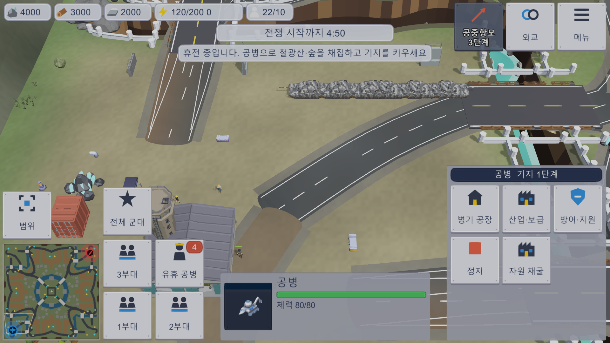 | 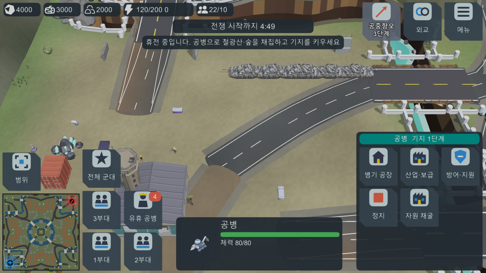 |
| 16:9 사령부 생산 | 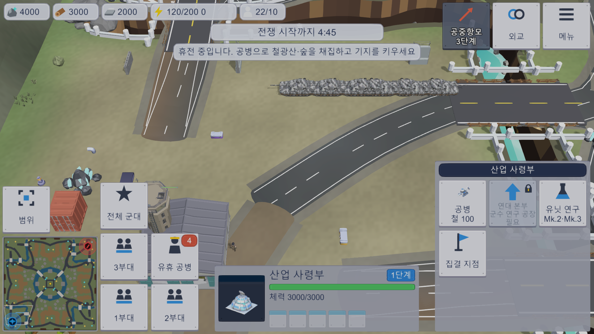 | 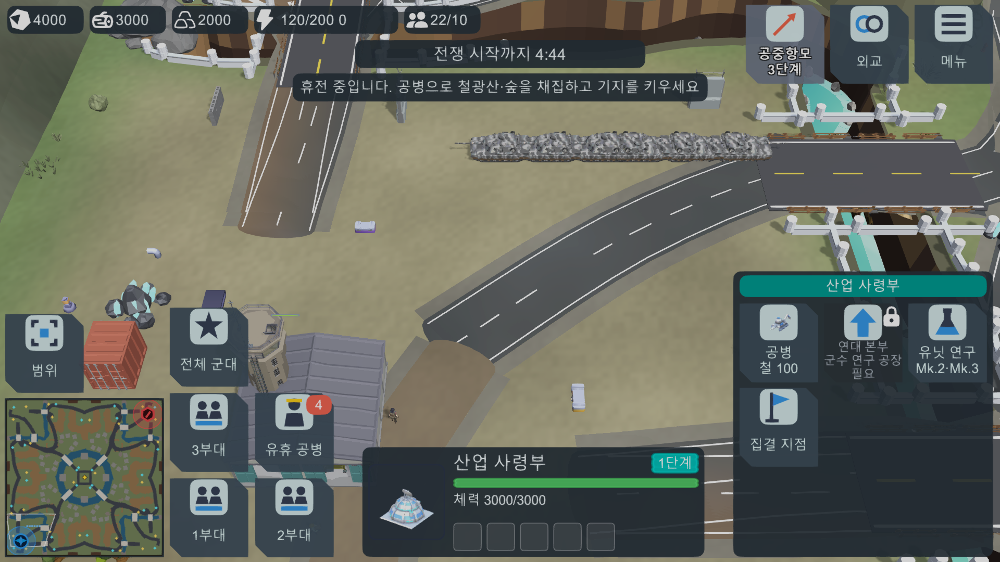 |
| 19.5:9 전차 6기 | 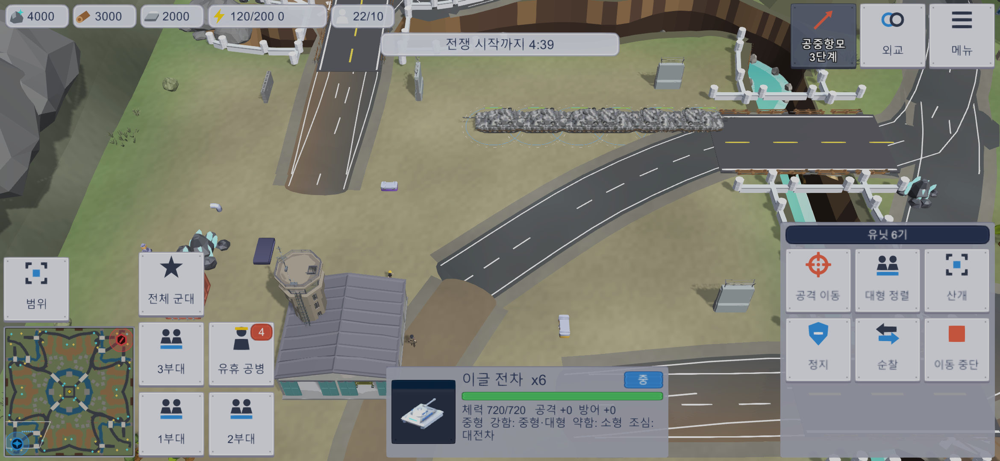 | 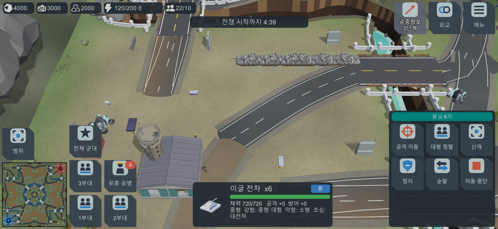 |
| 20:9 사령부 생산 | 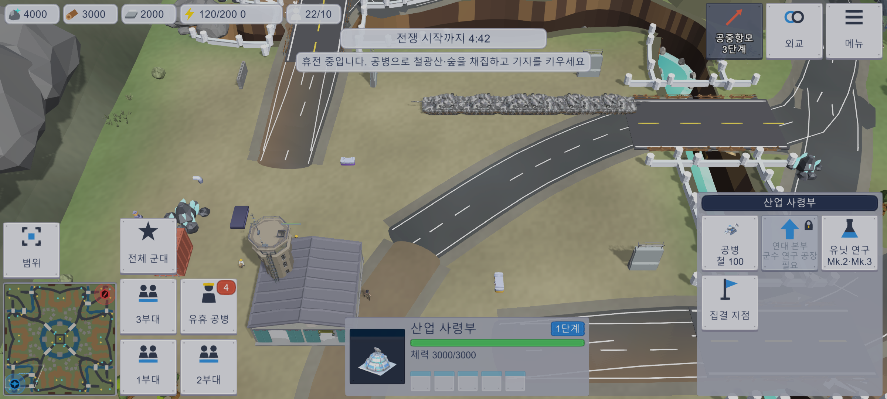 | 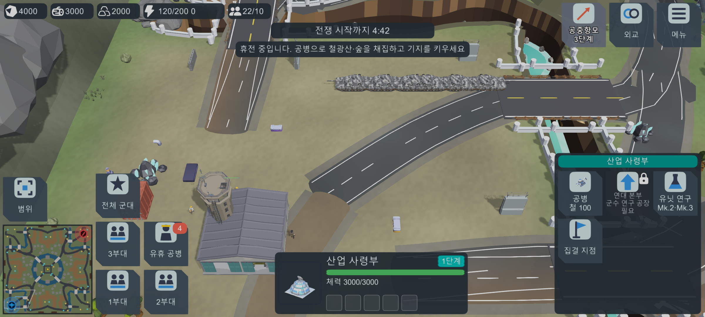 |

전체 9장씩은 `DevelopmentReports/Screenshots/StrategyUiKit/{before,after}/`에 있다(공병·사령부·전차 × 16:9·19.5:9·20:9).

## 창(모달) 정리 (2026-11-22)

- 외교·일시정지·설정 창에 도크트린 창과 같은 Cyan 제목줄(`Ui.Header`)을 붙였다.
- 창이 열리면 뒤를 어둡게 하고 같은 부모의 맨 앞으로 올린다(`Ui.Modal`). 그 전에는 휴전 띠가 일시정지 창 위에 그려지고 창 너머로 전장과 HUD 글자가 비쳤다. 어두운 뒤판은 입력을 막지 않아 기존 조작 흐름은 같다.
- 설정 창 배치 오류 수정: 줄 간격 90px에 154px 버튼을 놓아 버튼끼리 겹쳐 있었다. 3열 격자, 줄 간격 170px로 다시 배치했다.
- 선택 카드 아이콘 테두리·탑승 칸·툴팁에 남아 있던 예전 남색 고정값을 테마 색으로 바꿨다.
- Photon 개발용 프레임 표시(`QuantumStats`)가 상단 자원 막대의 철 수치를 가려서, 설정의 "성능 표시"를 켠 개발 빌드에서만 보이게 했다.

| 창 | 변경 후 |
| --- | --- |
| 16:9 사령부 유닛 연구 | 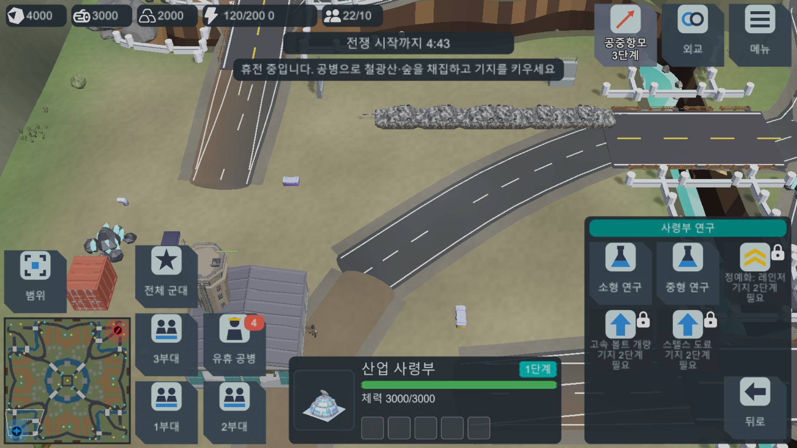 |
| 16:9 외교·쪽지 | 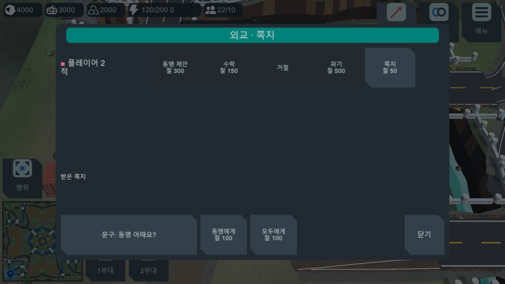 |
| 19.5:9 일시정지 | 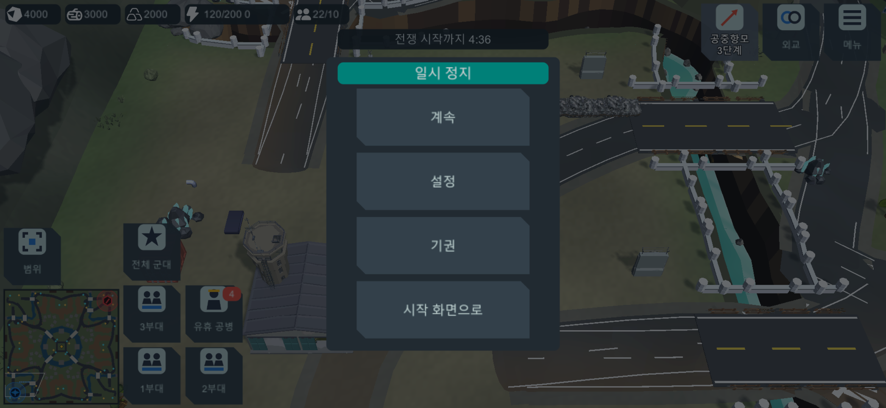 |
| 20:9 설정 | 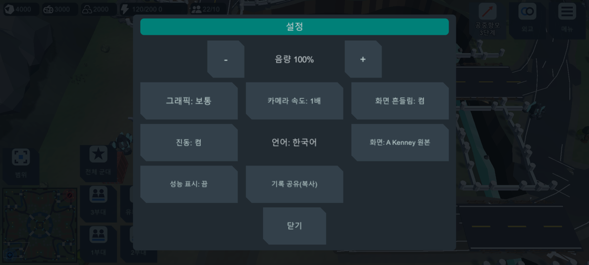 |

창 캡처까지 합친 21장(7개 장면 × 3비율)은 `DevelopmentReports/Screenshots/StrategyUiKit/after/`에 있다.

## 검증 (Unity 에디터 PlayMode, GPU)

| 항목 | 결과 | 근거 |
| --- | --- | --- |
| HUD 렌더링·3비율 캡처 | PASS | `UiKit_CaptureHudAtLandscapeAspects` |
| 버튼 최소 크기·글자 맞춤·패널 겹침·영역 겹침(전 해상도) | PASS | `Hud_ButtonsMeetMinimumSizeAtEveryAspect`, `Ui_TextFitsAllButtons`, `Ui_PanelsDoNotOverlap`, `Ui_ZonesDoNotOverlapAtAllResolutions`, `Ui_TouchTargetsAtLeast*` |
| 탭 선택·이동·적 탭 공격·박스·더블 탭·부대 | PASS | `Input_*` 4건 |
| 드래그·핀치·길게 누르기·UI 위 입력 무시 | PASS | `Gesture_*` 7건 |
| 공병 건설 메뉴·잠김 사유·비용 | PASS | `Hud_EngineerPanelShowsLockAndCost`, `Hud_IndustryMenuPlacesHeadquartersWithoutPaging`, `Build_PanelFitsAllFactionBuildings` |
| 공장 생산·프리셋·업그레이드 | PASS | `Hud_BuildingPanelProducesAndEditsPreset`, `Ui_CaptureFactoryUpgrades` |
| 자원 막대 | PASS | `Hud_TopBarShowsAllResources`, `Hud_ShowsResourceIconsAndPanelIcons` |
| 궁극 버튼·준비·목표·취소 | PASS | `Ui_UltimateSlotLocksPreparesAndTargets`, `Ultimate_PlayerCancelRefundsPartAndCooldownAllowsRearm` |
| 경고·쪽지·일시정지·설정·메뉴 | PASS | `Hud_RejectionBecomesAlert`, `Hud_ReceivedNoteShowsAndStaysInInbox`, `Pause_*`, `Settings_*`, `Menu_*` |
| 미니맵 | PASS | `Minimap_*`, `CaptureMinimap_TerritoryAndExpansion`(앞마당 부지 이동 후) |
| 연구 메뉴·외교·일시정지·설정 창 열기·닫기·캡처 | PASS | `UiKit_CaptureHudAtLandscapeAspects`(화면 버튼 경로로 연다) |
| 튜토리얼 1~2단계 | PASS(시험 수정) | `Tutorial_StartsFromMenuAndStepsAdvance`: 봉쇄 맵 시작 위치가 경계 쪽이라 +x 카메라 이동이 막혔다. 맵 가운데 쪽으로 끌도록 고쳤다 |
| UI 관련 묶음 69건 | 68 PASS / 1 FAIL | 실패 1건은 기존 `AiDiplomacy_BreaksAfterCommonEnemyFalls` |
| 인구 한도 대기열 | FAIL(기존 기준선 실패) | `Produce_PopulationLimitCountsQueue` |
| Android 실기기 | NOT TESTED(사용자 지시로 보류) | — |

## 남은 일

- 창은 제목줄·뒤판까지 맞췄지만 키트 문양(Sheet 3)·프로필 프레임(Sheet 2)을 쓴 전용 장식은 아직 없다.
- 키트 아이콘(Sheet 4)은 자원·자물쇠에만 썼다. 명령 아이콘은 기존 아이콘을 받침판 위에 둔다.
- 한국어를 지원하는 OFL 글꼴(Pretendard·Noto Sans KR)을 넣으면 `UiCatalog.Font`에 연결할 수 있다.
