# Factory Wars — Mobile RTS Dashboard

> **기준 일자:** **2026-11-19**
> **대상 플랫폼:** Android Mobile RTS (Touch-Only UI, Photon Quantum 3 결정론 `FP` 시뮬레이션 — 금지어 **0건**)
> **Git 저장소 루트:** `Game/` (`origin/main` → `https://github.com/5Bok2Daddy/factory-wars.git`)
> **스크린샷 정책:** 구버전·중복 캡처 전면 삭제 완료 — 최신 맵 5종 + 최신 핵심 현황 5종 + 유닛 쇼케이스 37종만 유지 (**총 47장**, 깨진 링크 **0건**)

---

## 1. 현재 진행 현황 (2026-11-19 기준)

| 구분 | 항목 | 상태 | 실제 검증·구현 현황 |
| --- | --- | --- | --- |
| **코어/멀티** | TASK-24~34 (해군·테크·엄폐·안개·저격·항공작전·온라인) | **완료** | 결정론 금지어 **0건**, 실서버 2클라이언트 체크섬 일치 확인 |
| **맵 & NavMesh** | 전장 맵 5종 (`Map4P`·`Desert`·`Urban`·`Archipelago`·`Strait`) | **완료** | 5종 씬 도로 이격(`3.8m`) 적용 및 NavMesh 재베이킹 완료 (`map_*.png`) |
| **전투 깊이** | 베테랑 9킬 상한(`3/6/9`) · 신규 공격 유닛 4종 · 미사일/항모 요격 | **완료** | 대전차 로켓병 · 화염 돌격병 · 다연장 로켓차 · 기동 대공차 + 패트리어트 요격 포대 적용 |
| **궁극 전력** | 전략 미사일 격납고 & 스톰네스트 공중 항모 고위험·고보상 튜닝 | **완료** | 항모 고도 상향(`Y+6m`)+지상 그림자+오라 링(`53`), 미사일 중앙 화염구/충격파/경보(`54`) 시각 검증 |
| **전장 흔적** | 60~90초 그을음 링-버퍼(120 풀) · 영구 크레이터 · 붕괴 잔해 | **완료** | 2차선 도로 침범 0건 강제 배제 및 파쇄 콘크리트/철근 잔해 교체(`57`) 시각 검증 |
| **스케일·비주얼** | 보병 `0.8x` · 차량/전차 `1.0x~1.1x` · 공장 `1.25x` & 소총 밀착 | **완료** | Kubold 손바닥 소총 밀착, 공병 카빈 지급, 포격함 PBR 킷배시, 반경 인지 비겹침 대형 적용 (`current_scale_overview.png`) |
| **산업 공장** | 8대 산업 공장 체계 (`병기 공장` 4 + `산업·보급` 4) | **완료** | 공장 증축(`Lv.1~3`), `12m` 발광 시너지 파이프라인(`+15%`), 과부하(`+50%`), 보급창 버프 & 연쇄 폭발 (`current_factory_complex.png`) |
| **AI 밸런스** | 2P/4P AI 대전 검증 & 무철 동맹 교착 해소 | **검증 진행 중** | v2 배치 **타임아웃 0/10건** 확인(`2P 평균 17.73분`, `4P 평균 15.33분`); 중간값 유닛 보정 반영 완료 — v3 10판 최종 재검증 예정 |
| **자동화 테스트** | 전체 PlayMode 스위트 & 수송 탑승 시스템 | **재검증 대기** | 직전 실행 `78/88` 통과 → 10건 원인 수정 + 수송 탑승(`APC`·`상륙정`·`수송헬기`) 코드 반영, Unity 재빌드·PlayMode 재실행 대기 |

---

## 2. 8대 산업 공장 체계 (`병기 공장` 4종 + `산업·보급` 4종)

| 탭 | 공장명 (ID) | 역할 및 생산·효과 |
| --- | --- | --- |
| **병기 공장** | **보병 무장 공장** (`barracks`) | 레인저/민병대, 공병/지원, 대전차 로켓병, 화염 돌격병, 저격수 생산 |
| **병기 공장** | **기동·화력 조립 공장** (`vehicle_factory`) | 정찰 버기/바이크, 주력 전차, 다연장 로켓차, 기동 대공차, 수송 장갑차(APC) 생산 |
| **병기 공장** | **중기갑 전차 공장** (`heavy_works`) | 방벽 중전차, 요새 전차, 만리 다연장포 생산 (오버헤드 갠트리 크레인) |
| **병기 공장** | **항공·드론 조립 격납고** (`airfield` / `carrier_yard`) | 공격헬기, 폭격기, 작전기 출격 및 공중 항모 조립 |
| **산업·보급** | **강철 제련소** (`processor`) | 철 → 강철 제련 + `12m` 이내 인접 공장 생산 속도 **`+15%`** (주황 시너지 파이프라인) |
| **산업·보급** | **터빈 발전소** (`power_plant`) | 전력 발전·저장 + `12m` 이내 인접 공장 **`+15%`** (시안 시너지 파이프라인); 저전력 시 공장 `-35%` |
| **산업·보급** | **군수·연료 보급창** (`supply_depot`) | 인구 한도 확장 + 전역 버프(차량 속도 `+10%`, 포병 재장전 `+12%`, 출격 쿨타임 `-15%`), 파괴 시 연쇄 대폭발 |
| **산업·보급** | **군수 연구 공장** (`research_lab`) | 병과 공/방 업그레이드, 진영 특화 연구, 궁극 전력 연구 (회전 레이더) |

- **공장 증축 (`Lv.1 → Lv.2 +25% → Lv.3 +50%`):** 증축 시 굴뚝·배관·갠트리 크레인이 실시간 3D 확장됩니다.
- **비상 과부하 (`Overdrive`):** 20초간 생산 속도 **`+50%`**, 전력 소비 2배, 초당 소량 과열 피해(검은 연기 + 적색 점멸).

---

## 3. 최신 핵심 현황 스크린샷 (5장)

### 8대 산업 공장 복합 단지 (`Lv.2/3` 증축 · 시너지 파이프라인 · 과부하 · 보급창)

### 보병(`0.8x`) · 전차(`1.0x~1.1x`) · 산업 공장(`1.25x`) 통합 스케일 비교

### 스톰네스트 공중 항모 (상승 호버 고도 · 지상 그림자 · 회전 전술 오라 링 · 고대비 UI)

### 전략 미사일 착탄 (중앙 화염구 · 3D 충격파 링 · 영구 크레이터 · 전술 레드 경보)
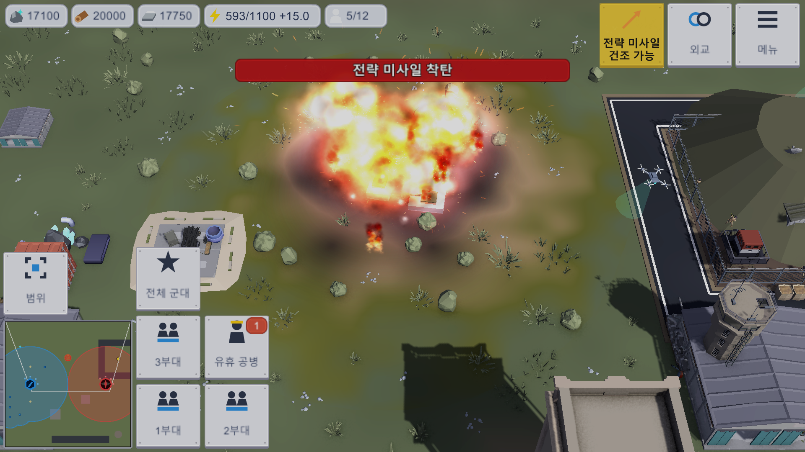

### 영구 전장 흔적 (그을음 데칼 · 파쇄 콘크리트/철근 잔해 · 2차선 도로 침범 0건)
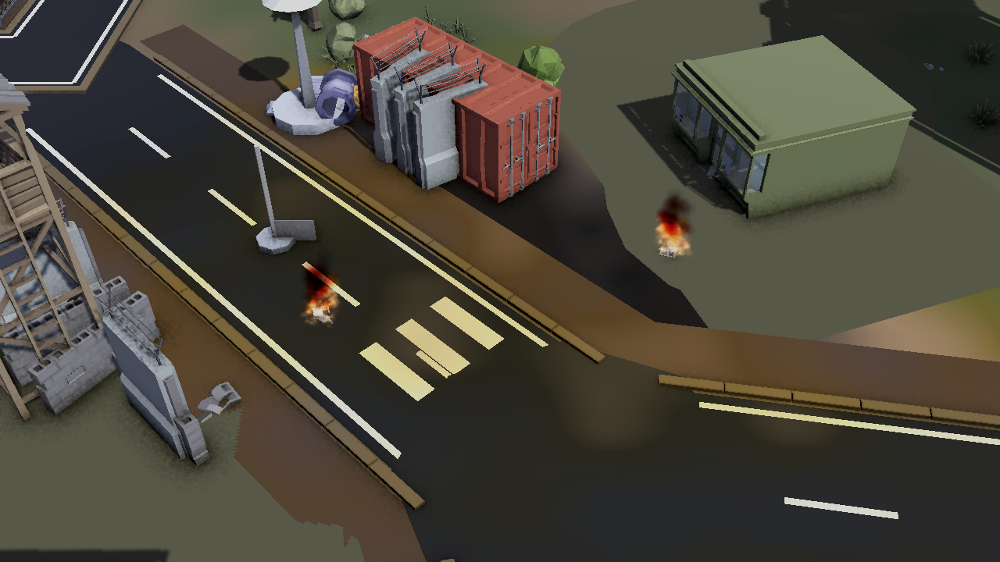

---

## 4. 전장 맵 5종 프리셋 (표준 · 사막 · 시가지 · 다도해 · 해협)

| 표준 4인전 (`Map4P`) | 사막 보급전 (`MapDesert`) |
| :---: | :---: |
|  |  |

| 시가지 시가전 (`MapUrban`) | 다도해 상륙전 (`MapArchipelago`) |
| :---: | :---: |
|  |  |

| 해협 도하전 (`MapStrait`) |
| :---: |
|  |

---

## 5. 전 진영 유닛 & 궁극 전력 비주얼 카탈로그 (37종)

### 자유 연방 (Free Federation — 19종)

| 공병 (`ff_engineer`) | 레인저 (`ff_ranger_squad`) | 스카이가드 (`ff_skyguard_squad`) | 대전차 로켓병 (`ff_at_rocket`) |
| :---: | :---: | :---: | :---: |
|  |  |  |  |

| 화염 돌격병 (`ff_breacher`) | 정밀 저격수 (`ff_sniper`) | 정찰 버기 (`ff_scout_buggy`) | 이글 전차 (`ff_eagle_tank`) |
| :---: | :---: | :---: | :---: |
|  | 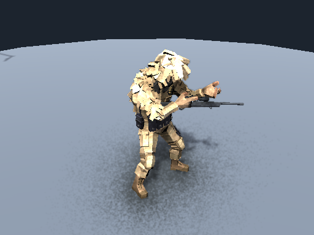 |  |  |

| 야전 정비·수송차 (`ff_field_support`) | 다연장 로켓차 (`ff_mlrs_artillery`) | 기동 대공차 (`ff_mobile_sam`) | 호크 공격헬기 (`ff_hawk_gunship`) |
| :---: | :---: | :---: | :---: |
|  | 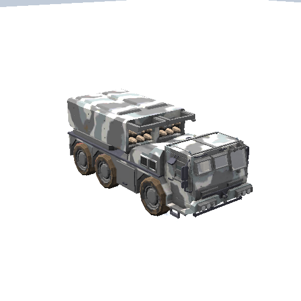 |  | 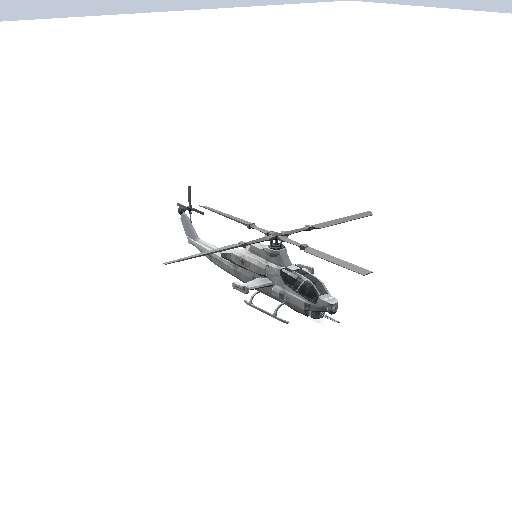 |

| 스카이포트리스 폭격기 (`ff_skyfortress_bomber`) | 방벽 중전차 (`ff_bulwark_tank`) | 정찰선 (`ff_scout_boat`) | 포격함 (`ff_artillery_ship`) |
| :---: | :---: | :---: | :---: |
|  |  | 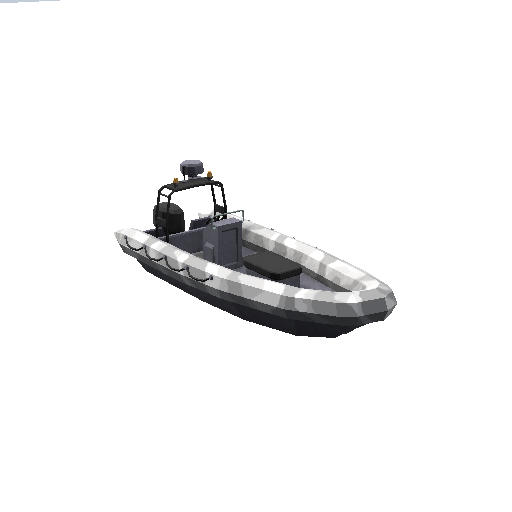 |  |

| 스톰네스트 공중 항모 (`ff_stormnest_carrier`) | 둥지 드론 (`ff_nest_drone`) | 패트리어트 요격 포대 (`ff_patriot_turret`) |
| :---: | :---: | :---: |
| 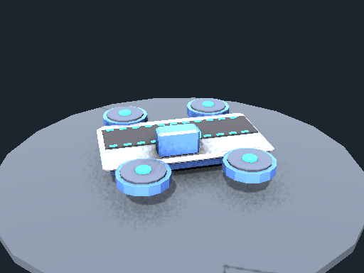 |  | 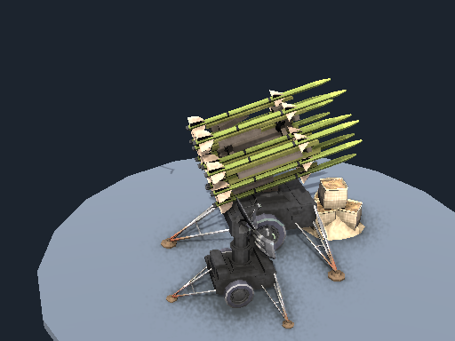 |

### 대륙 연방 (Continental Federation — 18종)

| 공병 (`cf_engineer`) | 민병대 (`cf_militia`) | 화염방사병 (`cf_flame_squad`) | 대전차 로켓병 (`cf_at_rocket`) |
| :---: | :---: | :---: | :---: |
|  | 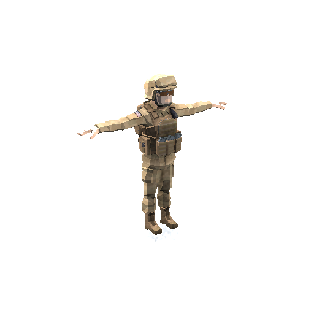 | 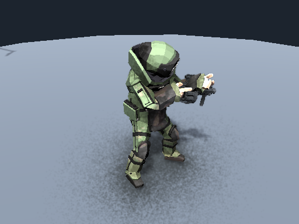 |  |

| 중화염 돌격병 (`cf_breacher`) | 매복 사수 (`cf_sniper`) | 척후 오토바이 (`cf_scout_bike`) | 용린 전차 (`cf_dragonscale_tank`) |
| :---: | :---: | :---: | :---: |
|  |  |  |  |

| 천둥 대공차 (`cf_thunder_aa`) | 화력지원 로켓차 (`cf_rocket_artillery`) | 기동 대공미사일차 (`cf_mobile_sam`) | 돌풍 공격헬기 (`cf_gale_gunship`) |
| :---: | :---: | :---: | :---: |
| 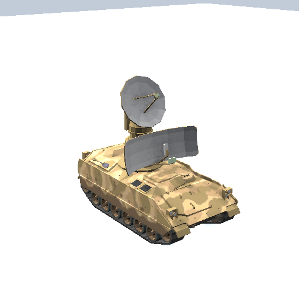 |  |  | 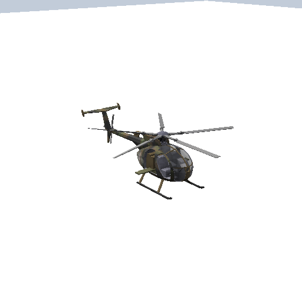 |

| 만리 다연장포 (`cf_longwall_mlrs`) | 요새 전차 (`cf_fortress_tank`) | 정찰선 (`cf_scout_boat`) | 포격함 (`cf_artillery_ship`) |
| :---: | :---: | :---: | :---: |
|  |  | 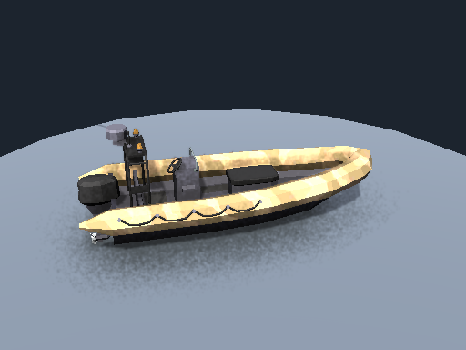 |  |

| 전략 미사일 격납고 (`cf_missile_silo`) | 패트리어트 요격 포대 (`cf_patriot_turret`) |
| :---: | :---: |
| 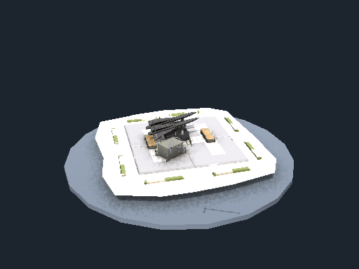 |  |
