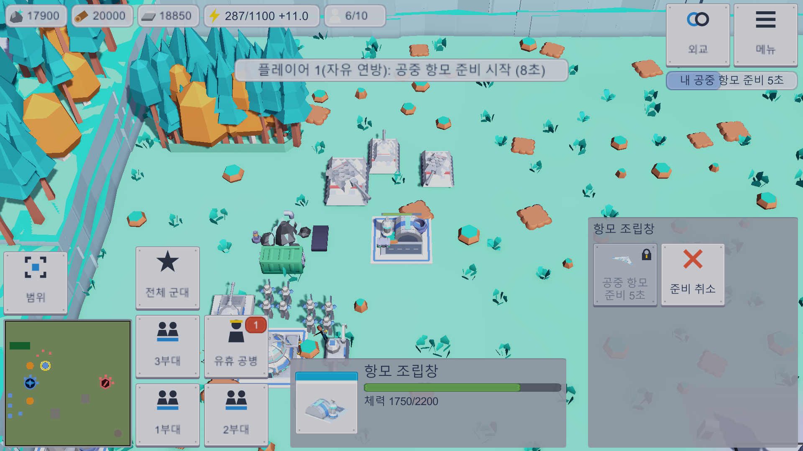
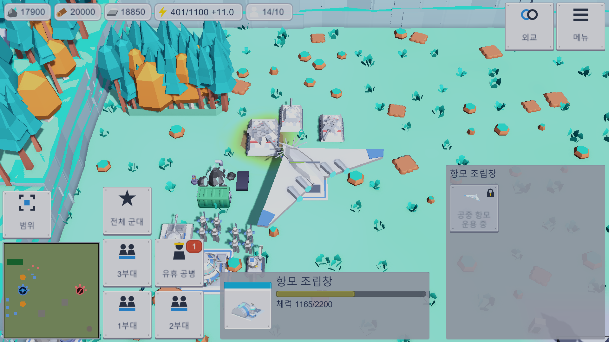
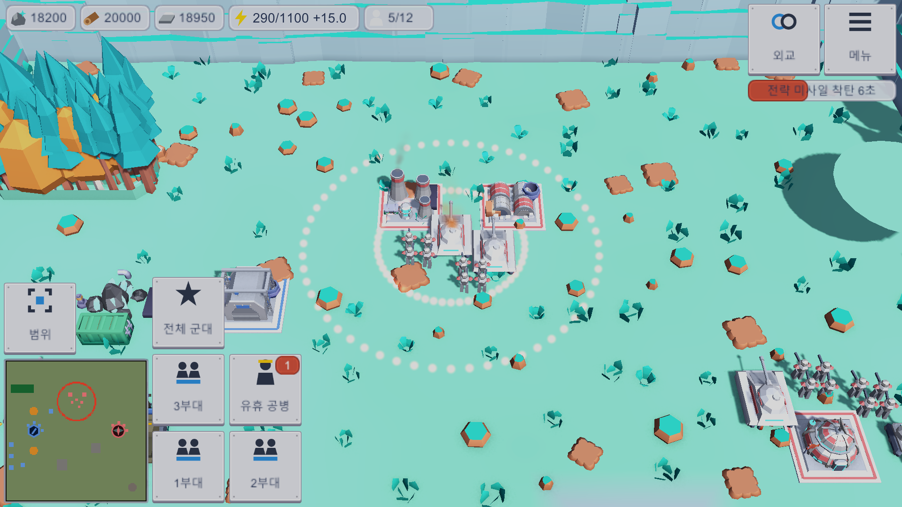
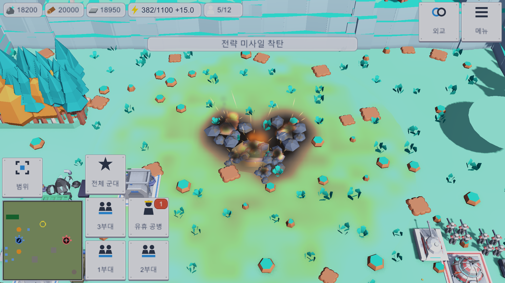
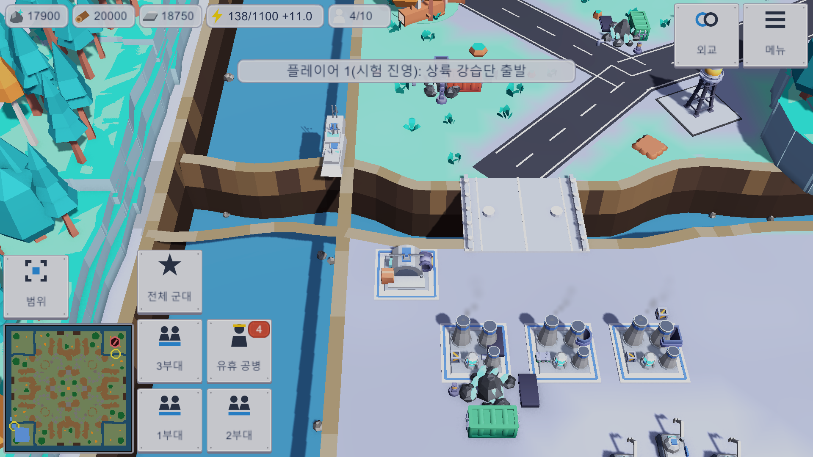
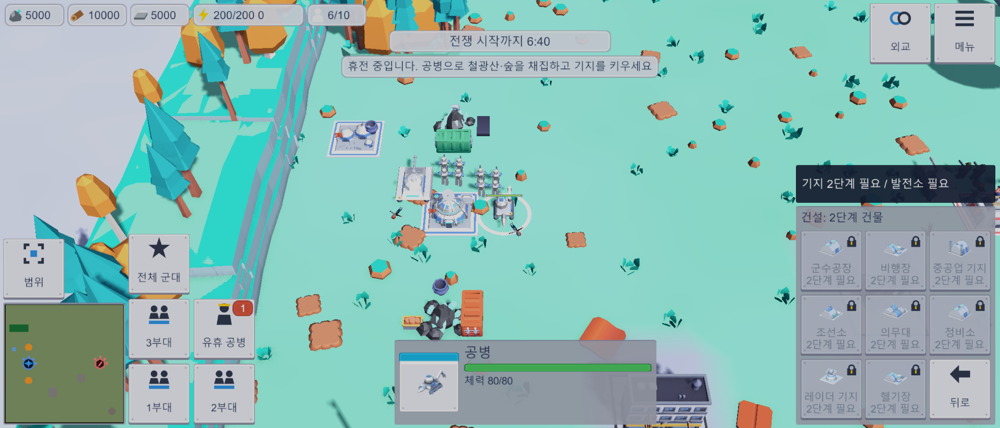

# Factory Wars — 모바일 진행 현황 대시보드

> **현재 완료된 마지막 TASK:** **TASK-33** (진영 궁극 전력 · 벙커 수용 · 4인 쏠림 원인 규명)
> **다음 진행 예정:** Synty 에셋 들여오기(`temp-assets/Synty/`) → **TASK-34** (전장의 안개 · 저격수 · 항공 작전) → **TASK-35** (맵 풀 5종)
> **기준 시각:** 2026-11-14 (최신 커밋 `f6d8df2` 기준)

---

## 1. 최근 Git 커밋 10개 요약

| 커밋 | 날짜 | 내용 |
| --- | --- | --- |
| `f6d8df2` | 2026-11-14 | `[claude-fable]` 33-8: 재개 기준 메모 (에셋 들여오기 시작 전에 멈춤) |
| `5bdb4ea` | 2026-11-14 | `[claude-fable]` 33-7: 항목 33 결과 보고서·대기열 완료 표시, 확인 측정(t3b), APK 55.7MB (`FW3-f75c4d685804`) |
| `a3a5c88` | 2026-11-14 | `[claude-fable]` 33-6: 미사일 착탄 반경 고리 유지 표시, 항모 임시 모델 배율, 성능·안정성·캡처 측정 |
| `ab23c92` | 2026-11-14 | `[claude-fable]` 33-5: 3차 측정 기록, 본진 철광산 5500→4000 되돌림, 성능 시험 보통 품질 |
| `95f36cb` | 2026-11-13 | `[claude-fable]` 33-4: 3차 조정 — AI 선행 건물 순서 버그 수정, 궁극 연구·전용 건물 동시, 민병대 사거리 6.5 |
| `cba49cb` | 2026-11-13 | `[claude-fable]` 33-3: 2차 조정 — AI 유리할 때만 선공, 궁극 전력 모으기, 민병대 간격 복구 |
| `6c37d57` | 2026-11-13 | `[claude-fable]` 33-2: 4인 쏠림 원인 측정(가설 a~e·들판 교전) 및 1차 데이터 조정 |
| `f97e36b` | 2026-11-13 | `[claude-fable]` 33-1: 진영 궁극 전력(항모·전략 미사일·상륙 강습), 벙커 수용, AI·HUD |
| `ecac1db` | 2026-11-12 | `[claude]` 32-6: 항목 32 결과 보고서·대기열 완료 표시, APK 55.6MB (`FW3-5c7741a36f9c`) |
| `a82491a` | 2026-11-12 | `[claude]` 32-5: AI 재측정(2인·4인 각 2회), 용린 전차 비용 조정, 항목 32 화면 캡처 시험 |

---

## 2. TASK-24 ~ 35 세부 진행 현황

| TASK | 주제 | 상태 | 세부 현황 및 막힌 이슈 |
| --- | --- | --- | --- |
| **TASK-24** | 해군 시스템 (수로·조선소·함선) | **완료** | 외곽 수로·수상 NavMesh·7분 수문 개방·정찰선/포격함·수상 보급품 완료 (`34ebc67`) |
| **TASK-25** | Gemini 작업 이어받기 | **완료** | 19D 마무리 및 대기열(`29 → 24 → 27 → 26 → 22 → 23 → 28`) 인계 완료 |
| **TASK-26** | Kenney 팝 스타일 UI | **완료** | 둥근 밝은 패널·진한 글자, 9mm 터치 규격, 6×2 건설 패널 (`34ebc67`, `49075c9`) |
| **TASK-27** | 그래픽 2차 (Kenney 분위기·파괴) | **완료** | K-0~K-4 파스텔 장난감 디오라마 룩 및 전투 누적 파괴 완료 (`5e5d329`) |
| **TASK-28** | 온라인 대전 (방 코드·봇 대체) | **완료** | 6자리 방 코드 대기실, 이탈 시 봇 대체·재접속 복귀 (`f8fb564`) |
| **TASK-29** | Kenney 완성도 패스 | **완료** | 빛/노출 고정(화이트픽셀 0.02%), 9mm 터치 결함 0건 (`49075c9`) |
| **TASK-30** | 게임 완성도 · 에셋 교체 구조 · 실서버 | **완료** | `ViewCatalog`/`UiCatalog` 교체 구조, 실서버 2클라이언트 검증, APK `FW3-3fcb27df6c6c` (`6810f48`) |
| **TASK-31** | 테크 단계 · 연구소 · HUD 개편 | **완료** | 1~3단계 테크, 연구소 업그레이드, 유닛 6종 추가, HUD 4구역·3×3 명령 카드 (`56448ab`) |
| **TASK-32** | 보병 엄폐 · 건물 7종 · 에셋/애니메이션 | **부분 완료 / 막힌 이슈** | **완료:** 보병 엄폐(`CoverSystem`), 새 건물 7종, 차량/항공 기울기 (`ecac1db`) **막힌 이슈:** `Kubold 소총 애니메이션`·`GUI Pro` 패키지 없음 (`temp-assets/Synty/`에는 Synty zip 4종 존재 → 33 이후 들여오기 예정) |
| **TASK-33** | 진영 궁극 전력 · 벙커 수용 · 밸런스 | **완료 (목표 일부 미달)** | **완료:** 공중 항모·전략 미사일·상륙 강습단 3종, 벙커 4분대 수용, 지정 시험 11개·실서버 체크섬 8877회 일치(디싱크 0), APK `FW3-f75c4d685804` (`5bdb4ea`) **미달 이슈:** 4인 자유 연방 승률 91%(목표 40~60%), 평균 경기 시간 25.9~27.3분(목표 초과) — 유닛 상성+본진 철 고갈 원인 규명 완료 |
| **TASK-34** | 전장의 안개 · 저격수 · 항공 작전 | **대기** | `OVERNIGHT-QUEUE.md` 20:55 이후 순서 2번 (에셋 들여오기 직후 진행 예정) |
| **TASK-35** | 맵 풀 5종 · 고밀도 시가전 배치 | **대기** | `OVERNIGHT-QUEUE.md` 20:55 이후 순서 3번 (TASK-34 완료 후 진행 예정) |

---

## 3. `SETUP-REPORT.md` & `OVERNIGHT-QUEUE.md` 핵심 결과 요약

- **궁극 전력 3종 및 결정론 검증 (TASK-33):**
  - 자유 연방 **공중 항모("스톰네스트")**, 대륙 연방 **전략 미사일**, 차기 진영 예약 **상륙 강습단** 구현 완료.
  - 실제 Photon 서버 2클라이언트 온라인 테스트에서 **체크섬 8,877회 일치 · 디싱크 0건** (전체 세션 10,623회 일치).
  - PlayMode 전체 **427개 중 331개 통과 · 0 실패** (96개는 AI 배치/캡처/성능 등 별도 실행 시험), 시뮬레이션 금지어 **0건**.
  - 최신 빌드: `Builds/FactoryWars-dev.apk` (**55.7MB**, 버전 `FW3-f75c4d685804`).
- **AI 밸런스 및 경기 시간 측정 (t3b 최종, 보통 AI 20판씩):**
  - **2인전:** 자유 연방 승률 62%, 평균 25.9분, 시간 초과 7/20, 궁극 사용률 80% (첫 사용 평균 20.9분).
  - **4인전:** 자유 연방 승률 91%, 평균 27.3분, 시간 초과 9/20, 궁극 사용률 85% (첫 사용 평균 21.2분).
  - **규명된 원인:** (1) 동일 자원 교전에서도 자유 연방 유닛 상성이 우세, (2) 4인전은 10분경 본진 철 고갈 후 첫 교전 승자만 앞마당 확장 가능.
- **다음 재개 지점 (`OVERNIGHT-QUEUE.md`):**
  1. `temp-assets/Synty/` zip 4종(`POLYGON_Military_PACK`, `POLYGON_City_PACK`, `Battle Royale Pack`, `ANIMATION_Base_Locomotion`) 확인 및 `Docs/ASSET-SWAP.md` 절차대로 들여오기
  2. `NEXT-TASK-34-FOG-SNIPER-SORTIE.md` 진행
  3. `NEXT-TASK-35-FIVE-MAPS.md` 진행

---

## 4. 최신 화면 캡처 (`Docs/status_images/`)

### 24 해군 완료 (2026-11-14 01:23)

### 33 궁극 전력 — 항모 준비 중 (2026-11-14 01:05)

### 33 궁극 전력 — 항모 출격 및 드론 발진 (2026-11-14 01:05)

### 33 궁극 전력 — 전략 미사일 착탄 경고 (2026-11-14 01:05)

### 33 궁극 전력 — 전략 미사일 착탄 폭발 (2026-11-14 01:05)

### 33 궁극 전력 — 상륙 강습단 출발 (2026-11-14 01:05)

### 33 궁극 전력 — 상륙 강습단 해안 하선 (2026-11-14 01:05)

### 31 HUD 개편 — 21:9 잠금 상태 (2026-11-13 15:02)

