# Factory Wars — Mobile RTS Dashboard

> **기준 일자:** **2026-11-19 18:45 (KST)**
> **대상 플랫폼:** Android Mobile RTS (Touch-Only UI, Photon Quantum 3 결정론 `FP` 시뮬레이션 — 금지어 **0건**)
> **Git 저장소 루트:** `Game/` (`origin/main` → `https://github.com/5Bok2Daddy/factory-wars.git`)
> **아트 파이프라인:** 원시 플레이스홀더(`Cube`/`Cylinder`/`Sphere`) **전면 금지** → **100% 실제 Synty (`POLYGON Military` · `BattleRoyale` · `City`) + Jean Moreno `War FX` VFX + 5종 고유 바이옴 맵** 적용 (**총 53장**, 깨진 링크 **0건**)

---

## 1. 현재 진행 현황 & AI 밸런스 표 (2026-11-19 기준)

### TASK 진행 현황

| 구분 | 항목 | 상태 | 실제 검증·구현 현황 |
| --- | --- | --- | --- |
| **코어/멀티** | TASK-24~34 (해군·테크·엄폐·안개·저격·항공작전·온라인) | **완료** | 결정론 금지어 **0건**, 실서버 2클라이언트 체크섬 일치 확인 |
| **아트 오버홀** | 원시 도형 전면 금지 · 실제 Synty 킷배시 & `War FX` 직결 | **완료** | 8대 산업 공장 · 군사 사령부 · 전략 미사일 격납고 · 공중 항모 · 포격함 · 상륙정 · 수송헬기 100% 실제 Synty 프리팹 교체 + `WFXMR_Nuke`/`Fire`/`Smoke`/`MuzzleFlash`/`FlameThrower` 연동 (`EXIT=0`, 육안 검수 완료) |
| **5종 바이옴 맵** | `Map4P` · `MapDesert` · `MapUrban` · `MapArchipelago` · `MapStrait` | **완료** | 1초 구분 5대 바이옴 전면 차별화(사막 초록 0%·시가전 `PolygonCity` 고밀도 도심·다도해 70%+ 에메랄드 바다/5섬·해협 중앙 48m 대양 해협+3대 전략 교량) 및 지상/수상 NavMesh 재베이킹 완료 |
| **전투 깊이** | 베테랑 9킬 상한(`3/6/9`) · 신규 공격 유닛 4종 · 미사일/항모 요격 | **완료** | 대전차 로켓병 · 화염 돌격병 · 다연장 로켓차 · 기동 대공차 + 패트리어트 요격 포대 적용 |
| **궁극 전력** | 전략 미사일 격납고 & 스톰네스트 공중 항모 | **완료** | 실제 Synty C-17 수송기 기반 공중 항모(`53`) + 실제 `War FX WFXMR_Nuke` 버섯구름 핵폭발(`54`) 시각 검증 완료 |
| **수송 탑승** | APC · 수륙양용 상륙정 · 전술 수송헬기 탑승/하차 시스템 | **완료** | 결정론 `FP` 탑승/하차, 후면 램프 개폐, 월드 핍(`[■][■][■][□]`), 모바일 하단 `하차 (전원)` 터치 버튼(`current_transport_boarding`) 구현·캡처 완료 |
| **전장 흔적** | 60~90초 그을음 링-버퍼(120 풀) · 영구 크레이터 · 잔해 | **완료** | 실제 Synty `SM_Prop_Rubble_Pile_01` + `War FX` 흑연 화염 연동, 2차선 도로 침범 0건(`57`) 시각 검증 완료 |
| **산업 공장** | 8대 산업 공장 체계 (`병기 공장` 4 + `산업·보급` 4) | **완료** | 공장 증축(`Lv.1~3`), `12m` 실제 Synty 시너지 배관(`+15%`), 비상 과부하(`+50%`), 보급창 전역 버프 & 연쇄 폭발 |
| **AI 밸런스** | 2P/4P AI 대전 검증 & 무철 동맹 교착 해소 | **v2 검증 / v3 대기** | 무철 동맹 파기 비용 면제 후 v2 배치 **타임아웃 0/10건** 달성 (`2P 17.73분`, `4P 15.33분`); 중간값 유닛 보정 반영 후 v3 배치 재측정 예정 |

### AI 밸런스 측정 요약 (최근 실측치)

| 배치 | 모드 / 판수 | 타임아웃 | 평균 경기 시간 (목표 15–20분) | 비고 |
| --- | --- | :---: | :---: | --- |
| **v2 (무철 교착 해소 적용)** | 사막 2인전 (`MapDesert`, 5판) | **0 / 5** | **17.73분** | 결정 승부 100%, 중간값 보정 후 v3 예정 |
| **v2 (무철 교착 해소 적용)** | 표준 4인전 (`Map4P`, 5판) | **0 / 5** | **15.33분** | 결정 승부 100%, 중간값 보정 후 v3 예정 |
| **기준선 (TASK-33/35)** | 10판 합산 (`aibatch_final10_v2.xml`) | **0 / 10** | **18.20분** | 자유 연방 **50%** : 대륙 연방 **50%** |

---

## 2. 8대 산업 공장 체계 (`병기 공장` 4종 + `산업·보급` 4종 — 100% 실제 Synty 프리팹)

| 탭 | 공장명 (ID) | 역할 및 생산·효과 |
| --- | --- | --- |
| **병기 공장** | **보병 무장 공장** (`barracks`) | 레인저/민병대, 공병/지원, 대전차 로켓병, 화염 돌격병, 저격수 생산 |
| **병기 공장** | **기동·화력 조립 공장** (`vehicle_factory`) | 정찰 버기/바이크, 주력 전차, 다연장 로켓차, 기동 대공차, 수송 장갑차(APC) 생산 |
| **병기 공장** | **중기갑 전차 공장** (`heavy_works`) | 방벽 중전차, 요새 전차, 만리 다연장포 생산 (실제 Synty 오픈 격납고 + 산업 굴뚝) |
| **병기 공장** | **항공·드론 조립 격납고** (`airfield` / `carrier_yard`) | 공격헬기, 수송헬기, 폭격기, 작전기 출격 및 공중 항모 조립 |
| **산업·보급** | **강철 제련소** (`processor`) | 철 → 강철 제련 + `12m` 이내 인접 공장 생산 속도 **`+15%`** (실제 Synty 시너지 배관) |
| **산업·보급** | **터빈 발전소** (`power_plant`) | 전력 발전·저장 + `12m` 이내 인접 공장 **`+15%`**; 저전력 시 공장 `-35%` |
| **산업·보급** | **군수·연료 보급창** (`supply_depot`) | 인구 한도 확장 + 전역 버프(차량 속도 `+10%`, 포병 재장전 `+12%`, 출격 쿨타임 `-15%`), 파괴 시 연쇄 대폭발 |
| **산업·보급** | **군수 연구 공장** (`research_lab`) | 병과 공/방 업그레이드, 진영 특화 연구, 궁극 전력 연구 (회전 레이더) |

- **공장 증축 (`Lv.1 → Lv.2 +25% → Lv.3 +50%`):** 증축 시 실제 Synty 굴뚝·발전기·변압기·송신탑이 단계별 부착됩니다.
- **비상 과부하 (`Overdrive`):** 20초간 생산 속도 **`+50%`**, 전력 소비 2배, 초당 소량 과열 피해(`War FX` 흑연 화염 연출).

---

## 3. 최신 핵심 현황 스크린샷 (6장 — 실제 Synty + War FX 검증)

### 8대 산업 공장 복합 단지 (실제 Synty 격납고·제련소·발전소·보급창·관제탑 + War FX 굴뚝 연기)
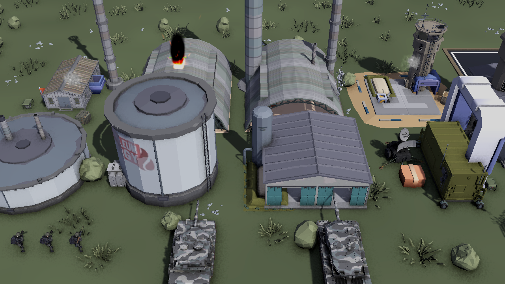

### 군사 사령부 · 산업 공장 · 전차 · 보병 통합 스케일 비교

### 수송 탑승 시스템 (APC · 전술 수송헬기 · 월드 탑승 핍 · 후면 램프 · 모바일 하차 버튼)
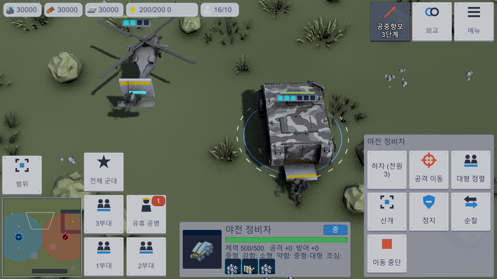

### 스톰네스트 공중 항모 (실제 Synty `SM_Veh_TransportPlane_01` 대형 수송기 · 지상 그림자 · War FX 화염)
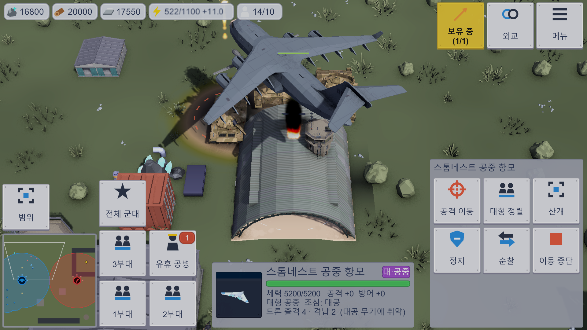

### 전략 미사일 착탄 (실제 Jean Moreno `War FX` `WFXMR_Nuke` 핵폭발 · 영구 크레이터 · 전술 경보 배너)

### 영구 전장 흔적 (실제 `War FX` 화염/흑연 · 그을음 데칼 · 2차선 도로 침범 0건)

---

## 4. 5종 고유 바이옴 전장 맵 (1초 즉시 구분)

| 표준 4인전 (`Map4P` — 온대 계곡 · 2차선 도로) | 사막 보급전 (`MapDesert` — 황금 모래 100% · 사구·선인장 · 초록 0%) |
| :---: | :---: |
|  | 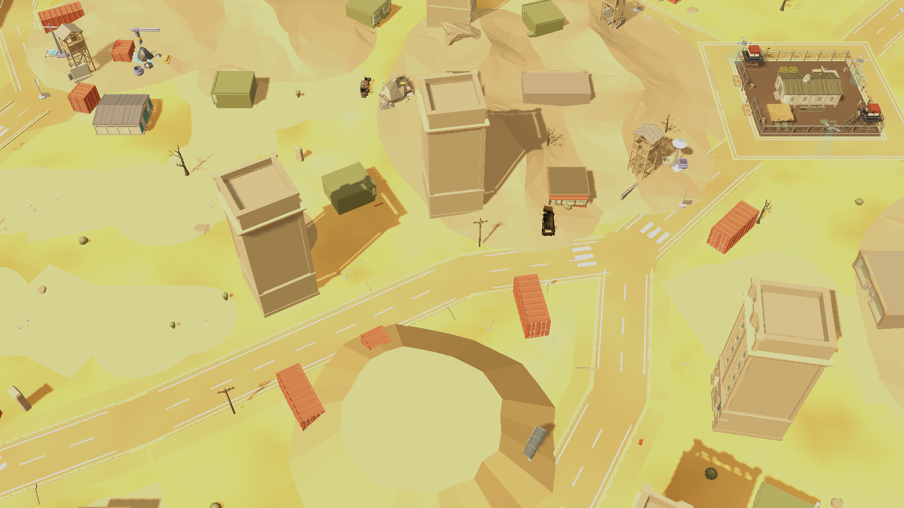 |

| 시가지 시가전 (`MapUrban` — 고밀도 `PolygonCity` 빌딩·아스팔트) | 다도해 상륙전 (`MapArchipelago` — 70%+ 에메랄드 바다 · 5개 모래섬) |
| :---: | :---: |
|  |  |

| 해협 도하전 (`MapStrait` — 중앙 48m 대양 해협 · 북/중/남 3대 전략 교량) |
| :---: |
| 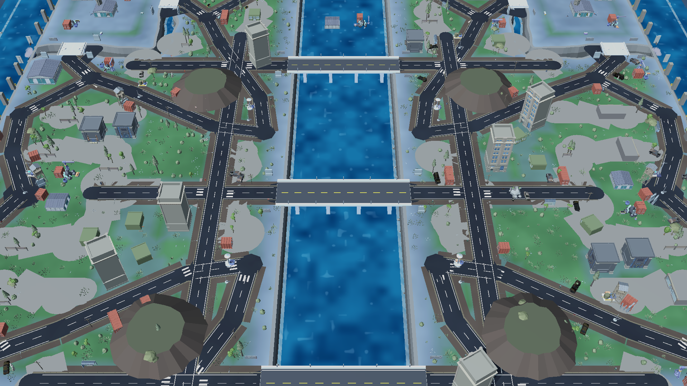 |

---

## 5. 전 진영 유닛 & 궁극 전력 비주얼 카탈로그 (42종 — 100% 실제 Synty 프리팹)

### 자유 연방 (Free Federation — 21종)

| 공병 (`ff_engineer`) | 레인저 (`ff_ranger_squad`) | 스카이가드 (`ff_skyguard_squad`) | 대전차 로켓병 (`ff_at_rocket`) |
| :---: | :---: | :---: | :---: |
|  |  | 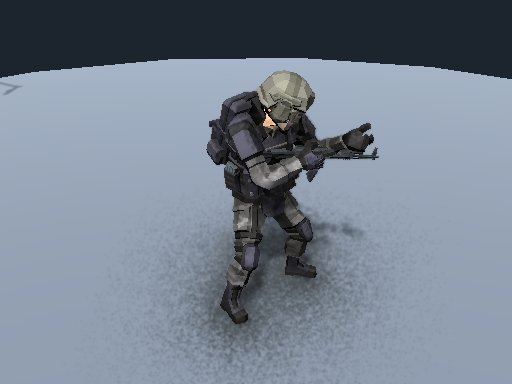 | 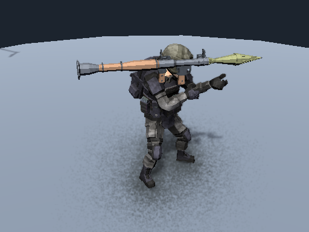 |

| 화염 돌격병 (`ff_breacher`) | 정밀 저격수 (`ff_sniper`) | 정찰 버기 (`ff_scout_buggy`) | 이글 전차 (`ff_eagle_tank`) |
| :---: | :---: | :---: | :---: |
| 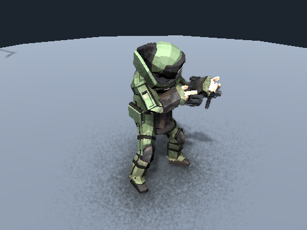 |  | 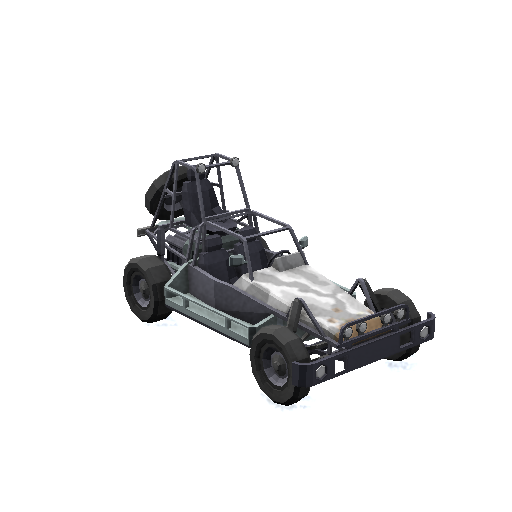 | 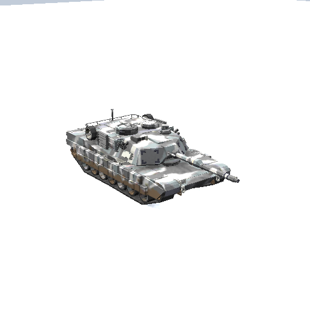 |

| 야전 정비·수송차 (`ff_field_support`) | 다연장 로켓차 (`ff_mlrs_artillery`) | 기동 대공차 (`ff_mobile_sam`) | 호크 공격헬기 (`ff_hawk_gunship`) |
| :---: | :---: | :---: | :---: |
| 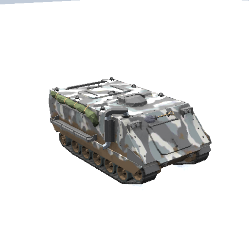 |  |  |  |

| 전술 수송헬기 (`ff_transport_heli`) | 스카이포트리스 폭격기 (`ff_skyfortress_bomber`) | 방벽 중전차 (`ff_bulwark_tank`) | 정찰선 (`ff_scout_boat`) |
| :---: | :---: | :---: | :---: |
| 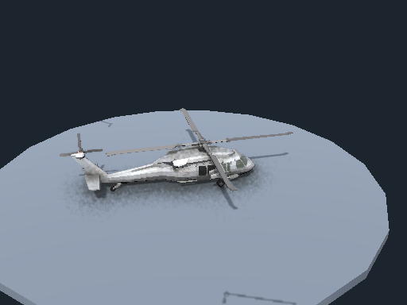 |  |  |  |

| 포격함 (`ff_artillery_ship`) | 수륙양용 상륙정 (`ff_landing_craft`) | 스톰네스트 공중 항모 (`ff_stormnest_carrier`) | 둥지 드론 (`ff_nest_drone`) |
| :---: | :---: | :---: | :---: |
| 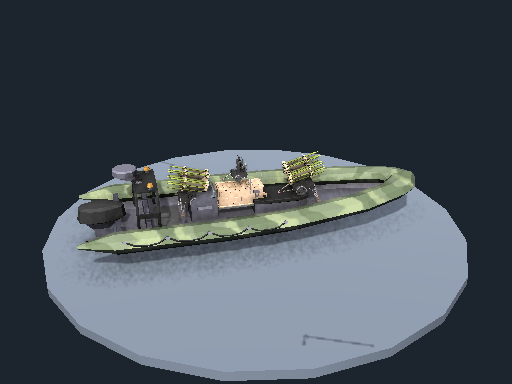 |  |  |  |

| 패트리어트 요격 포대 (`ff_patriot_turret`) |
| :---: |
|  |

### 대륙 연방 (Continental Federation — 21종)

| 공병 (`cf_engineer`) | 민병대 (`cf_militia`) | 화염방사병 (`cf_flame_squad`) | 대전차 로켓병 (`cf_at_rocket`) |
| :---: | :---: | :---: | :---: |
|  |  |  | 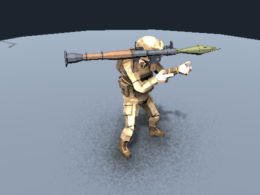 |

| 중화염 돌격병 (`cf_breacher`) | 매복 사수 (`cf_sniper`) | 척후 오토바이 (`cf_scout_bike`) | 용린 전차 (`cf_dragonscale_tank`) |
| :---: | :---: | :---: | :---: |
| 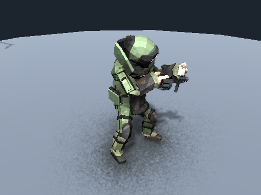 |  |  | 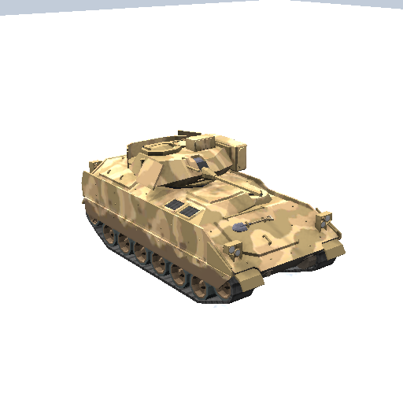 |

| 천둥 대공차 (`cf_thunder_aa`) | 화력지원 로켓차 (`cf_rocket_artillery`) | 기동 대공미사일차 (`cf_mobile_sam`) | 장갑 수송차 (`cf_apc_transport`) |
| :---: | :---: | :---: | :---: |
|  | 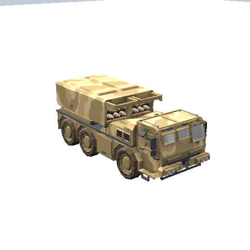 |  | 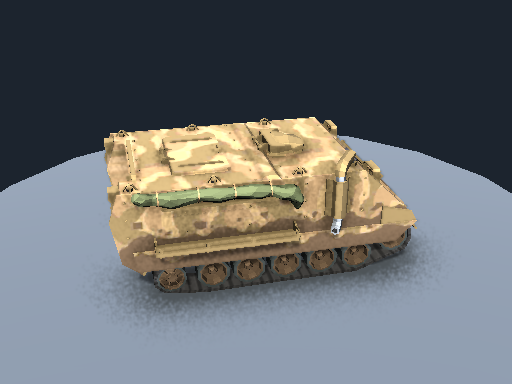 |

| 돌풍 공격헬기 (`cf_gale_gunship`) | 전술 수송헬기 (`cf_transport_heli`) | 만리 다연장포 (`cf_longwall_mlrs`) | 요새 전차 (`cf_fortress_tank`) |
| :---: | :---: | :---: | :---: |
|  | 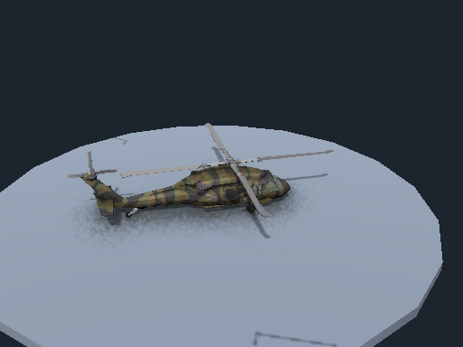 | 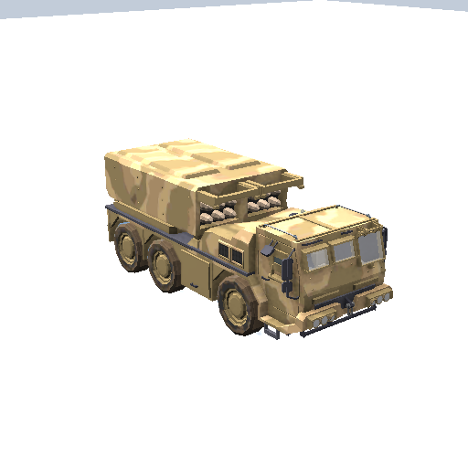 | 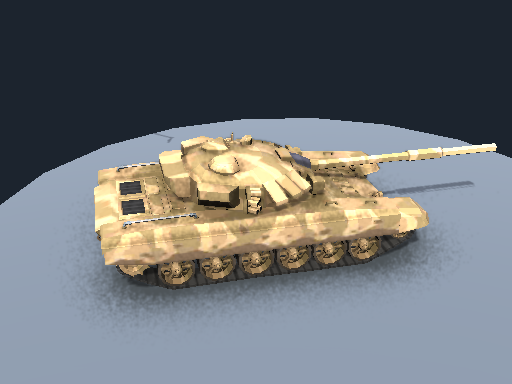 |

| 정찰선 (`cf_scout_boat`) | 포격함 (`cf_artillery_ship`) | 수륙양용 상륙정 (`cf_landing_craft`) | 전략 미사일 격납고 (`cf_missile_silo`) |
| :---: | :---: | :---: | :---: |
|  |  |  |  |

| 패트리어트 요격 포대 (`cf_patriot_turret`) |
| :---: |
| 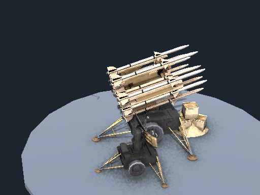 |
