# Factory Wars — Mobile RTS Dashboard

> **기준 일자:** **2026-11-20 23:57 (KST)**
> **대상 플랫폼:** Android Mobile RTS (Touch-Only UI, Photon Quantum 3 결정론 `FP` 시뮬레이션 — 금지어 **0건**)
> **Git 저장소 루트:** `Game/` (`origin/main` → `https://github.com/5Bok2Daddy/factory-wars.git`)
> **아트 파이프라인:** Synty POLYGON 및 War FX에 Desert World, Roadside Tales와 NatureForge 맵 에셋을 선별 적용.

---

### 구매 환경 번들 · 2026-11-20 KST

| 적용 에셋 | 프리팹 | 적용 위치 |
| --- | ---: | --- |
| Desert World – Stylized Environment | 3 | MapDesert의 모래 표면 노멀, 암석군, 바위 능선 |
| Roadside Tales Backroad Bridges | 3 | Map4P·MapStrait·MapArchipelago의 상판 하부, 교각, 난간 및 진입부 정렬 |
| NatureForge Woodland의 Unity판 | 3 | Map4P 목재 노드의 나무와 벌목 그루터기 |
| NatureForge LITE Meadow & Farm | 2 | Map4P 목재 노드 가장자리의 덤불·바위 |

32개 EGG 볼륨에서 100개 파일을 스테이징에 풀고 위 프리팹 11개 및 의존성 26개를 로컬 프로젝트로 가져왔다. Cartoon City, 던전, 중세·바이킹, 묘지·PolyVania, 늪, 주방·식당, 80/90년대 인테리어, 픽셀 지하철, 주민 캐릭터, Harboria는 스테이징에 보관한다. Synty 군수·산업 건물은 기존 연결을 사용한다.

Unity 6000.0.85f2에서 지상·수상 NavMesh 5맵 재베이크 및 GPU PlayMode 5/5 통과. 사막·숲 프리팹의 회전된 도로 경계와 교량 난간의 실제 메쉬 경계를 검사했다. 자체 시뮬레이션의 결정론 금지 표현 0건. 전체 PlayMode 실행 중.

[사막](Docs/status_images/map_desert.png) · [해협](Docs/status_images/map_strait.png) · [표준](Docs/status_images/map_standard.png) · [제재소와 목재 이송](Docs/status_images/current_resource_extraction.png) · [다도해](Docs/status_images/map_archipelago.png) · [시가지](Docs/status_images/map_urban.png)

다른 로컬 작업 환경에서는 구매 번들을 `temp-asset/new bundle/_extracted`에 풀고 `py Tools/import_new_bundle.py`를 실행한 뒤 Unity의 **Tools → Factory Wars → Assets → Prepare New Bundle**을 실행한다. 번들 원본과 로컬 변형 에셋은 기존 구매 팩과 같이 Git에서 제외된다.
### 공병 자동 배치와 작업자 순환 근무 · 2026-11-20 KST

철광산과 제재소 완공 공병이 자동 배치되고, 정원 내 추가 진입과 퇴거를 지원한다. 장식 작업자는 적재·하역과 사령부 주변의 휴식·복귀를 반복한다. Unity GPU·Photon 실서버 집중 검사 16/16 통과. 채굴 시나리오의 확정 프레임 체크섬 590개 일치. 전체 PlayMode는 546건 중 398 통과, 25 실패, 123 건너뜀이다.

[전체 맵](Docs/status_images/recovery/after/full-standard-map.png) · [작업자](Docs/status_images/recovery/after/headquarters-workers.png) · [공병 시공](Docs/status_images/recovery/after/engineer-construction.png) · [공병 진입](Docs/status_images/recovery/after/engineer-entry.png) · [철광산](Docs/status_images/recovery/after/staffed-iron-extractor.png) · [제재소](Docs/status_images/recovery/after/staffed-lumber-mill.png) · [경기 HUD](Docs/status_images/recovery/after/factory-hud.png)

### 복구 검증 · 2026-11-20 KST

Unity GPU PlayMode 13/13 통과. 자원 시설 건설·배치·생산, 기지 작업자, RTS 카메라와 공장 HUD를 재검증했다. [복구 보고서](Docs/FactoryWars_Status.md) · [기지 작업자](Docs/status_images/recovery/before/headquarters-workers.png) · [가동 철광산](Docs/status_images/recovery/before/staffed-iron-extractor.png)

### 무료 시가지 에셋 · 2026-11-20 KST

| 상태 | 작업 | 확인 결과 |
| --- | --- | --- |
| 검증 완료 | 시가지 카페와 아스팔트 | 기존 저층 부지 4곳에 카페를 표시한다. 차선과 보도는 기존 색을 유지하고, 아스팔트 굴곡은 보통·높음에서 표시한다. |
| 검증 완료 | Unity GPU PlayMode | **7/7 통과**. 카페 부지 경계, 도로 재질과 품질 전환, 기본 5개 맵, 바리케이드와 전차 음향을 확인했다. |
| 검증 대기 | 출시 전 검증 | Android 프레임·음량, 온라인 동기화, 전체 회귀, 최종 맵 목록 확인이 남았다. |

[카페 근접 화면](Docs/status_images/free-assets/urban-cafe.png) · [시가지 도로](Docs/status_images/free-assets/urban-roads.png)

### 전장 사운드와 에셋 점검 · 2026-11-20 KST

| 상태 | 작업 | 확인 결과 |
| --- | --- | --- |
| 로컬 적용 | 전장 효과음 9개 | 기관총·저격·로켓·미사일 경보·제트기와 전차·헬기·항공기·전투 배경을 연결했다. 화면 위치로 방향과 크기를 조정하고, 엔진의 반복음은 움직임과 가시성에 맞춰 서서히 섞는다. |
| 검증 완료 | Unity GPU PlayMode 13/13 | 음원 읽기, 화면 밖 감쇠, 단발 재생 간격, 전차 이동과 정차의 페이드를 확인했다. 출격, 저격, 전략 미사일과 기존 효과 검사도 통과했다. |
| 검증 대기 | 배포와 Android | 원본 MP3와 로컬 WAV는 Git 제외 경로에 있다. 음원 일부의 배포 조건과 Android 청취를 확인해야 한다. |

[사막·해안 계획을 반영한 에셋 검토](Docs/ASSET-SHOPPING.md) · [오디오 인계](Docs/ai/HANDOVER.md)

### 조명·표면과 모바일 HUD · 2026-11-20 KST

| 상태 | 작업 | 확인 결과 |
| --- | --- | --- |
| 검증 완료 | 조명과 표면 | 접촉 그림자와 명암 대비를 줄였다. 보통·높음에서 바닥 굴곡과 수면 반사를 표시하고, 높음에서는 FXAA로 차선과 물체 가장자리를 정리했다. 기본 맵 5개를 Unity GPU로 확인했다. |
| 검증 완료 | 화면 표시 결함 | 대형 항공기 선택 링, 건설 용접 효과를 수정했다. 출격과 승객 하차 버튼은 모바일 기준 크기로 키웠고 방어·지원 메뉴의 복귀 버튼을 확인했다. |
| 검증 완료 | Unity 6000.0.85f2 GPU PlayMode | 집중 검사 **22/22 통과**. 직전 전체 검사에서 실패했던 34개 중 10개 항목의 동작을 다시 확인했다. 현재 건설 단계와 보병 애니메이션도 검증했다. |
| 검증 대기 | 전체 회귀와 실기기 | 직전 실패 목록 중 24개는 후속 확인 대상이다. 최신 전체 회귀, Android 프레임 시간, 온라인 경기도 남아 있다. |

[시가지 개선 전](Docs/status_images/facilities/map-urban.png) · [시가지 개선 후](Docs/status_images/soft-look/map-urban.png) · [표준 맵](Docs/status_images/soft-look/map-standard.png) · [다도해](Docs/status_images/soft-look/map-archipelago.png) · [환경 에셋 후보](Docs/ASSET-SHOPPING.md)

### 로컬 개발 현황 · 2026-11-20 KST

| 상태 | 작업 | 확인 결과 |
| --- | --- | --- |
| 검증 완료 | 맵 배치 겹침 교정 | 길가 소품, 점령지, 광산, 사막·시가지·항만 배경 프리팹을 실제 방향과 폭으로 검사한다. 교량 접속로와 언덕 가장자리의 도로 메시도 정리했다. |
| 검증 완료 | 함선 건조와 진수 | 조선소 대기열에 맞춰 수상 지지대 위에서 선체가 커지고 용접 효과가 나온다. 완성된 함선은 같은 수면에서 운하 방향으로 진수한다. |
| 검증 완료 | 비행장과 헬기장 2단계 시공 | 본체 뒤에 같은 공병이 인접 활주로·착륙장을 포장한다. 부속 시설 완공 뒤 생산이 열린다. |
| 검증 완료 | 바리케이드 붕괴 | 전술 바리케이드는 체력을 다 잃으면 무너지고 길이 열린다. 길가·점령지의 장식 방벽도 주변 범위 폭발 때 쓰러진다. |
| 검증 완료 | Unity GPU PlayMode | 관련 검사 **21/21 통과**. 기본 5개 맵을 직접 로드해 배치와 화면을 확인했다. |
| 기존 실패 재현 | 전체 PlayMode 회귀 | 542건 중 387건 통과, 34건 실패, 121건 건너뜀. 기준선 대비 신규 실패 0건. 기존 실패가 남아 GitHub 반영은 보류한다. Android 실기기와 온라인 경기 확인은 남아 있다. |

[조선 중](Docs/status_images/facilities/shipbuilding.png) · [진수 후](Docs/status_images/facilities/ship-launched.png) · [활주로 시공](Docs/status_images/facilities/runway-building.png) · [활주로 완료](Docs/status_images/facilities/runway-finished.png) · [착륙장 완료](Docs/status_images/facilities/landing-pad.png)

[도로변 배치](Docs/status_images/facilities/roadside.png) · [바리케이드 붕괴](Docs/status_images/facilities/barrier-collapse.png) · [표준](Docs/status_images/facilities/map-standard.png) · [사막](Docs/status_images/facilities/map-desert.png) · [시가전](Docs/status_images/facilities/map-urban.png) · [다도해](Docs/status_images/facilities/map-archipelago.png) · [해협](Docs/status_images/facilities/map-strait.png)

### 앞서 적용한 컨베이어와 공장 증축

| 상태 | 작업 | 확인 결과 |
| --- | --- | --- |
| 검증 완료 | 채굴 시설과 사령부 컨베이어 | 완공한 제재소·철 채굴 공장이 가장 가까운 같은 소유자의 사령부에 연결된다. 가동 중 벨트가 목재·철광석을 옮기며, 작업자가 빠지면 마지막 화물이 도착한 뒤 벨트가 멈춘다. |
| 검증 완료 | 공장 증축 외형과 전투 HUD | Lv.2 측면 정비동, Lv.3 산업 굴뚝을 추가했다. 공장 관리에서 단계, 자원별 증축 비용, 생산 효과와 과부하를 확인할 수 있다. 도크린 카드의 아이콘·이름·효과를 나누고 배경 HUD를 어둡게 했다. |
| 검증 완료 | Unity PlayMode 및 PC 프레임 표본 | 관련 검사 **13/13 통과**. 공병 도구 **47/48**, 철광석 화물 **30/30**, 원거리 작업자 **36/36** 프레임에서 위치 변화. 60fps 제한 표본의 최대 프레임 간격 **16.9ms**. |
| 검증 대기 | 실기기와 전체 회귀 | Android 실기기와 온라인 경기 검증이 남았다. 기존 전체 회귀 실패 38건이 포함된 작업 트리는 로컬에서 검토 중이다. |

[공병 건설](Docs/status_images/extraction/construction.png) · [사령부 컨베이어](Docs/status_images/extraction/headquarters-delivery.png) · 공장 [Lv.1](Docs/status_images/factory/level-1.png) / [Lv.2](Docs/status_images/factory/level-2.png) / [Lv.3](Docs/status_images/factory/level-3.png) · [공장 관리](Docs/status_images/factory/management-hud.png) · [도크린 선택](Docs/status_images/factory/doctrine.png)

[AI 인계 기록](Docs/ai/HANDOVER.md) · [UI 에셋 후보](Docs/ASSET-SHOPPING.md)

## 1. 현재 진행 현황 & AI 밸런스 표 (2026-11-19 기준)

### TASK 진행 현황

| 구분 | 항목 | 상태 | 실제 검증·구현 현황 |
| --- | --- | --- | --- |
| **코어/멀티** | TASK-24~34 (해군·테크·엄폐·안개·저격·항공작전·온라인) | **완료** | 결정론 금지어 **0건**, 실서버 2클라이언트 체크섬 일치 확인 |
| **아트 오버홀** | 원시 도형 전면 금지 · 실제 Synty 킷배시 & `War FX` 직결 | **완료** | 8대 산업 공장 · 군사 사령부 · 전략 미사일 격납고 · 공중 항모 · 포격함 · 상륙정 · 수송헬기 100% 실제 Synty 프리팹 교체 + `WFXMR_Nuke`/`Fire`/`Smoke`/`MuzzleFlash`/`FlameThrower` 연동 (`EXIT=0`, 육안 검수 완료) |
| **5종 바이옴 맵** | `Map4P` · `MapDesert` · `MapUrban` · `MapArchipelago` · `MapStrait` | **완료** | 1초 구분 5대 바이옴 전면 차별화(사막 초록 0%·시가전 `PolygonCity` 고밀도 도심·다도해 70%+ 에메랄드 바다/5섬·해협 중앙 48m 대양 해협+3대 전략 교량) 및 지상/수상 NavMesh 재베이킹 완료 |
| **전투 깊이** | 베테랑 9킬 상한(`3/6/9`) · 신규 공격 유닛 4종 · 미사일/항모 요격 | **완료** | 대전차 로켓병 · 화염 돌격병 · 다연장 로켓차 · 기동 대공차 + 패트리어트 요격 포대 적용 |
| **궁극 전력** | 전략 미사일 격납고 & 스톰네스트 공중 항모 | **완료** | 실제 Synty C-17 수송기 기반 공중 항모(`53`) + 실제 `War FX WFXMR_Nuke` 버섯구름 핵폭발(`54`) 시각 검증 완료 |
| **수송 탑승** | APC · 수륙양용 상륙정 · 전술 수송헬기 탑승/하차 시스템 | **완료** | 결정론 `FP` 탑승/하차, 후면 램프 개폐, 월드 핍(`[■][■][■][□]`), 모바일 하단 `하차 (전원)` 터치 버튼(`current_transport_boarding`) 구현·캡처 완료 |
| **전장 흔적** | 60~90초 그을음 링-버퍼(120 풀) · 영구 크레이터 · 잔해 | **완료** | 실제 Synty `SM_Prop_Rubble_Pile_01` + `War FX` 흑연 화염 연동, 2차선 도로 침범 0건(`57`) 시각 검증 완료 |
| **산업 공장** | 8대 산업 공장 체계 (`병기 공장` 4 + `산업·보급` 4) | **완료** | 공장 증축(`Lv.1~3`), `12m` 실제 Synty 시너지 배관(`+15%`), 비상 과부하(`+50%`), 보급창 전역 버프 & 연쇄 폭발 |
| **AI 밸런스** | 2P/4P AI 대전 검증 & 무철 동맹 교착 해소 | **v2 검증 / v3 대기** | 무철 동맹 파기 비용 면제 후 v2 배치 **타임아웃 0/10건** 달성 (`2P 17.73분`, `4P 15.33분`); 중간값 유닛 보정 반영 후 v3 배치 재측정 예정 |

### AI 밸런스 측정 요약 (최근 실측치)

| 배치 | 모드 / 판수 | 타임아웃 | 평균 경기 시간 (목표 15–20분) | 비고 |
| --- | --- | :---: | :---: | --- |
| **v2 (무철 교착 해소 적용)** | 사막 2인전 (`MapDesert`, 5판) | **0 / 5** | **17.73분** | 결정 승부 100%, 중간값 보정 후 v3 예정 |
| **v2 (무철 교착 해소 적용)** | 표준 4인전 (`Map4P`, 5판) | **0 / 5** | **15.33분** | 결정 승부 100%, 중간값 보정 후 v3 예정 |
| **기준선 (TASK-33/35)** | 10판 합산 (`aibatch_final10_v2.xml`) | **0 / 10** | **18.20분** | 자유 연방 **50%** : 대륙 연방 **50%** |

---

## 2. 8대 산업 공장 체계 (`병기 공장` 4종 + `산업·보급` 4종 — 100% 실제 Synty 프리팹)

| 탭 | 공장명 (ID) | 역할 및 생산·효과 |
| --- | --- | --- |
| **병기 공장** | **보병 무장 공장** (`barracks`) | 레인저/민병대, 공병/지원, 대전차 로켓병, 화염 돌격병, 저격수 생산 |
| **병기 공장** | **기동·화력 조립 공장** (`vehicle_factory`) | 정찰 버기/바이크, 주력 전차, 다연장 로켓차, 기동 대공차, 수송 장갑차(APC) 생산 |
| **병기 공장** | **중기갑 전차 공장** (`heavy_works`) | 방벽 중전차, 요새 전차, 만리 다연장포 생산 (실제 Synty 오픈 격납고 + 산업 굴뚝) |
| **병기 공장** | **항공·드론 조립 격납고** (`airfield` / `carrier_yard`) | 공격헬기, 수송헬기, 폭격기, 작전기 출격 및 공중 항모 조립 |
| **산업·보급** | **강철 제련소** (`processor`) | 철 → 강철 제련 + `12m` 이내 인접 공장 생산 속도 **`+15%`** (실제 Synty 시너지 배관) |
| **산업·보급** | **터빈 발전소** (`power_plant`) | 전력 발전·저장 + `12m` 이내 인접 공장 **`+15%`**; 저전력 시 공장 `-35%` |
| **산업·보급** | **군수·연료 보급창** (`supply_depot`) | 인구 한도 확장 + 전역 버프(차량 속도 `+10%`, 포병 재장전 `+12%`, 출격 쿨타임 `-15%`), 파괴 시 연쇄 대폭발 |
| **산업·보급** | **군수 연구 공장** (`research_lab`) | 병과 공/방 업그레이드, 진영 특화 연구, 궁극 전력 연구 (회전 레이더) |

- **공장 증축 (`Lv.1 → Lv.2 +25% → Lv.3 +50%`):** 생산 공장의 기본 대비 속도 보너스입니다. Lv.2에서 측면 정비동, Lv.3에서 산업 굴뚝이 추가됩니다.
- **비상 과부하 (`Overdrive`):** 20초간 생산 속도 **`+50%`**, 전력 소비 2배, 초당 소량 과열 피해(`War FX` 흑연 화염 연출).

---

## 3. 최신 핵심 현황 스크린샷 (6장 — 실제 Synty + War FX 검증)

### 8대 산업 공장 복합 단지 (실제 Synty 격납고·제련소·발전소·보급창·관제탑 + War FX 굴뚝 연기)

### 군사 사령부 · 산업 공장 · 전차 · 보병 통합 스케일 비교
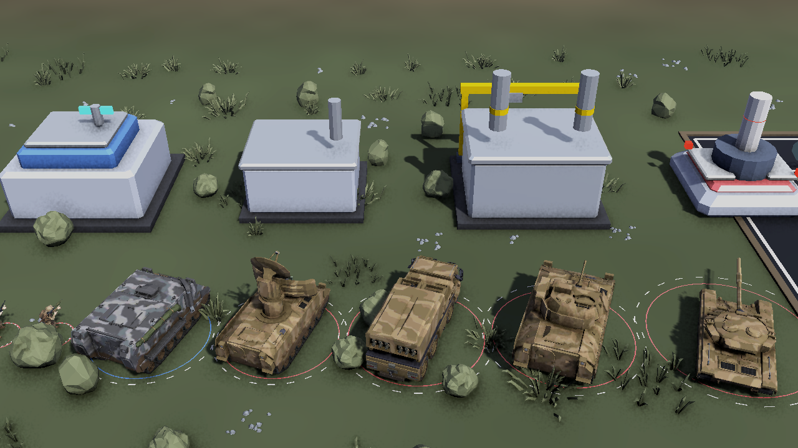

### 수송 탑승 시스템 (APC · 전술 수송헬기 · 월드 탑승 핍 · 후면 램프 · 모바일 하차 버튼)

### 스톰네스트 공중 항모 (실제 Synty `SM_Veh_TransportPlane_01` 대형 수송기 · 지상 그림자 · War FX 화염)

### 전략 미사일 착탄 (실제 Jean Moreno `War FX` `WFXMR_Nuke` 핵폭발 · 영구 크레이터 · 전술 경보 배너)

### 영구 전장 흔적 (실제 `War FX` 화염/흑연 · 그을음 데칼 · 2차선 도로 침범 0건)

---

## 4. 5종 고유 바이옴 전장 맵 (1초 즉시 구분)

| 표준 4인전 (`Map4P` — 온대 계곡 · 2차선 도로) | 사막 보급전 (`MapDesert` — 황금 모래 100% · 사구·선인장 · 초록 0%) |
| :---: | :---: |
|  |  |

| 시가지 시가전 (`MapUrban` — 고밀도 `PolygonCity` 빌딩·아스팔트) | 다도해 상륙전 (`MapArchipelago` — 70%+ 에메랄드 바다 · 5개 모래섬) |
| :---: | :---: |
|  | 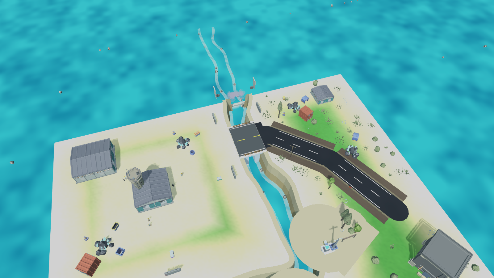 |

| 해협 도하전 (`MapStrait` — 중앙 48m 대양 해협 · 북/중/남 3대 전략 교량) |
| :---: |
|  |

---

## 5. 전 진영 유닛 & 궁극 전력 비주얼 카탈로그 (42종 — 100% 실제 Synty 프리팹)

### 자유 연방 (Free Federation — 21종)

| 공병 (`ff_engineer`) | 레인저 (`ff_ranger_squad`) | 스카이가드 (`ff_skyguard_squad`) | 대전차 로켓병 (`ff_at_rocket`) |
| :---: | :---: | :---: | :---: |
| 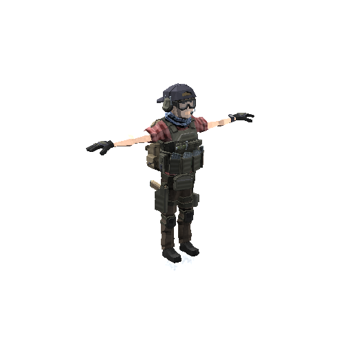 | 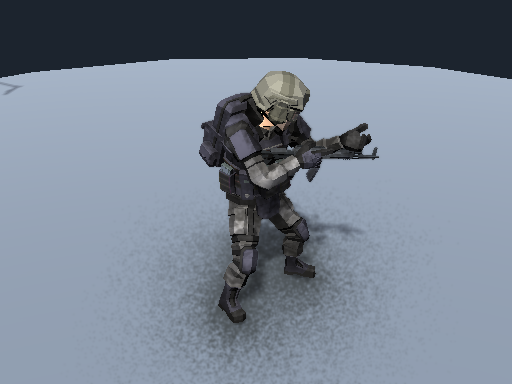 |  |  |

| 화염 돌격병 (`ff_breacher`) | 정밀 저격수 (`ff_sniper`) | 정찰 버기 (`ff_scout_buggy`) | 이글 전차 (`ff_eagle_tank`) |
| :---: | :---: | :---: | :---: |
|  |  |  |  |

| 야전 정비·수송차 (`ff_field_support`) | 다연장 로켓차 (`ff_mlrs_artillery`) | 기동 대공차 (`ff_mobile_sam`) | 호크 공격헬기 (`ff_hawk_gunship`) |
| :---: | :---: | :---: | :---: |
|  |  | 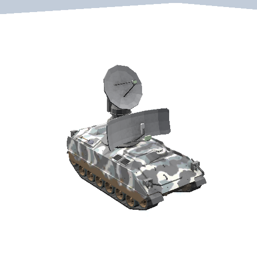 |  |

| 전술 수송헬기 (`ff_transport_heli`) | 스카이포트리스 폭격기 (`ff_skyfortress_bomber`) | 방벽 중전차 (`ff_bulwark_tank`) | 정찰선 (`ff_scout_boat`) |
| :---: | :---: | :---: | :---: |
|  | 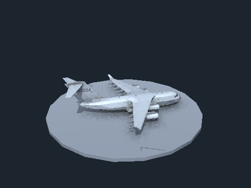 | 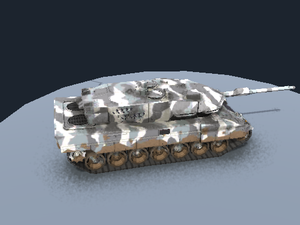 |  |

| 포격함 (`ff_artillery_ship`) | 수륙양용 상륙정 (`ff_landing_craft`) | 스톰네스트 공중 항모 (`ff_stormnest_carrier`) | 둥지 드론 (`ff_nest_drone`) |
| :---: | :---: | :---: | :---: |
|  | 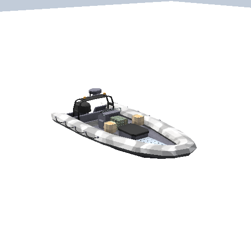 |  | 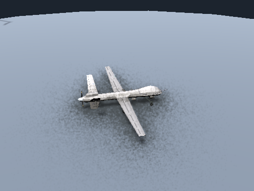 |

| 패트리어트 요격 포대 (`ff_patriot_turret`) |
| :---: |
|  |

### 대륙 연방 (Continental Federation — 21종)

| 공병 (`cf_engineer`) | 민병대 (`cf_militia`) | 화염방사병 (`cf_flame_squad`) | 대전차 로켓병 (`cf_at_rocket`) |
| :---: | :---: | :---: | :---: |
| 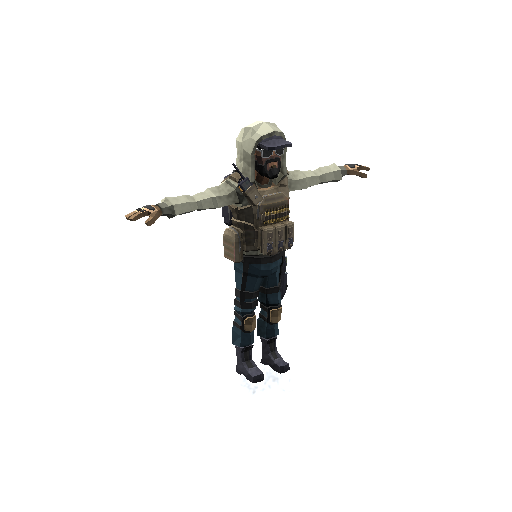 |  |  |  |

| 중화염 돌격병 (`cf_breacher`) | 매복 사수 (`cf_sniper`) | 척후 오토바이 (`cf_scout_bike`) | 용린 전차 (`cf_dragonscale_tank`) |
| :---: | :---: | :---: | :---: |
|  | 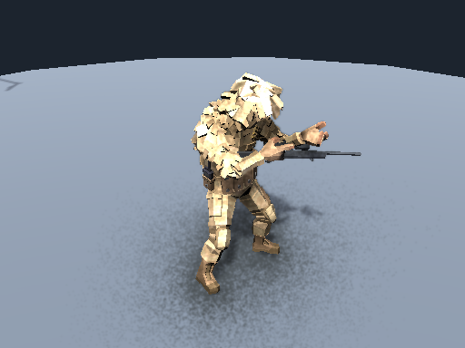 | 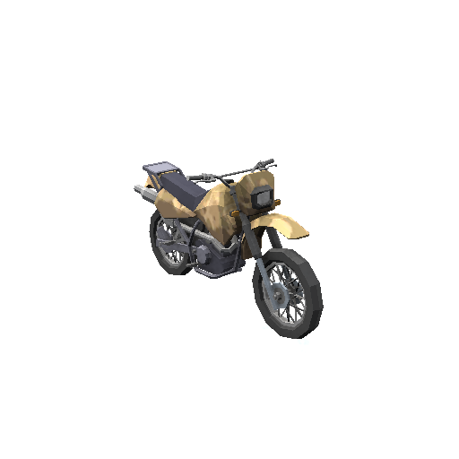 |  |

| 천둥 대공차 (`cf_thunder_aa`) | 화력지원 로켓차 (`cf_rocket_artillery`) | 기동 대공미사일차 (`cf_mobile_sam`) | 장갑 수송차 (`cf_apc_transport`) |
| :---: | :---: | :---: | :---: |
|  |  |  |  |

| 돌풍 공격헬기 (`cf_gale_gunship`) | 전술 수송헬기 (`cf_transport_heli`) | 만리 다연장포 (`cf_longwall_mlrs`) | 요새 전차 (`cf_fortress_tank`) |
| :---: | :---: | :---: | :---: |
|  |  |  |  |

| 정찰선 (`cf_scout_boat`) | 포격함 (`cf_artillery_ship`) | 수륙양용 상륙정 (`cf_landing_craft`) | 전략 미사일 격납고 (`cf_missile_silo`) |
| :---: | :---: | :---: | :---: |
|  | 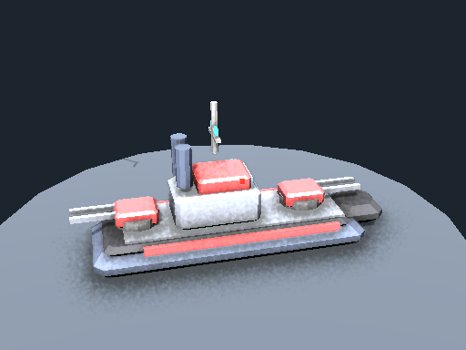 | 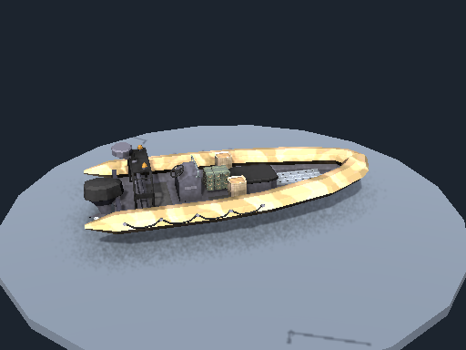 |  |

| 패트리어트 요격 포대 (`cf_patriot_turret`) |
| :---: |
|  |
